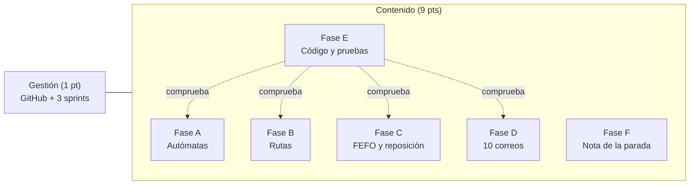
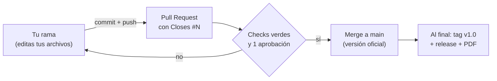

# Empieza aquí: qué estamos haciendo y por qué

Léelo antes que cualquier otro archivo (unos 10 minutos). Explica el deber desde cero, qué hay en el repo, qué es cada cosa de GitHub y qué capturas hay que tomar.
Para ver los diagramas: en GitHub se ven solos; en el Codespace abre este archivo y presiona `Ctrl+Shift+V`.

---

## 1. El deber en una frase

LOGISTPULSE es una empresa de logística inventada (pedidos, bodega, camiones). El profesor pide dos cosas:

1. **Contenido (9 de 10 puntos):** usar lo que vemos en Teoría de la Computación (autómatas, grafos, algoritmos, P y NP) para resolver los problemas de esa empresa, y demostrar que la solución es correcta.
2. **Forma de trabajo (1 punto):** trabajar como un equipo de software real: 3 sprints de una semana, tareas repartidas, revisiones entre compañeros y una versión final etiquetada. Esa forma de trabajo se demuestra con GitHub.

---

## 2. Las seis fases, sin jerga

| Fase | Qué es, en simple | Ejemplo de nuestro trabajo | Dónde está | Quién |
|---|---|---|---|---|
| **A · Autómatas** | Un pedido pasa por estados (Borrador, Confirmado, ..., Entregado). El autómata es la lista de reglas de qué cambio de estado está permitido. Se prueban secuencias válidas e inválidas en JFLAP. | "Borrador → Despachado" se rechaza: no se puede despachar sin confirmar, reservar, preparar y empacar. | `docs/fase_A_automatas.md`, `jflap/` | Camila |
| **B · Rutas** | La planta es un mapa: zonas = puntos, pasillos = líneas con metros. Dijkstra encuentra el camino más corto. | De R a D: 11 m. | `docs/fase_B_rutas.md` | Luis |
| **C · FEFO y reposición** | FEFO = sacar primero lo que vence primero. Reposición = calcular cuánto pedir al proveedor. | Ejemplo del enunciado: pedir 27 unidades. | `docs/fase_C_fefo_reposicion.md` | Luis |
| **D · 10 correos** | 10 "empleados" escriben con un problema. Para cada uno se escribe una **ficha**: qué tan difícil es (P, NP o NP-completo) y por qué. | c2: ¿hay un recorrido por todos los centros que cueste como máximo 20 km? Sí, 15 km. | `docs/fichas/` | p: Luis · n: Camila · c: Jessica |
| **E · Código y pruebas** | El programa en Python que resuelve todo y 142 pruebas automáticas que demuestran que funciona. **Ya está hecho.** | Si alguien cambia algo y lo rompe, las pruebas lo detectan. | `logistpulse/`, `tests/` | Todos lo revisan |
| **F · Parada** | Nota de 1 página: diferencia entre "se puede resolver" y "se puede resolver rápido", y por qué ningún programa puede decidir si cualquier otro programa termina. | — | `docs/fase_F_nota_parada.md` | Jessica |

### Qué es una ficha (y qué es `c2.md`)
Una **ficha** es el análisis de **un** correo. `docs/fichas/c2.md` es la ficha del correo c2 (Jorge Tapia, recorrido dentro del presupuesto). Habla del **problema del correo**, no de lo que hicimos en GitHub.
Lo que hicimos en GitHub (repo, protección, Issues, PR) se registra en `docs/sprints/sprint_1.md` y en `docs/sprints/backlog.md`. Los comandos para hacerlo están en `equipo/GUIA_CODESPACES.md`.

---

## 3. P, NP y NP-completo en un minuto

Piensa en un sudoku:
- **Resolverlo** desde cero puede tomar mucho tiempo.
- **Comprobar** una solución que alguien te da es rápido: revisas filas, columnas y cuadros.

| Grupo del deber | Idea | Qué hay que demostrar en la ficha | Nuestros correos |
|---|---|---|---|
| **A · P** | Hay una receta rápida para **resolverlo**. | El algoritmo, su pseudocódigo y su Big-O. | p1, p2, p3 |
| **B · NP** | Si te dan una respuesta, la **compruebas** rápido. No decimos si resolverlo es fácil o difícil. | Qué es el certificado (la respuesta propuesta) y cómo se verifica rápido. | n1, n2, n3, n4 |
| **C · NP-completo** | Está en NP y además es de los **más difíciles** de NP: si uno de estos se resolviera rápido, todos los de NP también. | Verificador rápido + reducción desde un problema NP-completo conocido + qué pasa cuando la instancia crece. | c1, c2, c3 |

Regla del profesor: P está dentro de NP, y NP-completo también está dentro de NP. No son grupos separados. Y nadie ha demostrado que P sea distinto de NP.

---

## 4. Qué hay en el repo

| Carpeta | Qué guarda | ¿La tocas? |
|---|---|---|
| `docs/` | Todo lo que se **lee**: fases, fichas, sprints, evidencias (capturas) | Sí, tus archivos |
| `logistpulse/` | El código Python | No (ya está hecho y probado) |
| `tests/` | Las 142 pruebas | No |
| `data/` | Los datos del enunciado (planta, lotes, los 10 correos) | No |
| `jflap/` | Los autómatas para abrir en JFLAP y sus capturas | Camila |
| `scripts/` | "Botones" automáticos: generar documentos, armar el informe, revisar qué falta | Solo los ejecutas |
| `equipo/` | Roles, prompts y la guía de comandos | Para leer |

El botón más útil: `python scripts/verificar_entrega.py`. Dice, criterio por criterio de la rúbrica, qué está **[OK]** y qué está **[PENDIENTE]**.

---

## 5. GitHub explicado con un documento compartido

Imagina un documento compartido donde nadie puede escribir directo en la versión oficial: cada uno trabaja en un borrador y pide permiso para pasarlo.

| Palabra | Qué es | Comparación |
|---|---|---|
| **Repositorio (repo)** | La carpeta del proyecto en GitHub, con el historial de cada cambio | La carpeta compartida |
| **`main`** | La versión oficial. Es la que ve el profesor | El documento final |
| **Rama** | Tu copia de trabajo (la tuya es `jessica/fase-df-gestion`) | Tu borrador |
| **Commit** | Guardar cambios con un mensaje. Queda tu nombre y la fecha | "Guardar versión" |
| **Push** | Subir tus commits a GitHub | Sincronizar |
| **Pull Request (PR)** | Pedir que tu rama entre a `main` | "Propongo estos cambios" |
| **Checks (GitHub Actions)** | Un robot corre las 142 pruebas en cada PR. Verde = todo bien | Corrector automático |
| **Aprobación (review)** | Un compañero revisa tu PR y lo aprueba (a ti te revisa Luis) | Visto bueno |
| **Merge** | Tu rama entra a `main` | Aceptar los cambios |
| **Issue** | Una tarea pendiente. Si el PR dice `Closes #N`, el Issue N se cierra solo al hacer merge | Post-it de tareas |
| **Ruleset (protección de `main`)** | La regla: nada entra a `main` sin PR + 1 aprobación + checks verdes | El candado |
| **Codespace** | Una computadora en la nube con todo instalado (VS Code en el navegador) | Tu laboratorio |
| **Tag `v1.0` y release** | La "foto" de la versión final que se entrega | Sello de "versión entregada" |

El ciclo que se repite cada vez que alguien termina algo:

**¿Por qué tanto proceso?** La rúbrica (Gestión, 1,0 pt) pide: backlog, tres sprints, revisiones, retrospectiva, historial y release identificable. Cada PR aprobado es una **revisión**, cada commit con tu nombre es **historial**, cada Issue cerrado es una tarea del **backlog**, y el tag `v1.0` es el **release**. Las capturas (sección 8) son la prueba visual en el informe.

---

## 6. Los tres sprints

| Sprint | Fechas | Meta (del enunciado) | Quién entrega qué | Cierre (lunes) |
|---|---|---|---|---|
| **1** | 17–23 nov | Autómatas y grafo de la planta | Jessica: repo, protección, Issues, ficha c2. Camila: capturas JFLAP + borrador Fase A. Luis: borrador Fase B | 23/11: completar "Revisión" y "Retrospectiva" de `sprint_1.md` + capturas `s1_` |
| **2** | 24–30 nov | Pseudocódigo y Big-O revisados por pares | Luis: Fases B y C. Camila: Fase A final. Jessica: backlog + sprints 1–2 | 30/11: `sprint_2.md` + capturas `s2_` |
| **3** | 1–7 dic | 10 fichas, nota de la parada, informe, release | Cada uno sus fichas. Jessica: c1, c3, parada, conclusiones, informe PDF, simulador, tag `v1.0` | 7/12: `sprint_3.md` + capturas `s3_` y `final_` |

Los roles de proceso rotan cada sprint (tabla en `equipo/ROLES_Y_PROMPTS.md`). En el Sprint 1, Jessica coordina.

---

## 7. Dónde estamos (20/11)

| Ya está | En curso | Falta |
|---|---|---|
| Código + 142 pruebas, archivos JFLAP, diagramas, tabla resumen | Camila: Fase A + capturas JFLAP | Fichas p2, p3 (Luis), n1–n4 (Camila), c1, c3 (Jessica) |
| Fichas p1 (modelo) y c2 | Luis: Fase B | Fases A, B, C redactadas; Fase F; conclusiones |
| Repo público, Codespaces, Actions, protección de `main`, Issues | Jessica: PR de la ficha c2 | Cierres de los 3 sprints; declaración de IA del README |
| Limpieza sin emojis (PR aprobado y fusionado) | | Guion de la presentación, informe PDF, simulador, tag `v1.0` |

---

## 8. Capturas de pantalla (evidencias)

**Dónde se guardan:** `docs/evidencias/` (las de JFLAP van aparte, en `jflap/capturas/`, y las toma Camila).
**Cómo subirlas:** arrastra la imagen desde tu computadora al explorador del Codespace, sobre la carpeta `docs/evidencias`. Clic derecho → *Rename* para ponerle el nombre de la tabla (sin espacios). Luego `git add docs/evidencias` y commit en tu rama.
**Por qué el nombre importa:** `scripts/armar_informe.py` las pone solas en el informe (sección de gestión), y `scripts/verificar_entrega.py` revisa que existan las de cada sprint (`s1_`, `s2_`, `s3_`, `final_`).

### Sprint 1: ya se pueden tomar (todo sigue visible en GitHub)
| Archivo | Dónde, en GitHub | Qué tiene que verse |
|---|---|---|
| `s1_01_ruleset_main.png` | *Settings → Rules → Rulesets →* `proteger-main` | *Active*, *Default branch*, PR con 1 aprobación, checks `pruebas (3.10)` y `pruebas (3.12)`. Si no cabe, dos capturas: `s1_01a_...` y `s1_01b_...` |
| `s1_02_colaboradores.png` | *Settings → Collaborators* | Camila y Luis con acceso |
| `s1_03_issues_backlog.png` | Pestaña *Issues* | La lista de Issues con su responsable (avatar a la derecha) |
| `s1_04_pr_sin_emojis.png` | *Pull requests → Closed →* el PR de la limpieza sin emojis | Arriba *Merged*; abajo *approved these changes* y los checks en verde |
| `s1_05_actions_verde.png` | Pestaña *Actions →* la ejecución más reciente | `pruebas (3.10)` y `pruebas (3.12)` en verde |
| `s1_06_codespace_pruebas.png` | Terminal del Codespace: `python -m unittest discover -s tests` | Al final: `Ran 142 tests` y `OK` |

### Sprint 1: se toman cuando ocurra
| Archivo | Cuándo |
|---|---|
| `s1_07_pr_c2.png` | Cuando Luis apruebe el PR de la ficha c2 y se haga el merge |
| `s1_08_issues_cerrados.png` | Lunes 23/11: *Issues → Closed* |

### Sprints 2 y 3, y entrega final
| Archivo | Cuándo | Dónde |
|---|---|---|
| `s2_01_prs_cerrados.png` | Lunes 30/11 | *Pull requests → Closed* |
| `s2_02_revision_de_pares.png` | Cuando alguien comente o pida cambios en un PR del Sprint 2 | El PR, pestaña *Conversation* |
| `s3_01_prs_cerrados.png` | Lunes 7/12 | *Pull requests → Closed* |
| `s3_02_issues_cerrados.png` | Lunes 7/12 | *Issues → Closed* |
| `final_01_contribuidores.png` | Antes de entregar | *Insights → Contributors* (deben verse los 3) |
| `final_02_release_v1.png` | Después de crear el release | *Releases →* `v1.0` con el PDF adjunto |

---

## 9. Qué leer después

1. `equipo/ROLES_Y_PROMPTS.md`: tu parte y tu prompt.
2. `docs/QUE_PIDE_CADA_CORREO.md`: qué pide cada correo (el cuerpo completo, no solo el asunto), de dónde salen los números del simulador y qué falta en cada ficha.
3. `docs/fichas/p1.md`: cómo se ve una ficha terminada.
4. `docs/DECISIONES_Y_HALLAZGOS.md`: las decisiones del modelo y los hallazgos (empates, ambigüedades de los correos).
5. `equipo/GUIA_CODESPACES.md`: los comandos exactos de Git y GitHub.
