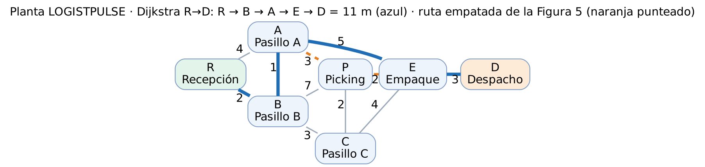

# Fase B · Planta como grafo y búsqueda de rutas
**Responsable: Luis** · Rúbrica: 1,5 pts (grafo definido, ruta válida, algoritmo y precondiciones, Big-O)

## 1. Modelado del grafo de la planta

La planta de LOGISTPULSE se representa como un grafo ponderado no dirigido G = (V, E, w), según la Figura 5 del enunciado y los datos de `data/planta.json`. Los vértices V representan zonas transitables y las aristas E representan pasillos que el robot móvil autónomo (AMR) puede recorrer en ambos sentidos. A cada arista le corresponde un peso w igual a su longitud en metros, con w ≥ 0 e igual para ambos sentidos. El objetivo es encontrar una ruta de distancia mínima de **Recepción (R)** a **Despacho (D)**. La distancia de una ruta es la suma de los pesos de los pasillos recorridos.

| Vértice | Zona |
|---|---|
| R | Recepción (origen) |
| A | Pasillo A |
| B | Pasillo B |
| C | Pasillo C |
| P | Picking |
| E | Empaque |
| D | Despacho (destino) |

| Pasillo bidireccional | Distancia (m) |
|---|---:|
| R ↔ A | 4 |
| R ↔ B | 2 |
| A ↔ B | 1 |
| A ↔ P | 3 |
| A ↔ E | 5 |
| B ↔ P | 7 |
| B ↔ C | 3 |
| P ↔ E | 2 |
| P ↔ C | 2 |
| C ↔ E | 4 |
| E ↔ D | 3 |

El grafo base tiene **7 vértices y 11 aristas**. Cada pasillo se cuenta una vez en E y se almacena en ambas listas de adyacencia, una por cada extremo. Por tanto, el grafo base tiene 22 entradas de adyacencia.



## 2. Escenarios de operación

En el **escenario base**, el grafo es **no dirigido** y **todas las zonas están habilitadas**. El AMR parte de **Recepción (R)** y se dirige a **Despacho (D)**. Los bloqueos de Pasillo A, Picking y Empaque están definidos en `data/planta.json` y se evalúan **por separado** como escenarios de prueba para observar su efecto en la ruta.

Un bloqueo fija una zona como inaccesible durante el cálculo. Si B es el conjunto de zonas bloqueadas, el AMR opera sobre el subgrafo inducido por V menos B. Esto equivale a retirar los vértices bloqueados y todas las aristas incidentes. La implementación omite esas zonas durante la búsqueda. Un origen bloqueado genera un error de entrada. Un destino bloqueado se reporta como inalcanzable, con distancia ∞.

| Escenario | Zona bloqueada | Ruta devuelta por Dijkstra | Distancia |
|---|---|---|---:|
| Operación base | Ninguna | R → B → A → E → D | 11 m |
| Cierre del pasillo A | A | R → B → C → E → D | 12 m |
| Picking fuera de servicio | P | R → B → A → E → D | 11 m |
| Empaque fuera de servicio | E | Sin ruta. D queda aislado. | ∞ |

En el escenario base, la ruta devuelta cuesta 2 + 1 + 5 + 3 = **11 m**. La ruta destacada en la Figura 5 cuesta 2 + 1 + 3 + 2 + 3 = **11 m** y también es óptima. Si se bloquea A, la ruta por C cuesta 2 + 3 + 4 + 3 = **12 m**. Bloquear P conserva la ruta óptima que pasa directamente de A a E. Bloquear E elimina el único pasillo que conecta con D.

**Reproducción.** Desde la raíz del repositorio, ejecutar `python -m logistpulse rutas` para obtener los cuatro escenarios, o `python -m unittest tests.test_rutas -v` para verificar las rutas, los empates y las entradas inválidas.

## 3. Dijkstra para minimizar la distancia

La entrada es un grafo finito con pesos numéricos finitos y no negativos, el origen, el destino y las zonas bloqueadas. El origen y el destino deben pertenecer al grafo. El origen debe estar habilitado y cada zona bloqueada debe existir. La salida es una ruta óptima y su distancia en metros, o sin ruta y distancia infinita si el destino es inalcanzable.

El módulo `logistpulse/rutas/dijkstra.py` usa un montículo mínimo para extraer la menor distancia provisional. Cada mejora guarda un par nuevo en el montículo y actualiza `pred`. Las entradas antiguas se descartan cuando su vértice ya está finalizado. Este método se conoce como inserción perezosa. El montículo desempata por identificador y los vecinos se recorren en orden alfabético. Una ruta de costo igual conserva el predecesor registrado porque la actualización exige una mejora estricta.

```text
RUTA_MÍNIMA(grafo, origen, destino, bloqueados)
    validar los vértices, los pesos y los bloqueos
    para cada vértice v
        dist[v] ← ∞
        pred[v] ← NULO
    dist[origen] ← 0
    heap ← montículo con (0, origen)
    finalizados ← conjunto vacío

    mientras el heap no esté vacío
        (d, u) ← extraer el par mínimo
        si u está finalizado
            continuar con la siguiente extracción
        marcar u como finalizado
        para cada vecino (v, peso) de u en orden alfabético
            si v está habilitado y aún no se ha finalizado
                candidato ← d + peso
                si candidato < dist[v]
                    dist[v] ← candidato
                    pred[v] ← u
                    insertar (candidato, v) en el heap

    si dist[destino] = ∞
        devolver (SIN RUTA, ∞)
    reconstruir siguiendo pred desde destino hasta NULO
    devolver (secuencia invertida, dist[destino])
```

**Correctitud.** Dijkstra finaliza cada vértice con su distancia mínima. Si hubiera una ruta más corta hacia el vértice extraído, el primer vértice aún sin finalizar de esa ruta ya tendría en el montículo una distancia menor. Esto se debe a que su predecesor ya fue procesado y, como los pesos son no negativos, el costo de ese tramo inicial es como máximo el de la ruta completa. Esto contradice que se haya extraído la menor distancia provisional. Los predecesores permiten reconstruir la ruta obtenida.

**Terminación.** Cada vértice se finaliza como máximo una vez. En un grafo no dirigido con m aristas se revisan como máximo 2m entradas de adyacencia, una por cada sentido. Cada revisión genera como máximo una inserción, así que el montículo recibe a lo sumo 2m+1 entradas contando la inicial. Como cada iteración extrae una entrada, el bucle termina. Reconstruir la ruta recorre a lo sumo n vértices, donde n es el total de vértices del grafo.

**Complejidad.** Sean n = |V| y m = |E|. El tiempo es **O((n + m) log n)** para n ≥ 2. El montículo puede guardar O(m + 1) entradas y cada operación cuesta O(log n) en este grafo simple, donde m = O(n²). Ordenar los vértices y las listas de vecinos cuesta en total O((n + m) log n) y queda dentro de la misma cota. El espacio auxiliar es **O(n + m)** para distancias, predecesores, finalizados, orden y montículo. La reconstrucción agrega O(n). La demo enumera también las rutas empatadas mediante una función aparte. El número de rutas óptimas puede ser exponencial y su enumeración tiene su propio costo.

**Precondición de los pesos.** Dijkstra requiere que todas las aristas tengan pesos no negativos. En el caso p2, desde S se llega a A con costo 2 y a B con costo 3. Como 2 es menor que 3, Dijkstra finaliza A primero y calcula que llegar a C por S → A → C cuesta 2 + 1 = 3. Al procesar B, la arista B → A de peso −2 permite llegar a A con costo 3 − 2 = 1. Como A ya fue finalizado, Dijkstra no lo vuelve a procesar y conserva el costo 3 para C. Bellman–Ford sí encuentra la ruta óptima S → B → A → C, que cuesta 2. Este ejemplo explica por qué el código valida los pesos antes de ejecutar Dijkstra.

## 4. Traza observada de Dijkstra en la planta

La tabla reproduce el escenario base de `python -m logistpulse rutas`. Cada fila registra una finalización y las mejoras aceptadas al examinar los vecinos.

| Paso | Vértice finalizado | Distancia (m) | Mejoras aceptadas |
|---|---|---:|---|
| 1 | R | 0 | A de ∞ a 4, B de ∞ a 2. Ambos reciben a R como predecesor. |
| 2 | B | 2 | A de 4 a 3, C de ∞ a 5, P de ∞ a 9. Los tres reciben a B como predecesor. |
| 3 | A | 3 | E de ∞ a 8, P de 9 a 6. Ambos reciben a A como predecesor. |
| 4 | C | 5 | Ninguna. |
| 5 | P | 6 | Ninguna. Pasar por P hasta E da 6 + 2 = 8, igual a la distancia registrada. |
| 6 | E | 8 | D de ∞ a 11, con E como predecesor. |
| 7 | D | 11 | Ninguna. |

Para reconstruir la ruta se sigue la cadena **D ← E ← A ← B ← R** en sentido inverso al recorrido. Al invertir la lista obtenemos **R → B → A → E → D**, de **11 m**. En el paso 5 se observa por qué la Figura 5 también muestra una solución óptima. Pasar por Picking llega a Empaque con los mismos 8 m.

## 5. BFS para minimizar el número de tramos

`logistpulse/rutas/bfs.py` recibe una lista de adyacencia sin pesos. Usa una cola FIFO y registra a cada vértice cuando lo encola por primera vez. Por ello procesa las zonas por niveles de distancia en número de tramos. Al extraer el destino, los predecesores permiten reconstruir una ruta con el mínimo número de tramos.

```text
MENOS_TRAMOS(adyacencia, origen, destino, bloqueados)
    validar origen y destino, y comprobar que el origen esté habilitado
    si destino está bloqueado
        devolver SIN RUTA
    cola ← cola FIFO con origen
    pred[origen] ← NULO

    mientras la cola no esté vacía
        u ← extraer el primero
        si u = destino
            devolver la ruta reconstruida mediante pred
        para cada vecino v de u en el orden de la lista
            si v está habilitado y no tiene entrada en pred
                pred[v] ← u
                encolar v

    devolver SIN RUTA
```

**Terminación y complejidad.** Cada vértice se encola y se extrae a lo sumo una vez y las listas de vecinos son finitas. Con la lista de adyacencia ya construida y sin guardar copias de la cola para una traza, el tiempo es **O(n + m)** y el espacio auxiliar es **O(n)**. La representación de entrada ocupa O(n + m). En la demo, preparar la lista a partir del grafo ponderado incluye el ordenamiento de los vecinos para reproducir el resultado. Esa preparación es independiente de la búsqueda.

| Algoritmo | Criterio | Ruta devuelta | Tramos | Distancia |
|---|---|---|---:|---:|
| Dijkstra | Distancia total | R → B → A → E → D | 4 | 11 m |
| BFS | Número de tramos | R → A → E → D | 3 | 12 m |

Para el AMR se elige Dijkstra porque el objetivo de la planta se mide en metros y los pasillos tienen longitudes distintas.

## 6. Validación

| Tipo | Prueba o escenario | Resultado comprobado |
|---|---|---|
| Normal | `test_ruta_base_costo_11` y `test_ruta_de_la_figura_es_optima_y_empata` | La ruta devuelta suma 11 m y la de la Figura 5 empata. |
| Normal | `test_bloqueos` y `test_bfs_minimiza_tramos_no_costo` | Se reproducen los cierres de la tabla y BFS devuelve la ruta de 3 tramos y 12 m. |
| Límite | `test_origen_igual_destino` y `test_destino_bloqueado_no_tiene_ruta` | R a R devuelve la ruta [R] con costo 0. Un destino bloqueado es inalcanzable. |
| Inválida | `test_pesos_invalidos` y `test_origen_destino_y_bloqueos_invalidos` | Un peso negativo, un vértice inexistente o un origen bloqueado provocan un error. |

Las pruebas de la tabla están en `tests/test_rutas.py`. En `tests/test_complejidad.py`, `test_dijkstra_operaciones_de_heap_acotadas` verifica la cota de inserciones, extracciones y aristas examinadas. `test_bfs_es_O_V_mas_E` verifica que las extracciones y las aristas examinadas respeten las cotas lineales. `test_dijkstra_crece_casi_lineal` compara tiempos en grafos dispersos de 5 000 y 20 000 vértices. Estos resultados respaldan el análisis de crecimiento para los casos probados.

### Preguntas de práctica para la defensa oral

1. **¿Por qué hay 11 aristas si en la lista de adyacencia hay 22 entradas?** Un pasillo bidireccional conecta dos zonas mediante una sola arista. Para poder recorrerlo desde cualquiera de sus extremos, cada zona registra a la otra como vecina.
2. **¿Por qué bloquear Empaque impide llegar a Despacho?** El tramo E ↔ D es la única conexión de Despacho con la planta. Quitar E elimina ese tramo y deja D aislado.
3. **¿Por qué el programa devuelve una ruta diferente de la Figura 5?** Desde A, el pasillo directo a E cuesta 5 m y el desvío por P cuesta 3 + 2 = 5 m. Las dos rutas completas tienen distancia mínima de 11 m.

## Checklist
- [x] V, E y pesos (tabla); no dirigido y por qué; origen R, destino D; escenarios con bloqueos
- [x] Precondiciones de Dijkstra y contraejemplo con un peso negativo (p2)
- [x] Pseudocódigo de Dijkstra y BFS + terminación + Big-O de tiempo y espacio
- [x] Tabla paso a paso de Dijkstra en la planta
- [x] Ruta encontrada (11 m) + empate con la Figura 5 (H1) + comparación con BFS (H2)

