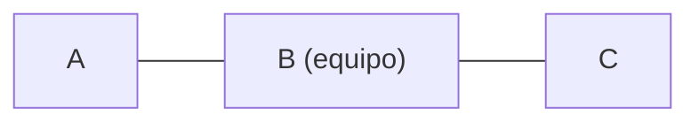

# Ficha c3 · ¿Bastan k almacenes para cubrir todas las zonas?

**Remitente:** Carla Núñez · Red logística (para Continuidad Operativa) · **Grupo:** C · **Clasificación propuesta:** NP-completo
**Responsable de redacción:** Jessica

> **Solicitud operativa:** ¿Existe una selección de no más de k zonas donde desplegar equipos de inspección, de modo que cada corredor tenga un equipo en al menos uno de sus extremos?

## 0. Respuesta al correo (para Carla Núñez)
Carla: **sí, basta con k = 1 equipo de inspección, desplegado en la zona B**. B es extremo de los dos corredores del mapa (A–B y B–C), así que los dos movimientos quedan cubiertos y se puede confirmar el despliegue nocturno. La selección {B} es el certificado; el verificador adjunto, separado de la búsqueda, comprueba que tiene a lo sumo k zonas y que todo corredor tiene un equipo en un extremo. Un equipo en A no alcanza, porque B–C queda sin cubrir, y sin equipos (k = 0) tampoco. Si el mapa crece, la búsqueda exacta crece de forma exponencial con k (sección 3).

## 1. Resumen del correo
Para el próximo turno solo se pueden desplegar **hasta k equipos de inspección**. El mapa conecta zonas que comparten un **corredor de transferencia**, y por política **cada corredor debe tener un equipo en al menos uno de sus extremos** para que el movimiento quede cubierto. La pregunta es de **decisión** (Sí/No): ¿existe una selección de no más de k zonas que cubra todos los corredores? Se pide: entregar la selección como certificado si existe, un **verificador separado**, una búsqueda que resuelva el expediente y explicar cómo varía el esfuerzo cuando crece el mapa. La respuesta se necesita antes de confirmar el despliegue nocturno.

**Ambigüedad detectada (hallazgo H7):** el asunto y la ficha del simulador hablan de "k **almacenes**" y de "zona cubierta por un almacén **propio o vecino**", que sería *Dominating Set*. El **cuerpo del correo** pide otra cosa: equipos de inspección con un equipo en un extremo de **cada corredor**, que es *Vertex Cover*. Además, el mapa del portal se titula "Corredores entre zonas" y los datos preguntan "¿Cubre toda arista?". Seguimos el cuerpo del correo, como en c2 (H8). La clasificación no cambia con la otra lectura (Dominating Set también es NP-completo), y en esta instancia las dos dan la misma respuesta: {B}. Donde sí se separan es con zonas aisladas: en Vertex Cover una zona sin corredores no necesita equipo; en Dominating Set sí.



| Datos del expediente (`data/casos_simulador.json` → `"c3"`) | Valor |
|---|---|
| Zonas (vértices) | A, B, C (V = 3) |
| Corredores (aristas) | A–B, B–C (E = 2) |
| Máximo de equipos | k = 1 |
| Pregunta | ¿Cubre toda arista? (Sí/No) |

## 2. Entrada, salida y restricciones
- **Pregunta de decisión:** dados un grafo no dirigido G = (V, E) y un entero k, ¿existe S ⊆ V con |S| ≤ k tal que todo corredor {u, v} ∈ E tenga u ∈ S o v ∈ S?
- **Lenguaje:** VERTEX-COVER = { ⟨G, k⟩ : G tiene una cobertura de vértices de tamaño ≤ k }.
- **Entrada:** la lista de V zonas y E corredores (cada nombre ocupa O(log V) bits) y el número k en binario (O(log k) bits). **Tamaño:** O((V + E)·log V + log k) bits. Aquí V = 3, E = 2 y k = 1.
- **Salida:** *Sí* + la selección S de zonas con equipo (certificado), o *No*.
- **Restricciones del correo:** **no más de** k equipos (no exactamente k); cada equipo se despliega en una zona; **todo** corredor debe quedar cubierto; los corredores no tienen sentido (grafo no dirigido) y una zona no tiene un corredor consigo misma.
- **Versión analizada:** **decisión**, tal como pregunta el correo ("¿existe una selección de no más de k zonas?"). La versión de **optimización** ("¿cuál es el menor número de equipos?") es otra pregunta: se resuelve con la de decisión probando k = 0, 1, 2, … hasta la primera respuesta Sí. Esa versión no es un problema Sí/No, así que no se dice que sea NP-completa sino NP-difícil.

## 3. Clasificación y evidencia: **NP-completo**
Para el grupo C hay que probar dos cosas: que VERTEX-COVER **pertenece a NP** y que es **NP-difícil**, mediante una reducción polinómica desde un problema que ya se sabe NP-completo.

**(a) VERTEX-COVER ∈ NP: certificado + verificador polinómico.**
- *Certificado:* el conjunto S, a lo sumo k nombres de zonas. Su tamaño es polinomial en la entrada.
- *Verificador* (`verificar` en `c3_vertex_cover.py`), independiente del buscador, como pide el correo: (1) valida el grafo y arma la lista de aristas en una pasada; (2) comprueba que S ⊆ V y que |S| ≤ k; (3) recorre las aristas y rechaza si encuentra una con ningún extremo en S. Tiempo **O(V + E)**, polinomial. `test_verificadores_polinomicos` lo respalda contando ≤ 3n + 1 pasos en estrellas de n = 10, 50 y 200 hojas.

**(b) VERTEX-COVER es NP-difícil: INDEPENDENT-SET ≤p VERTEX-COVER** (Karp, 1972).
INDEPENDENT-SET = { ⟨G, j⟩ : G tiene un conjunto independiente de tamaño ≥ j } es NP-completo (un conjunto es *independiente* si no tiene dos vértices adyacentes; es el problema CLIQUE sobre el grafo complemento). La reducción va del problema **conocido** al **nuestro**. Sipser (sección 7.5) prueba lo mismo con otra reducción, desde 3SAT; usamos la de INDEPENDENT-SET porque es más corta.

- *Idea clave:* **S es una cobertura de vértices ⇔ V ∖ S es un conjunto independiente.** S cubre todas las aristas ⇔ ninguna arista tiene sus dos extremos fuera de S ⇔ no hay dos vértices adyacentes en V ∖ S.
- *Construcción* `f(⟨G, j⟩) = ⟨G, |V| − j⟩` (`reducir_is_a_vc`): el mismo grafo, con presupuesto k = |V| − j. Si j > |V| no puede haber un conjunto independiente tan grande, y la reducción devuelve una instancia fija con respuesta No.
- *Tiempo de la transformación:* copiar el grafo y contar sus vértices, O(V + E), polinomial.
- *Correctitud (⇔):*
  - (⇒) Si G tiene un conjunto independiente I con |I| ≥ j, entonces S = V ∖ I es una cobertura con |S| = |V| − |I| ≤ |V| − j. Respuesta Sí en VERTEX-COVER.
  - (⇐) Si G tiene una cobertura S con |S| ≤ |V| − j, entonces I = V ∖ S es independiente con |I| ≥ j. Respuesta Sí en INDEPENDENT-SET.
- *Comprobación ejecutable:* `test_reduccion_is_a_vc` construye 80 grafos aleatorios de 1 a 7 vértices y, para cada j de 0 a |V|, confirma que "hay conjunto independiente de tamaño j" coincide **siempre** con "la instancia reducida tiene respuesta Sí". `test_reduccion_k_mayor_que_V_da_no` cubre el caso j > |V|. En la salida observada: ¿hay un independiente de tamaño 2 en A–B–C? Sí ({A, C}), y por lo tanto hay cobertura de tamaño 3 − 2 = 1 ({B}).

Con (a) y (b), **VERTEX-COVER es NP-completo**. Esto **no** demuestra que no exista un algoritmo polinómico: dice que, si existiera uno, entonces P = NP, algo que nadie ha probado ni refutado. Recordar que P ⊆ NP, que NP-completo ⊆ NP y que "NP" no significa "no polinómico".

**Consecuencia práctica para el tamaño de la instancia.** La búsqueda exacta por ramificación es exponencial en **k**: cada equipo extra duplica el árbol. Tiempos **medidos** (`docs/generado/crecimiento.md`; dependen de la máquina), en el peor caso (respuesta No, árbol completo de 2ᵏ⁺¹ − 1 nodos): k = 16 → 131 071 nodos en unos 0,1 s; extrapolando ese costo, **k = 40 → unos 19 días** y **k = 60 → unos 55 000 años**. Si en vez de ramificar se prueban todos los subconjuntos de zonas, el costo es 2^V: con 60 zonas ya son unos 10¹⁸ subconjuntos. En cambio, la 2-aproximación cubrió una red de 100 000 zonas en unos 0,2 s, pero puede usar hasta el doble de equipos que el óptimo.

## 4. Decidibilidad y computabilidad
- **Modelo de cómputo:** máquina de Turing determinista; de forma equivalente, modelo RAM con enteros codificados en binario.
- **Qué se computa:** la función característica de VERTEX-COVER: f(⟨G, k⟩) = 1 si y solo si G tiene una cobertura de tamaño ≤ k. Cuando la respuesta es Sí, el procedimiento devuelve además el conjunto S como testigo.
- **Decidible: sí.** Para **toda** entrada válida, el procedimiento termina y responde correctamente:
  - *Terminación:* la ramificación toma una arista sin cubrir {u, v} y prueba dos ramas (u en S, o v en S). En cada rama el presupuesto baja en 1 y se eliminan las aristas ya cubiertas. Con k = 0 o sin aristas, se detiene. El árbol tiene profundidad ≤ k y, por lo tanto, ≤ 2ᵏ⁺¹ − 1 nodos, una cantidad finita.
  - *Correctitud:* toda cobertura debe contener a u o a v (si no, la arista {u, v} queda sin cubrir), así que las dos ramas abarcan todas las coberturas posibles. Si las dos fallan, no existe cobertura con ese presupuesto. Si responde Sí, el conjunto pasa el verificador.
- Que sea decidible **no** significa que sea eficiente: es decidible para todo k, pero con k grande el árbol crece de forma exponencial (sección 3, consecuencia práctica). Ese es el caso límite de la Fase F.

## 5. Algoritmo seleccionado
| Pregunta | Algoritmo (`c3_vertex_cover.py`) | Tipo | Qué garantiza |
|---|---|---|---|
| **Decisión** (la del correo): ¿bastan k? | `ramificacion`: ramificación acotada sobre una arista sin cubrir | **Exacto** | Responde Sí o No siempre correctamente; si es Sí, entrega S |
| Optimización: ¿cuántos equipos como mínimo? | `minimo_por_subconjuntos`: prueba subconjuntos de tamaño creciente | **Exacto** | Da una cobertura mínima |
| Cobertura rápida | `aproximacion_2`: toma los dos extremos de cada arista que siga sin cubrir (emparejamiento maximal) | **Aproximado**, factor 2 | Siempre da una cobertura **válida** con \|S\| ≤ 2·ÓPTIMO |

```
RAMIFICAR(E, k, S):                        ▹ E = corredores sin cubrir; S = zonas con equipo
  si E está vacía: devolver S               ▹ todo cubierto
  si k = 0: devolver FALLA                  ▹ quedan aristas y no hay presupuesto
  {u, v} ← primera arista de E
  para z en (u, v):                         ▹ toda cobertura contiene a u o a v
      r ← RAMIFICAR(E sin las aristas que tocan z, k − 1, S ∪ {z})
      si r ≠ FALLA: devolver r
  devolver FALLA
```

**Por qué la ramificación:** es el algoritmo que pide el simulador ("Backtracking / ramificación"), es **exacto** y su costo depende de k, no del número de zonas: con pocos equipos es rápido aunque el mapa sea grande. En la instancia del expediente toma el corredor A–B: la rama "A" deja B–C sin cubrir y sin presupuesto, así que falla; la rama "B" cubre los dos corredores y responde Sí con S = {B}.

**Exacto vs aproximado (estrella de 5 hojas):** el óptimo es {centro} (1 equipo) y la 2-aproximación da {centro, h0} (2 equipos), dentro de la garantía 2·1. **Consecuencia para la decisión:** si la aproximación da |S| ≤ k, ese S es un certificado y se puede responder **Sí**. Si da |S| > 2k, se puede responder **No**, porque el óptimo es al menos |S|/2 > k. Entre k y 2k la aproximación no decide, y hay que usar el método exacto.

## 6. Complejidad (Big-O)
- **Variables:** V = número de zonas; E = número de corredores; k = máximo de equipos. k es un **número**: ocupa O(log k) bits, así que una cota en 2ᵏ es exponencial en su valor. Además, solo interesa k < V (con k ≥ V la respuesta es Sí tomando todas las zonas).
- **`ramificacion`:** el árbol tiene ≤ 2ᵏ⁺¹ − 1 nodos y en cada uno se filtra la lista de aristas en O(E); antes se valida el grafo en O(V + E). Tiempo **O(2ᵏ·(V + E))**. Espacio **O(k·(V + E))**: la profundidad es ≤ k y cada nivel guarda su lista de aristas pendientes y su conjunto S. Como k puede llegar a V, en el peor caso general es O(2^V·(V + E)). `test_vertex_cover_ramificacion_2_a_la_k` cuenta ≤ 2ᵏ⁺¹ − 1 nodos en 60 grafos aleatorios de 3 a 12 vértices con k = 0…5.
- **`minimo_por_subconjuntos`:** hasta 2^V subconjuntos y cada uno se revisa en O(E). Tiempo **O(2^V·(V + E))**, espacio O(V + E).
- **`aproximacion_2`:** una pasada por las aristas. Tiempo **O(V + E)**, espacio O(V + E).
- **`verificar`:** tiempo **O(V + E)**, espacio O(V + E).
- Contraste clave: **verificar** una cobertura es polinómico (O(V + E)), mientras que **encontrar** una de tamaño ≤ k con los métodos exactos conocidos es exponencial (en k o en V).

## 7. Código, pruebas y salida observada
- **Código:** `logistpulse/casos/c3_vertex_cover.py` (`ady_desde_aristas`, `aristas_de`, `verificar`, `ramificacion`, `minimo_por_subconjuntos`, `aproximacion_2`, `reducir_is_a_vc`). Los datos se leen con `io_datos.cargar_casos` y el texto lo arma `presentacion_casos.demo_c3`.
- **Pruebas:** `tests/test_casos_npc.py::TestC3`
  - *Normales:* la instancia da S = {B} y el verificador lo acepta (`test_instancia`); en 120 grafos aleatorios la ramificación encuentra cobertura con el tamaño óptimo y no con uno menos, y la 2-aproximación es válida y ≤ 2·ÓPTIMO (`test_exactos_y_aproximacion`); la reducción coincide con una búsqueda directa de conjuntos independientes en 80 grafos (`test_reduccion_is_a_vc`).
  - *Límite:* con k = 0 la instancia da No, y un grafo sin aristas da Sí con S vacío (`test_limites`); con j > |V| la reducción produce una instancia No (`test_reduccion_k_mayor_que_V_da_no`).
  - *Inválidas:* listas de adyacencia no simétricas, lazos y k negativo lanzan ValueError (`test_invalidos`); el verificador rechaza un S que deja una arista sin cubrir, uno que excede k y uno con una zona que no existe (`test_verificador_rechaza`).
- **Complejidad:** `tests/test_complejidad.py` (los conteos citados en la sección 6) y `docs/generado/crecimiento.md` (los tiempos de la sección 3).
- **Reproducir:** `python -m logistpulse casos` · `python -m unittest tests.test_casos_npc -v`

Salida observada (ejecución real; el bloque lo actualiza `scripts/generar_docs.py`):
<!-- SALIDA:INICIO (generado por scripts/generar_docs.py; no editar) -->
```text
RESPUESTA AL CORREO: Sí, basta con 1 equipo(s) de inspección (k = 1): selección ['B']; cubre todos los corredores (verificar = True).
verificar({'A'}) = False · con k = 0: None (No)
Estrella de 5 hojas: óptimo = {'centro'} · 2-aproximación = ['centro', 'h0'] (tamaño 2 ≤ 2·1)
Reducción IS→VC: ¿IS de tamaño 2 en A-B-C? ⇔ ¿VC de tamaño 1? -> True
```
<!-- SALIDA:FIN -->

```text
test_exactos_y_aproximacion (tests.test_casos_npc.TestC3.test_exactos_y_aproximacion) ... ok
test_instancia (tests.test_casos_npc.TestC3.test_instancia) ... ok
test_invalidos (tests.test_casos_npc.TestC3.test_invalidos) ... ok
test_limites (tests.test_casos_npc.TestC3.test_limites) ... ok
test_reduccion_is_a_vc (tests.test_casos_npc.TestC3.test_reduccion_is_a_vc) ... ok
test_reduccion_k_mayor_que_V_da_no (tests.test_casos_npc.TestC3.test_reduccion_k_mayor_que_V_da_no)
Con k > |V| no hay conjunto independiente de ese tamaño: la reducción produce una instancia No. ... ok
test_verificador_rechaza (tests.test_casos_npc.TestC3.test_verificador_rechaza) ... ok
Ran 7 tests in 0.020s
OK
```

## 8. Observaciones y límites de la inferencia
- **H7 (Vertex Cover vs Dominating Set):** se siguió el cuerpo del correo (un equipo en un extremo de cada corredor), que coincide con el mapa del portal y con los datos ("¿Cubre toda arista?"). La lectura del asunto y la ficha ("almacén propio o vecino") también es NP-completa y en esta instancia da la misma respuesta.
- La respuesta vale para **este grafo** (3 zonas, 2 corredores). Si la red cambia, hay que volver a ejecutar; el verificador permite comprobar en O(V + E) cualquier propuesta de ubicación hecha por otra persona.
- El correo dice "no más de k": si basta con menos equipos, la respuesta es Sí. Aquí S = {B} usa exactamente 1, y es también el mínimo.
- La NP-completitud describe el **peor caso del problema general**. Con k pequeño la ramificación es rápida aunque haya muchas zonas, y eso no contradice la clasificación: k es parte de la entrada y puede crecer junto con la red.

## ¿Qué concluimos?
| Decidibilidad | Computabilidad | Complejidad |
|---|---|---|
| **Sí.** La ramificación tiene profundidad ≤ k y ≤ 2ᵏ⁺¹ − 1 nodos (o hay 2^V subconjuntos finitos): siempre termina y responde Sí (con testigo) o No. | **Sí.** Hay un procedimiento efectivo (MT determinista / RAM) que calcula la función característica de VERTEX-COVER y, si la respuesta es Sí, devuelve la selección de zonas con equipo. | **NP-completo** (∈ NP con verificador O(V + E); NP-difícil por INDEPENDENT-SET ≤p VERTEX-COVER). Exacto: O(2ᵏ·(V + E)) por ramificación. Aproximado: O(V + E) con \|S\| ≤ 2·ÓPTIMO. |

## Preguntas para la defensa oral
1. **¿Por qué tomaron Vertex Cover si el asunto habla de almacenes y la ficha dice "zona cubierta por un almacén propio o vecino"?** Porque el cuerpo del correo, que es la solicitud real, pide un equipo en al menos un extremo de **cada corredor**, y eso es Vertex Cover. El mapa del portal ("Corredores entre zonas") y los datos ("¿Cubre toda arista?") dicen lo mismo. Lo dejamos escrito como hallazgo H7. La clasificación no cambia, porque Dominating Set también es NP-completo, y en esta instancia las dos lecturas dan {B}.
2. **¿Por qué la reducción va de INDEPENDENT-SET a VERTEX-COVER y no al revés?** Para probar que VERTEX-COVER es al menos tan difícil como un problema NP-completo, transformamos cualquier instancia del problema conocido en una del nuestro con la misma respuesta. Si VERTEX-COVER fuera fácil, INDEPENDENT-SET también. Al revés solo probaríamos que nuestro problema no es más difícil que el conocido.
3. **Si con k pequeño la ramificación es rápida, ¿por qué dicen que es NP-completo?** Porque el costo O(2ᵏ·(V + E)) es exponencial en k, y k es parte de la entrada: puede ser del orden de V. Con k = 60 serían unos 55 000 años con nuestra medición. Que sea rápido para k fijo y pequeño es una ventaja práctica, no un algoritmo polinómico para todas las entradas.

## Lista de verificación (docs/PLANTILLA_FICHA.md)
- [x] Resumen fiel al correo; ninguna condición ni dato cambiado; ambigüedades señaladas
- [x] Pregunta de decisión explícita; si es optimización, clasificada por su versión de decisión
- [x] Entrada con su tamaño definido (bits si hay números)
- [x] Evidencia completa del grupo C
- [x] Modelo de cómputo nombrado · terminación argumentada
- [x] Algoritmo justificado (exacto / aproximado / heurístico)
- [x] Big-O de tiempo y espacio con variables definidas, coherente con el código
- [x] Código + pruebas + salida observada real · Big-O respaldado por tests/test_complejidad.py
- [x] Respuesta al correo (sección 0) y tabla "¿Qué concluimos?" completas
- [x] No se afirma P ≠ NP; P ⊆ NP; "NP" ≠ "no polinómico"
- [x] Sin marcas pendientes · 3 preguntas de defensa respondidas
