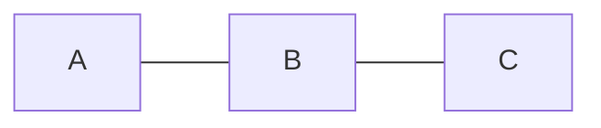

# Ficha c3 · ¿Bastan k almacenes/equipos para cubrir todo?

**Remitente:** Carla Núñez · Red logística · **Grupo:** C · **Clasificación propuesta:** NP-completo
**Responsable de redacción:** Jessica

> Esqueleto generado desde el código. Los datos técnicos ya están verificados con pruebas.
> Formato y profundidad a imitar: docs/fichas/p1.md (ficha modelo terminada).
> Las secciones marcadas ✍️ las redacta Jessica (con su IA) sin cambiar las condiciones del correo.
> Lo que debe establecer este grupo: Problema de decisión; verificador polinómico; problema NPC de origen y reducción polinómica (dirección correcta: CONOCIDO ≤p NUESTRO); consecuencia práctica para el tamaño de instancia.

> **Solicitud operativa:** ¿Existe S con |S| ≤ k que toque cada corredor (arista)?

## 0. Respuesta al correo (para Carla Núñez)
✍️ 2–3 líneas en lenguaje operativo, basadas en la salida observada de la sección 7 (primera línea).

## 1. Resumen del correo
✍️ (2–4 líneas, sin cambiar condiciones del problema)


## 2. Entrada, salida y restricciones
- **Pregunta de decisión:** ¿Existe S con |S| ≤ k que toque cada corredor (arista)?
- **Entrada:** Grafo no dirigido G=(V,E) y entero k.
- **Salida:** Sí/No + conjunto S como evidencia.
- **Versión analizada:** Decisión.
- ✍️ Restricciones del correo (pesos ≥ 0, binario, presupuesto, etc.)

## 3. Clasificación y evidencia
- **Clase:** NP-completo
- **Evidencia:** Verificador O(V + E) + INDEPENDENT-SET ≤p VERTEX-COVER.
- **Certificado / verificador:** Conjunto S ⊆ V.
- **Reducción:** IS ≤p VC: <G,k> ∈ IS ⇔ <G,|V|−k> ∈ VC (Karp 1972).

✍️ Justificación formal (ver guía del grupo arriba).

## 4. Decidibilidad y computabilidad
- **Modelo de cómputo supuesto:** máquina de Turing determinista (equivalente: modelo RAM con enteros codificados en binario).
- **¿Decidible?** Sí: árbol de búsqueda de profundidad ≤ k (o 2^V subconjuntos).
- ✍️ Qué función/relación se computa y por qué el procedimiento termina para TODA entrada válida.

## 5. Algoritmo seleccionado
- **Algoritmo:** Backtracking / ramificación acotada (exacto) · 2-aproximación por emparejamiento (heurística)
- **Tipo de solución:** Exacto (ramificación) / aproximado (factor 2)
- ✍️ Por qué este algoritmo y qué garantiza.

## 6. Complejidad (Big-O)
- **Variables:** V = zonas, E = corredores, k = equipos
- **Tiempo:** O(2^k·(V + E)) ramificación · O(V + E) aproximación
- **Espacio:** O(k·(V + E)) (lista de aristas por nivel)
- ✍️ Justificación de la cota (de dónde sale cada factor).

## 7. Código, pruebas y salida observada
- **Código:** `logistpulse/casos/c3_vertex_cover.py`
- **Pruebas:** `tests/test_casos_npc.py` (normales, límite e inválidas)
- **Datos del expediente:** `data/casos_simulador.json` → `"c3"` (leídos con `io_datos.cargar_casos`)
- **Pruebas de complejidad:** `tests/test_complejidad.py` (conteo de operaciones + tiempos reales)
- **Reproducir:** `python -m logistpulse casos` · `python -m unittest tests.test_casos_npc -v`

<!-- SALIDA:INICIO (generado por scripts/generar_docs.py; no editar) -->
```text
RESPUESTA AL CORREO: Sí, basta con 1 equipo(s) (k = 1): zona(s) ['B'] cubren todos los corredores (verificar = True).
verificar({'A'}) = False · con k = 0: None (No)
Estrella de 5 hojas: óptimo = {'centro'} · 2-aproximación = ['centro', 'h0'] (tamaño 2 ≤ 2·1)
Reducción IS→VC: ¿IS de tamaño 2 en A-B-C? ⇔ ¿VC de tamaño 1? -> True
```
<!-- SALIDA:FIN -->

## 8. Observaciones
El correo describe Vertex Cover (corredores); la ficha del simulador menciona 'propio o vecino' (Dominating Set). Se sigue el correo.

## ¿Qué concluimos?
| Decidibilidad | Computabilidad | Complejidad |
|---|---|---|
| ✍️ (¿siempre termina y responde Sí/No?) | ✍️ (¿qué función/relación calcula y con qué modelo?) | NP-completo · O(2^k·(V + E)) ramificación · O(V + E) aproximación |

## Preguntas para la defensa oral
✍️ 3 preguntas que podría hacer el profesor + respuesta en 2–3 frases.

## ✅ Lista de verificación (docs/PLANTILLA_FICHA.md)
- [ ] Resumen fiel al correo; ninguna condición ni dato cambiado; ambigüedades señaladas
- [ ] Pregunta de decisión explícita; si es optimización, clasificada por su versión de decisión
- [ ] Entrada con su tamaño definido (bits si hay números)
- [ ] Evidencia completa del grupo C
- [ ] Modelo de cómputo nombrado · terminación argumentada
- [ ] Algoritmo justificado (exacto / aproximado / heurístico)
- [ ] Big-O de tiempo y espacio con variables definidas, coherente con el código
- [ ] Código + pruebas + salida observada real · Big-O respaldado por tests/test_complejidad.py
- [ ] Respuesta al correo (sección 0) y tabla "¿Qué concluimos?" completas
- [ ] No se afirma P ≠ NP; P ⊆ NP; "NP" ≠ "no polinómico"
- [ ] Sin marcas ✍️ pendientes · 3 preguntas de defensa respondidas
