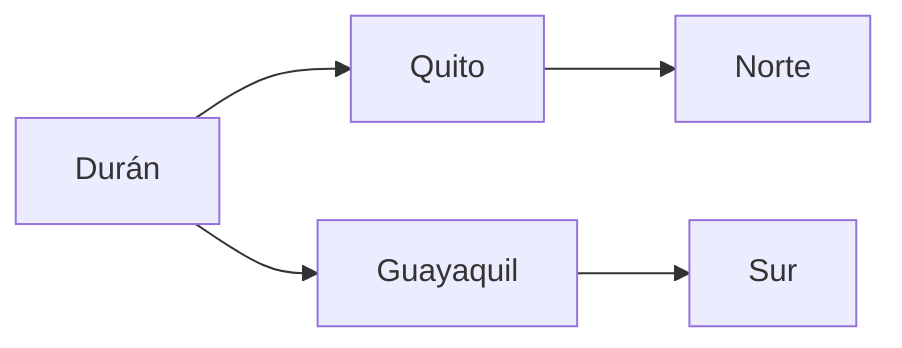

# Ficha p1 · ¿Puede llegar el envío a la zona Norte?

**Remitente:** Daniela Paredes · Planificación · **Grupo:** A · **Clasificación propuesta:** P
**Responsable:** Luis

> FICHA MODELO TERMINADA. Las otras nueve siguen esta estructura y esta profundidad (docs/PLANTILLA_FICHA.md).

> **Solicitud operativa:** ¿Puede un pedido llegar desde Planta Durán hasta la zona Norte usando únicamente rutas activas?

## 0. Respuesta al correo (para Daniela Paredes)
Daniela: **sí, hoy existe ruta** desde la Planta Durán hasta la zona Norte: **Durán → Quito → Norte (2 tramos)**, así que se puede coordinar el camión con el cliente. Si el cierre de vías hubiera dejado fuera de servicio el tramo Quito → Norte, la respuesta sería **no**: desde Durán solo se llegaría a Quito, Guayaquil y Sur. Adjuntamos el programa (BFS), que recibe cualquier lista de conexiones, con las dos pruebas.

## 1. Resumen del correo
El cliente de la zona Norte confirmó una ventana de recepción de 10:00 a 12:00. Antes de liberar el pedido, Planificación necesita saber si hoy existe una secuencia de **tramos habilitados** desde la Planta Durán hasta la zona Norte, porque el cierre de vías de anoche pudo dejar una conexión fuera de servicio. Se pide: (a) una respuesta Sí/No, (b) el procedimiento general para comprobarlo en **toda** la red, (c) un programa ejecutable que reciba una lista de conexiones y (d) un ejemplo con ruta disponible y otro sin ruta.



## 2. Entrada, salida y restricciones
- **Pregunta de decisión:** ¿existe un camino dirigido de *s* = Durán a *t* = Norte que use solo tramos activos?
- **Lenguaje:** ALCANZABILIDAD = { ⟨G, s, t⟩ : G es un grafo dirigido y existe un camino de s a t en G } (PATH en Sipser, §7.2).
- **Entrada:** G = (V, E) dirigido, que el programa recibe como **lista de conexiones** [origen, destino] (`red_desde_conexiones`) y convierte en lista de adyacencia. **Tamaño:** n = |V| + |E| elementos; cada identificador ocupa O(log |V|) bits.
- **Salida:** *Sí* si existe el camino y *No* en caso contrario. Como evidencia se entrega el camino encontrado.
- **Restricciones del correo:** solo cuentan los tramos activos (un tramo cerrado se modela **eliminando** su arista); se respeta el sentido de cada tramo; no hay pesos, porque el correo pregunta si **existe** una ruta, no cuánto cuesta.
- **Versión analizada:** decisión. El correo no pide optimizar nada.
- **Datos del expediente:** `data/casos_simulador.json` → `"p1"`: E = {Durán→Quito, Durán→Guayaquil, Quito→Norte, Guayaquil→Sur}. El escenario sin ruta cierra Quito→Norte.

## 3. Clasificación y evidencia: **P**
- **Evidencia del grupo A (algoritmo polinómico conocido):** la búsqueda en anchura (BFS) decide ALCANZABILIDAD en O(|V| + |E|), que es polinomial en el tamaño de la entrada. Por lo tanto **ALCANZABILIDAD ∈ P** (Sipser, Teorema 7.14, 3.ª ed.).
- **Relación con NP:** como P ⊆ NP, el problema también está en NP (el certificado sería el propio camino, verificable en O(|E| + |camino|) con `verificar_camino`). Para el grupo A, sin embargo, la evidencia exigida es el algoritmo polinómico, no el certificado. Que esté en P no dice nada sobre si P = NP.

## 4. Decidibilidad y computabilidad
- **Modelo de cómputo:** máquina de Turing determinista; de forma equivalente, el modelo RAM con el grafo codificado como lista de adyacencia.
- **Qué se computa:** la función característica de ALCANZABILIDAD, f(⟨G, s, t⟩) = 1 si y solo si existe un camino s ⇝ t.
- **Decidible: sí.** Para **toda** entrada válida el procedimiento termina y responde correctamente:
  - *Terminación:* un vértice se marca (recibe `padre`) al entrar a la cola y nunca vuelve a entrar. Hay como máximo |V| extracciones, cada una recorre una lista finita, así que el número total de pasos está acotado por |V| + |E|.
  - *Correctitud:* (i) todo vértice marcado es alcanzable desde s, porque se marcó desde un vecino que ya estaba marcado; (ii) todo vértice alcanzable termina marcado (por inducción sobre su distancia a s). Si la cola se vacía sin haber visto t, entonces t no es alcanzable, y responder **No** es correcto.

## 5. Algoritmo
- **Algoritmo:** BFS. **Tipo de solución:** exacta.
- **Por qué BFS:** no hay pesos, así que Dijkstra no aporta nada y costaría un factor log extra. BFS, además de decidir, devuelve el camino con **menos tramos**, que es útil para coordinar el camión. DFS también decide en O(|V| + |E|), pero no garantiza el camino más corto en tramos.

```
ALCANZABLE(G, s, t):
  si s ∉ V o t ∉ V: error "entrada inválida"
  padre[s] ← NIL ; cola ← ⟨s⟩
  mientras cola ≠ ∅:
      u ← DESENCOLAR(cola)
      si u = t: devolver (Sí, RECONSTRUIR(padre, t))
      para cada v ∈ ady[u]:
          si v no tiene padre:            ▹ cada vértice entra a la cola una sola vez
              padre[v] ← u ; ENCOLAR(cola, v)
  devolver No                             ▹ se agotaron los alcanzables sin ver t
```

**Ejecución real por niveles** (cola FIFO; sale de `python -m logistpulse casos`):

| Paso | Sale de la cola | Entran (se registra padre) | Cola después |
|---|---|---|---|
| INICIO | — | Durán | Durán |
| 1 | Durán | Quito, Guayaquil | Quito, Guayaquil |
| 2 | Quito | Norte | Guayaquil, Norte |
| 3 | Guayaquil | Sur | Norte, Sur |
| 4 | Norte | **¡destino!** | Sur |

Camino reconstruido con los padres: padre[Norte] = Quito y padre[Quito] = Durán, es decir, **Durán → Quito → Norte** (2 tramos).

## 6. Complejidad (Big-O)
- **Variables:** V = número de sitios (vértices); E = número de tramos activos (aristas).
- **Tiempo O(V + E):** cada vértice se encola y se desencola como máximo una vez (O(V)), y cada lista de adyacencia se recorre una sola vez (Σ |ady[u]| = E). La implementación **no** ordena los vecinos dentro del bucle, para no agregar un factor log a esta cota.
- **Espacio O(V):** el diccionario `padre` y la cola tienen como máximo V entradas, sin contar la entrada, que ocupa O(V + E).
- **Respaldo empírico:** `tests/test_complejidad.py::test_bfs_es_O_V_mas_E` cuenta las operaciones en grafos de 100 a 5 000 vértices y comprueba extracciones ≤ V y aristas examinadas ≤ E. `test_bfs_crece_lineal` mide que, al cuadruplicar el grafo, el tiempo crece unas 4 veces y no 16. En el expediente: 4 extracciones (≤ V = 5) y 4 aristas examinadas (≤ E = 4).

## 7. Código, pruebas y salida observada
- **Código:** `logistpulse/casos/p1_alcanzabilidad.py` (`red_desde_conexiones`, `resolver`, `decidir`, `verificar_camino`), que usa `logistpulse/rutas/bfs.py`. Los datos se leen con `io_datos.cargar_casos` y el texto se arma en `presentacion_casos.demo_p1`: lectura, procesamiento y presentación quedan separados. Para ejecutarlo **con cualquier lista de conexiones**, como pide el correo: `python -m logistpulse p1 ARCHIVO ORIGEN DESTINO` (lee el archivo con `io_datos.cargar_conexiones`, una conexión por línea, y responde con `presentacion_casos.respuesta_p1`).
- **Pruebas:** `tests/test_casos_p.py::TestP1`
  - *Normales:* hay ruta (`test_alcanzable`); con el cierre de Quito → Norte no la hay (`test_no_alcanzable_con_cierre`); la traza coincide con la tabla por niveles (`test_traza_bfs_por_niveles`); el programa responde Sí con `data/ejemplos/p1_con_ruta.txt` y No con `data/ejemplos/p1_sin_ruta.txt` (`test_programa_con_lista_de_conexiones`).
  - *Límite:* origen igual a destino da el camino [Durán] (`test_limite_origen_igual_destino`); el sentido importa, porque Norte ⇝ Durán da No (`test_grafo_dirigido_no_vuelve`).
  - *Inválidas:* un destino que no existe, conexiones mal formadas, en lazo o repetidas, o el cierre de un tramo inexistente lanzan ValueError (`test_invalidos`); el verificador rechaza caminos falsos o vacíos (`test_verificador_de_camino`); un archivo de conexiones mal escrito da un error claro (`test_lectura_de_conexiones_invalida`).
- **Reproducir (Codespace, Colab o local):** `python -m logistpulse casos` · `python -m logistpulse p1 data/ejemplos/p1_con_ruta.txt Durán Norte` · `python -m logistpulse p1 data/ejemplos/p1_sin_ruta.txt Durán Norte` · `python -m unittest tests.test_casos_p -v`

Salida observada (ejecución real; el bloque lo actualiza `scripts/generar_docs.py`):
<!-- SALIDA:INICIO (generado por scripts/generar_docs.py; no editar) -->
```text
RESPUESTA AL CORREO: Sí, hoy existe ruta Durán → Norte: Durán → Quito → Norte (2 tramos).
Si se cierra Quito→Norte: No existe ruta (BFS agotó la cola).
Verificar camino: True
BFS por niveles:
| Paso | Sale de la cola | Entran (se registra padre) | Cola después |
|---|---|---|---|
| INICIO | — | Durán | Durán |
| 1 | Durán | Quito, Guayaquil | Quito, Guayaquil |
| 2 | Quito | Norte | Guayaquil, Norte |
| 3 | Guayaquil | Sur | Norte, Sur |
| 4 | Norte | **¡destino!** | Sur |
```
<!-- SALIDA:FIN -->
```text
test_alcanzable (tests.test_casos_p.TestP1.test_alcanzable) ... ok
test_grafo_dirigido_no_vuelve (tests.test_casos_p.TestP1.test_grafo_dirigido_no_vuelve) ... ok
test_invalidos (tests.test_casos_p.TestP1.test_invalidos) ... ok
test_lectura_de_conexiones_invalida (tests.test_casos_p.TestP1.test_lectura_de_conexiones_invalida) ... ok
test_limite_origen_igual_destino (tests.test_casos_p.TestP1.test_limite_origen_igual_destino) ... ok
test_no_alcanzable_con_cierre (tests.test_casos_p.TestP1.test_no_alcanzable_con_cierre) ... ok
test_programa_con_lista_de_conexiones (tests.test_casos_p.TestP1.test_programa_con_lista_de_conexiones)
El correo pide un programa que se ejecute con una lista de conexiones: ejemplo con ruta y sin ruta. ... ok
test_traza_bfs_por_niveles (tests.test_casos_p.TestP1.test_traza_bfs_por_niveles) ... ok
test_verificador_de_camino (tests.test_casos_p.TestP1.test_verificador_de_camino) ... ok
Ran 9 tests in 0.005s
OK
```

## 8. Observaciones y límites de la inferencia
- La respuesta "Sí" vale **para los tramos reportados por Transporte**. Si el reporte está desactualizado, la respuesta también lo estará: el algoritmo es correcto respecto de su entrada, no respecto de la realidad.
- La existencia de una ruta no garantiza cumplir la ventana de 10:00 a 12:00. Eso sería otro problema (con tiempos, como en p2).

## ¿Qué concluimos?
| Decidibilidad | Computabilidad | Complejidad |
|---|---|---|
| **Sí.** BFS termina al agotar la cola o al encontrar el destino. | **Sí.** Hay un procedimiento efectivo (MT determinista / RAM) que calcula la función característica de ALCANZABILIDAD para toda red finita. | **P.** O(V + E) de tiempo y O(V) de espacio con listas de adyacencia (comprobado con conteo de operaciones). |

## Preguntas para la defensa oral
1. **¿Por qué está en P y no "solo" en NP?** Porque tenemos un algoritmo determinista que decide el problema en O(V + E), que es polinomial. Estar en NP no excluye estar en P: P ⊆ NP.
2. **¿Cómo saben que BFS siempre termina?** Cada vértice entra a la cola una sola vez, así que hay como máximo V extracciones y cada una revisa una lista finita. El total está acotado por V + E pasos. Además lo medimos: el contador nunca pasa de V extracciones ni de E aristas.
3. **¿Por qué no usaron Dijkstra?** El correo pregunta si existe una ruta, no cuánto cuesta, y no hay pesos. Dijkstra resolvería lo mismo con un factor log extra; BFS es suficiente y además da la ruta con menos tramos.

## Lista de verificación (docs/PLANTILLA_FICHA.md)
- [x] Resumen fiel al correo; ninguna condición ni dato cambiado; ambigüedades señaladas
- [x] Pregunta de decisión explícita; si es optimización, clasificada por su versión de decisión
- [x] Entrada con su tamaño definido (bits si hay números)
- [x] Evidencia completa del grupo A
- [x] Modelo de cómputo nombrado · terminación argumentada
- [x] Algoritmo justificado (exacto / aproximado / heurístico)
- [x] Big-O de tiempo y espacio con variables definidas, coherente con el código
- [x] Código + pruebas + salida observada real · Big-O respaldado por tests/test_complejidad.py
- [x] Respuesta al correo (sección 0) y tabla "¿Qué concluimos?" completas
- [x] No se afirma P ≠ NP; P ⊆ NP; "NP" ≠ "no polinómico"
- [x] Sin marcas pendientes · 3 preguntas de defensa respondidas
