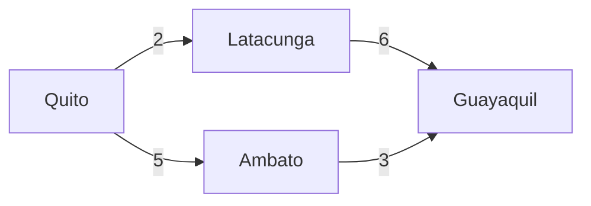

# Ficha p2 · Ruta mínima entre centros de distribución

**Remitente:** Marco Cedeño · Transporte · **Grupo:** A · **Clasificación propuesta:** P
**Responsable de redacción:** Luis

> Esqueleto generado desde el código. Los datos técnicos ya están verificados con pruebas.
> Formato y profundidad a imitar: docs/fichas/p1.md (ficha modelo terminada).
> Las secciones marcadas [POR REDACTAR] las redacta Luis (con su IA) sin cambiar las condiciones del correo.
> Lo que debe establecer este grupo: Definición formal; algoritmo polinómico conocido; pseudocódigo o código; complejidad temporal y espacial.

> **Solicitud operativa:** ¿Existe ruta CD Quito ⇝ CD Guayaquil con tiempo total ≤ K?

## 0. Respuesta al correo (para Marco Cedeño)
[POR REDACTAR] 2–3 líneas en lenguaje operativo, basadas en la salida observada de la sección 7 (primera línea).

## 1. Resumen del correo
[POR REDACTAR] (2–4 líneas, sin cambiar condiciones del problema)


## 2. Entrada, salida y restricciones
- **Pregunta de decisión:** ¿Existe ruta CD Quito ⇝ CD Guayaquil con tiempo total ≤ K?
- **Entrada:** Grafo dirigido con tiempos w(e) ≥ 0, origen s, destino t (y K en la versión de decisión).
- **Salida:** Tiempo mínimo a cada nodo + ruta reconstruida con predecesores.
- **Versión analizada:** Optimización (camino mínimo); decisión asociada con cota K.
- [POR REDACTAR] Restricciones del correo (pesos ≥ 0, binario, presupuesto, etc.)

## 3. Clasificación y evidencia
- **Clase:** P
- **Evidencia:** Algoritmo polinómico conocido: Dijkstra (requiere pesos ≥ 0).
- **Certificado / verificador:** —
- **Reducción:** —

[POR REDACTAR] Justificación formal (ver guía del grupo arriba).

## 4. Decidibilidad y computabilidad
- **Modelo de cómputo supuesto:** máquina de Turing determinista (equivalente: modelo RAM con enteros codificados en binario).
- **¿Decidible?** Sí: cada vértice se finaliza una vez; ≤ E inserciones en el heap.
- [POR REDACTAR] Qué función/relación se computa y por qué el procedimiento termina para TODA entrada válida.

## 5. Algoritmo seleccionado
- **Algoritmo:** Dijkstra (heap binario)
- **Tipo de solución:** Exacto
- [POR REDACTAR] Por qué este algoritmo y qué garantiza.

## 6. Complejidad (Big-O)
- **Variables:** V = centros, E = conexiones
- **Tiempo:** O((V + E) log V)
- **Espacio:** O(V + E)
- [POR REDACTAR] Justificación de la cota (de dónde sale cada factor).

## 7. Código, pruebas y salida observada
- **Código:** `logistpulse/casos/p2_ruta_minima.py`
- **Pruebas:** `tests/test_casos_p.py` (normales, límite e inválidas)
- **Datos del expediente:** `data/casos_simulador.json` → `"p2"` (leídos con `io_datos.cargar_casos`)
- **Pruebas de complejidad:** `tests/test_complejidad.py` (conteo de operaciones + tiempos reales)
- **Reproducir:** `python -m logistpulse casos` · `python -m unittest tests.test_casos_p -v`

<!-- SALIDA:INICIO (generado por scripts/generar_docs.py; no editar) -->
```text
RESPUESTA AL CORREO: recorrido sugerido Quito → Latacunga → Guayaquil, tiempo total 8. El sistema debe conservar pred[v] (predecesor) de cada nodo para reconstruir la ruta.
dist desde Quito: {'Ambato': 5, 'Guayaquil': 8, 'Latacunga': 2, 'Quito': 0}
Rutas de costo mínimo (empate): ['Quito → Ambato → Guayaquil', 'Quito → Latacunga → Guayaquil']
Versión de decisión: ¿ruta con costo ≤ 8? True · ≤ 7? False
Peso negativo (S→A 2, S→B 3, B→A −2, A→C 1): Dijkstra da C=3, Bellman–Ford da C=2  ⇒ Dijkstra falla
```
<!-- SALIDA:FIN -->

## 8. Observaciones
Costo 8 con EMPATE: Quito→Latacunga→Guayaquil y Quito→Ambato→Guayaquil. Con pesos negativos Dijkstra falla (contraejemplo incluido); usar Bellman–Ford O(V·E).

## ¿Qué concluimos?
| Decidibilidad | Computabilidad | Complejidad |
|---|---|---|
| [POR REDACTAR] (¿siempre termina y responde Sí/No?) | [POR REDACTAR] (¿qué función/relación calcula y con qué modelo?) | P · O((V + E) log V) |

## Preguntas para la defensa oral
[POR REDACTAR] 3 preguntas que podría hacer el profesor + respuesta en 2–3 frases.

## Lista de verificación (docs/PLANTILLA_FICHA.md)
- [ ] Resumen fiel al correo; ninguna condición ni dato cambiado; ambigüedades señaladas
- [ ] Pregunta de decisión explícita; si es optimización, clasificada por su versión de decisión
- [ ] Entrada con su tamaño definido (bits si hay números)
- [ ] Evidencia completa del grupo A
- [ ] Modelo de cómputo nombrado · terminación argumentada
- [ ] Algoritmo justificado (exacto / aproximado / heurístico)
- [ ] Big-O de tiempo y espacio con variables definidas, coherente con el código
- [ ] Código + pruebas + salida observada real · Big-O respaldado por tests/test_complejidad.py
- [ ] Respuesta al correo (sección 0) y tabla "¿Qué concluimos?" completas
- [ ] No se afirma P ≠ NP; P ⊆ NP; "NP" ≠ "no polinómico"
- [ ] Sin marcas [POR REDACTAR] pendientes · 3 preguntas de defensa respondidas
