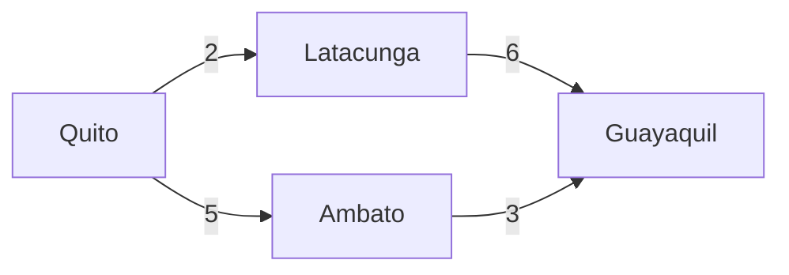

# Ficha p2 · Ruta mínima entre centros de distribución

**Remitente:** Marco Cedeño · Transporte · **Grupo:** A · **Clasificación de la versión de decisión:** P
**Responsable:** Luis

> **Solicitud operativa:** Encontrar el recorrido de menor tiempo de CD Quito a CD Guayaquil y explicar cómo reconstruirlo.

## 0. Respuesta al correo

Marco, para asignar el camión refrigerado te sugiero la ruta **Quito → Latacunga → Guayaquil**, con tiempo total **8** en las unidades de la tabla. Pasar por Ambato también da **8**. Guarda el predecesor de cada centro para reconstruir el recorrido desde el destino.

## 1. Resumen del correo

El proveedor actualizó los tiempos de traslado debido a obras en la vía. Antes del corte de asignación de vehículos, Transporte necesita el recorrido de menor tiempo entre CD Quito y CD Guayaquil, su costo, el dato para reconstruirlo y una prueba pequeña. Todas las conexiones registradas tienen tiempos no negativos y se respetan sus sentidos.



## 2. Entrada, salida y restricciones

- **Optimización.** Dado un grafo dirigido G = (V, E) con tiempos no negativos, obtener las distancias mínimas desde el origen s y reconstruir una ruta óptima al destino t. Si el destino es inalcanzable, su distancia es infinita y se informa que no hay ruta.
- **Decisión asociada.** Dados G, s, t y un umbral finito K, responder Sí si existe una ruta de s a t cuyo costo total sea a lo sumo K. El lenguaje es RUTA-CORTA = { ⟨G, s, t, K⟩ : existe una ruta dirigida de s a t de costo ≤ K } sobre entradas válidas. La clasificación en P se aplica a esta versión.
- **Codificación.** Para la clasificación formal, se admiten tiempos enteros no negativos y K entero no negativo codificados en binario. Con identificadores numéricos y una lista explícita de vértices y aristas, si B es el máximo de bits de un peso o de K, la entrada ocupa O((|V| + |E|) log(|V| + 1) + (|E| + 1)B) bits.
- **Instancia.** s = Quito, t = Guayaquil. Los números del correo se reportan en las unidades de su tabla.

## 3. Clasificación y evidencia

**RUTA-CORTA pertenece a P.** Dijkstra calcula la distancia mínima desde s hasta t. Luego se responde Sí exactamente cuando t es alcanzable y su distancia mínima es ≤ K. El número de operaciones es polinómico en el tamaño del grafo. Las sumas y comparaciones de tiempos también son polinómicas en bits, pues un camino simple suma a lo sumo |V| − 1 pesos. Con pesos no negativos siempre basta considerar caminos simples para encontrar una distancia mínima. Por tanto, una distancia finita requiere a lo sumo O(B + log(|V| + 1)) bits.

## 4. Decidibilidad y computabilidad

La función de decisión recibe ⟨G, s, t, K⟩ y devuelve Sí o No. La función de optimización calcula las distancias mínimas y una ruta a t, si existe. Ambas son computables de forma determinista. Para la clasificación formal puede usarse una máquina de Turing determinista con la codificación anterior. Para contar las operaciones del programa se usa el modelo RAM.

Dijkstra finaliza cada vértice a lo sumo una vez. Cuando lo finaliza, examina sus aristas salientes y cada mejora agrega una entrada a la cola de prioridad. Como hay a lo sumo |E| + 1 inserciones, contando la del origen, y cada vuelta extrae una entrada, la búsqueda termina. La comparación con K también termina.

## 5. Algoritmo seleccionado

Dijkstra es **exacto** con tiempos no negativos. La primera vez que extrae y finaliza un centro, su distancia ya es mínima. Cada mejora guarda en `pred[v]` el centro inmediatamente anterior a v. Para reconstruir la ruta, se empieza en el destino, se siguen los predecesores hasta el origen y se invierte la secuencia.

```text
RUTA_CORTA(G, s, t, K)
    ejecutar Dijkstra desde s y obtener distancias y predecesores
    si distancia[t] = ∞
        devolver No
    devolver distancia[t] ≤ K
```

Desde Quito, Latacunga se alcanza con 2 y Ambato con 5. Se procesa Latacunga primero y se registra Guayaquil con 2 + 6 = 8. Al procesar Ambato aparece otro recorrido de 5 + 3 = 8. Como el costo es igual, se conserva a Latacunga como predecesor de Guayaquil.

## 6. Complejidad

Sean **|V|** el número de centros y **|E|** el número de conexiones. Dijkstra con listas de adyacencia y montículo binario toma **O((|V| + |E|) log |V|)** operaciones en tiempo para |V| ≥ 2 y **O(|V| + |E|)** de espacio auxiliar. Cada conexión se examina como máximo una vez durante la búsqueda y hay como máximo una inserción por mejora. El montículo puede contener O(|E| + 1) entradas. En un grafo dirigido simple, |E| es O(|V|²), por lo que cada inserción o extracción cuesta O(log |V|). El ordenamiento de las listas de vecinos en esta implementación queda dentro de la misma cota temporal.

Esta cota corresponde a calcular las distancias y recuperar **una ruta**. El módulo del simulador también usa `todas_las_rutas_minimas` para enumerar empates. La función `decidir` actual llama a ese mismo envoltorio, así que su tiempo total incluye la enumeración y puede crecer exponencialmente cuando hay muchos empates. La cota polinómica de clasificación corresponde al pseudocódigo anterior, que usa la distancia mínima y compara con K sin enumerar rutas.

## 7. Código, pruebas y salida observada

- **Código:** `logistpulse/casos/p2_ruta_minima.py` y `logistpulse/rutas/dijkstra.py`. La instancia se carga desde `data/casos_simulador.json`, clave `p2`.
- **Normal:** `test_distancias_y_ruta` verifica las cuatro distancias y las dos rutas óptimas de costo 8.
- **Límite:** `test_version_decision_limite` comprueba que un umbral de 8 devuelve Sí y 7.999 devuelve No.
- **Inválida:** `test_grafo_rechaza_pesos_negativos_y_destino_inexistente` comprueba el rechazo de esas entradas.
- **Complejidad:** `tests/test_complejidad.py::test_dijkstra_operaciones_de_heap_acotadas` comprueba las cotas de inserciones, extracciones y aristas examinadas para Dijkstra. `test_dijkstra_crece_casi_lineal` compara tiempos en grafos dispersos.
- **Reproducir:** `python -m logistpulse casos` y `python -m unittest tests.test_casos_p.TestP2 -v`.

<!-- SALIDA:INICIO (generado por scripts/generar_docs.py; no editar) -->
```text
RESPUESTA AL CORREO: recorrido sugerido Quito → Latacunga → Guayaquil, tiempo total 8. El sistema debe conservar pred[v] (predecesor) de cada nodo para reconstruir la ruta.
dist desde Quito: {'Ambato': 5, 'Guayaquil': 8, 'Latacunga': 2, 'Quito': 0}
Rutas de costo mínimo (empate): ['Quito → Ambato → Guayaquil', 'Quito → Latacunga → Guayaquil']
Versión de decisión: ¿ruta con costo ≤ 8? True · ≤ 7? False
Peso negativo (S→A 2, S→B 3, B→A −2, A→C 1): Dijkstra da C=3, Bellman–Ford da C=2  ⇒ Dijkstra falla
```
<!-- SALIDA:FIN -->

## 8. Observaciones

El resultado usa los tiempos actualizados del correo. Si cambian las conexiones o los tiempos, hay que ejecutar la búsqueda otra vez. En el contraejemplo de la Fase B, Dijkstra finaliza A antes de descubrir una mejora a través del tramo negativo B → A. Bellman–Ford encuentra el costo 2 hasta C en ese ejemplo.

## ¿Qué concluimos?

| Decidibilidad | Computabilidad | Complejidad |
|---|---|---|
| Sí. Dijkstra y la comparación con K siempre terminan para entradas válidas. | Se calculan la distancia mínima, una ruta óptima y la respuesta Sí o No mediante un procedimiento determinista. | La versión de decisión está en P. Dijkstra con montículo usa O((V + E) log V) operaciones y O(V + E) de espacio auxiliar, donde V y E son las cantidades de vértices y aristas. |

## Preguntas para la defensa oral

1. **¿Por qué la ficha está en P si el correo pide optimizar?** La clase P se aplica a la decisión asociada. Basta calcular el costo mínimo y compararlo con el umbral K.
2. **¿Por qué se conserva Latacunga si Ambato también da 8?** Al examinar Ambato el costo registrado para Guayaquil ya es 8. Dijkstra cambia el predecesor solo si encuentra un costo estrictamente menor.
3. **¿Qué necesitamos guardar para reconstruir la ruta?** El predecesor de cada centro alcanzado. Desde Guayaquil retrocedemos a Latacunga y luego a Quito, e invertimos la secuencia.

## Lista de verificación

- [x] Resumen fiel al correo; ninguna condición ni dato cambiado; ambigüedades señaladas con la lectura elegida
- [x] Pregunta de decisión explícita (lenguaje L); si el correo pide optimización, la clasificación se hace sobre la versión de decisión y está escrito
- [x] Entrada con su **tamaño** definido (en bits si hay números: el valor B ≠ el tamaño log₂B)
- [x] Evidencia completa del grupo (tabla de arriba)
- [x] Modelo de cómputo nombrado (MT determinista / RAM con enteros en binario)
- [x] Terminación argumentada (cota o variante que decrece), no solo afirmada
- [x] Algoritmo justificado; dice si es exacto, aproximado o heurístico y qué garantiza
- [x] Big-O de tiempo **y** espacio, con variables definidas; coincide con el código
- [x] Ruta al código y a las pruebas (normales, límite, inválidas); salida observada **real**
- [x] Big-O respaldado por `tests/test_complejidad.py` (conteo de operaciones y/o tiempo real)
- [x] Respuesta al correo (sección 0) y tabla "¿Qué concluimos?" completas
- [x] No se afirma P ≠ NP · P ⊆ NP · "NP" no significa "no polinómico" · grupo B no dice "NP-completo"
- [x] Secciones redactadas
- [x] 3 preguntas de defensa oral con su respuesta
