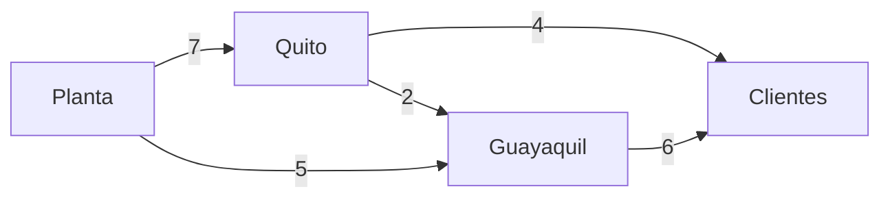

# Ficha p3 · Máximo de camiones hacia clientes

**Remitente:** Luis Vaca · Distribución · **Grupo:** A · **Clasificación propuesta:** P
**Responsable de redacción:** Luis

> Esqueleto generado desde el código. Los datos técnicos ya están verificados con pruebas.
> Formato y profundidad a imitar: docs/fichas/p1.md (ficha modelo terminada).
> Las secciones marcadas [POR REDACTAR] las redacta Luis (con su IA) sin cambiar las condiciones del correo.
> Lo que debe establecer este grupo: Definición formal; algoritmo polinómico conocido; pseudocódigo o código; complejidad temporal y espacial.

> **Solicitud operativa:** ¿Se pueden enviar al menos K camiones/día de Planta a Clientes sin exceder capacidades?

## 0. Respuesta al correo (para Luis Vaca)
[POR REDACTAR] 2–3 líneas en lenguaje operativo, basadas en la salida observada de la sección 7 (primera línea).

## 1. Resumen del correo
[POR REDACTAR] (2–4 líneas, sin cambiar condiciones del problema)


## 2. Entrada, salida y restricciones
- **Pregunta de decisión:** ¿Se pueden enviar al menos K camiones/día de Planta a Clientes sin exceder capacidades?
- **Entrada:** Red dirigida con capacidades enteras c(e) ≥ 0, fuente s, sumidero t.
- **Salida:** Valor del flujo máximo, flujo por tramo y corte mínimo.
- **Versión analizada:** Optimización (flujo máximo); decisión asociada flujo ≥ K.
- [POR REDACTAR] Restricciones del correo (pesos ≥ 0, binario, presupuesto, etc.)

## 3. Clasificación y evidencia
- **Clase:** P
- **Evidencia:** Algoritmo polinómico conocido: Edmonds–Karp; el corte mínimo certifica optimalidad.
- **Certificado / verificador:** Flujo factible (capacidad + conservación) verificable en O(V + E).
- **Reducción:** —

[POR REDACTAR] Justificación formal (ver guía del grupo arriba).

## 4. Decidibilidad y computabilidad
- **Modelo de cómputo supuesto:** máquina de Turing determinista (equivalente: modelo RAM con enteros codificados en binario).
- **¿Decidible?** Sí: a lo sumo O(V·E) aumentos, cada uno con un BFS O(E).
- [POR REDACTAR] Qué función/relación se computa y por qué el procedimiento termina para TODA entrada válida.

## 5. Algoritmo seleccionado
- **Algoritmo:** Edmonds–Karp (Ford–Fulkerson con BFS)
- **Tipo de solución:** Exacto
- [POR REDACTAR] Por qué este algoritmo y qué garantiza.

## 6. Complejidad (Big-O)
- **Variables:** V = nodos, E = tramos
- **Tiempo:** O(V·E²)
- **Espacio:** O(V + E)
- [POR REDACTAR] Justificación de la cota (de dónde sale cada factor).

## 7. Código, pruebas y salida observada
- **Código:** `logistpulse/casos/p3_flujo_maximo.py`
- **Pruebas:** `tests/test_casos_p.py` (normales, límite e inválidas)
- **Datos del expediente:** `data/casos_simulador.json` → `"p3"` (leídos con `io_datos.cargar_casos`)
- **Pruebas de complejidad:** `tests/test_complejidad.py` (conteo de operaciones + tiempos reales)
- **Reproducir:** `python -m logistpulse casos` · `python -m unittest tests.test_casos_p -v`

<!-- SALIDA:INICIO (generado por scripts/generar_docs.py; no editar) -->
```text
RESPUESTA AL CORREO: pueden llegar como máximo 10 camiones/día de Planta a Clientes (la salida de Planta suma 12, pero el cuello de botella deja pasar 10).
Registro de actualización de tramos (usado / disponible):
  Aumento 1: Planta → Quito → Clientes · cuello 4 · total 4
      usar     Planta→Quito           usado 4/7 · disponible 3
      usar     Quito→Clientes         usado 4/4 · disponible 0
  Aumento 2: Planta → Guayaquil → Clientes · cuello 5 · total 9
      usar     Planta→Guayaquil       usado 5/5 · disponible 0
      usar     Guayaquil→Clientes     usado 5/6 · disponible 1
  Aumento 3: Planta → Quito → Guayaquil → Clientes · cuello 1 · total 10
      usar     Planta→Quito           usado 5/7 · disponible 2
      usar     Quito→Guayaquil        usado 1/2 · disponible 1
      usar     Guayaquil→Clientes     usado 6/6 · disponible 0
Flujo final por tramo: {('Planta', 'Quito'): 5, ('Planta', 'Guayaquil'): 5, ('Quito', 'Clientes'): 4, ('Quito', 'Guayaquil'): 1, ('Guayaquil', 'Clientes'): 6}
Verificador (capacidad + conservación) -> valor 10
Corte mínimo S = ['Guayaquil', 'Planta', 'Quito'] · capacidad = 10 = flujo ⇒ óptimo
Versión de decisión: ¿≥ 10? True · ¿≥ 11? False
Trabajo realizado: 3 aumentos (cota V·E = 20) y 29 aristas residuales examinadas (cota (aumentos+1)·2E = 40); V = 4, E = 5
```
<!-- SALIDA:FIN -->

## 8. Observaciones
Flujo máximo = 10 aunque la salida de Planta suma 12 (cuello en los tramos hacia Clientes).

## ¿Qué concluimos?
| Decidibilidad | Computabilidad | Complejidad |
|---|---|---|
| [POR REDACTAR] (¿siempre termina y responde Sí/No?) | [POR REDACTAR] (¿qué función/relación calcula y con qué modelo?) | P · O(V·E²) |

## Preguntas para la defensa oral
[POR REDACTAR] 3 preguntas que podría hacer el profesor + respuesta en 2–3 frases.

## Lista de verificación (docs/PLANTILLA_FICHA.md)
- [ ] Resumen fiel al correo; ninguna condición ni dato cambiado; ambigüedades señaladas
- [ ] Pregunta de decisión explícita; si es optimización, clasificada por su versión de decisión
- [ ] Entrada con su tamaño definido (bits si hay números)
- [ ] Evidencia completa del grupo A
- [ ] Modelo de cómputo nombrado · terminación argumentada
- [ ] Algoritmo justificado (exacto / aproximado / heurístico)
- [ ] Big-O de tiempo y espacio con variables definidas, coherente con el código
- [ ] Código + pruebas + salida observada real · Big-O respaldado por tests/test_complejidad.py
- [ ] Respuesta al correo (sección 0) y tabla "¿Qué concluimos?" completas
- [ ] No se afirma P ≠ NP; P ⊆ NP; "NP" ≠ "no polinómico"
- [ ] Sin marcas [POR REDACTAR] pendientes · 3 preguntas de defensa respondidas
