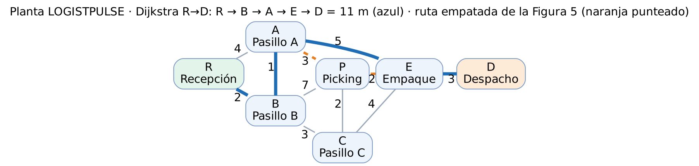
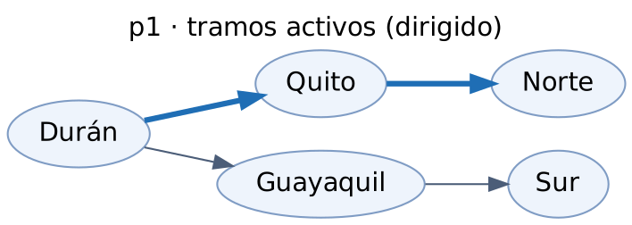
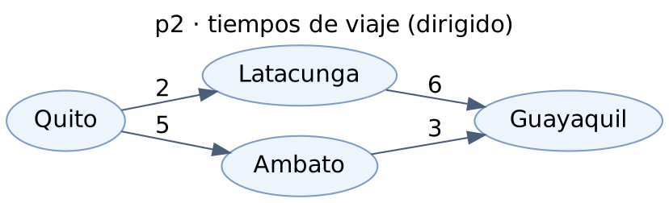
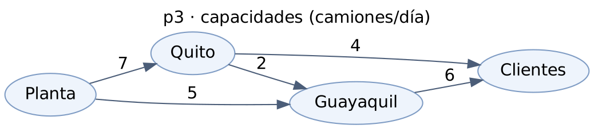
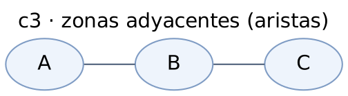

# 1. Introducción, regla conceptual y supuestos

P ⊆ NP y NP-completo ⊆ NP; la separación P ≠ NP no está demostrada. Cada correo se clasifica según la evidencia: (A) algoritmo polinómico conocido, (B) certificado + verificador polinómico sin afirmar NP-completitud, (C) NP-completo con reducción desde un problema conocido.

### 1. Decisiones de modelado

#### Fase A · Autómatas
| # | Decisión | Por qué |
|---|---|---|
| A1 | **F = estados terminales legítimos** (el ciclo cerró de forma válida) en los 3 AFD. Pedido: F = {Entregado, Cancelado}. Reserva: F = {Consumida, Liberada, Expirada, Rechazada}. Compra: F = {Recibida, Rechazada}. | Las Figuras 3 y 4 marcan *Rechazada* como final; la Figura 2 no marca *Cancelado*. Usamos un criterio único para los tres. La variante "solo pedidos entregados" está en `PEDIDO_ESTRICTO` (F = {Entregado}), así que se puede cambiar en una línea. |
| A2 | Símbolos de **1 carácter** (ej. `c` = confirmar). | JFLAP *Multiple Run* lee una cadena por línea, carácter a carácter. |
| A3 | δ **parcial**; lo no declarado va a un **sumidero ERROR** (no final y absorbente). | Así δ es total, como pide la definición formal. JFLAP hace lo mismo implícitamente: si no hay transición, rechaza. |
| A4 | Un símbolo ∉ Σ **no es un rechazo**: es una entrada inválida (ValueError). | La cadena no está en Σ*. Separamos "rechazada por el modelo" de "dato mal formado". |
| A5 | Pedido: "liberar/cancelar" en Reservado = **un solo evento `x`** (cancelar libera la reserva). | La Figura 2 lo dibuja como una sola flecha. |
| A6 | Pedido: **no se puede cancelar en Preparación** ni después. | La Figura 2 no tiene esa flecha: una vez iniciado el picking, el pedido sigue. Se prueba con la cadena `crix`, que se rechaza. |
| A7 | Compra: se agrega el bucle **δ(Recepción parcial, p) = Recepción parcial**. | Se pueden recibir varias entregas parciales antes de completar. Es la parte del enunciado que pide "completar eventos". |
| A8 | Los estados finales **no tienen transiciones de salida**. | Un proceso cerrado no se reabre. Así se rechaza "Rechazada → Enviada". |

#### Fase B · Planta
| # | Decisión |
|---|---|
| B1 | Grafo **no dirigido** (pasillos de doble sentido), pesos = metros (≥ 0), origen **R**, destino **D**. Datos en `data/planta.json`. |
| B2 | Zona bloqueada = vértice eliminado. **Origen bloqueado = dato inválido** (error). **Destino bloqueado = no hay ruta** (dist = ∞). |
| B3 | Desempate reproducible: el heap compara (distancia, nombre del vértice) y los vecinos se recorren en orden alfabético. |

#### Fase C · Inventario
| # | Decisión |
|---|---|
| C1 | Lote elegible ⇔ mismo SKU ∧ disponible > 0 ∧ **vencimiento > fecha de referencia**. Un lote que vence **hoy** ya no se reserva. |
| C2 | Orden FEFO: (vencimiento ↑, código de lote ↑). |
| C3 | Si el stock no alcanza, las **tres** políticas del enunciado están implementadas: `parcial` (reserva lo que hay y reporta el pendiente → PARCIAL), `rechazar` (no reserva nada → RECHAZADO) y `esperar` (no reserva; el pedido queda EN_ESPERA con `requiere_reposicion = True`, que alimenta la regla de reposición). |
| C4 | `en_orden` = solo órdenes de compra **abiertas** (emitidas y no recibidas). Esto evita sugerencias duplicadas (ver H5). |

#### Fase E · Código
| # | Decisión |
|---|---|
| E1 | Capas separadas: **lectura** (`io_datos.py`, que lee `data/*.json`, incluidos los 10 expedientes en `data/casos_simulador.json`), **procesamiento** (`automatas/`, `rutas/`, `inventario/`, `casos/`: algoritmos puros, sin E/S) y **presentación** (`presentacion.py`, `presentacion_casos.py`). Lo comprueba `tests/test_registro.py::TestCapas`. |
| E2 | Cada algoritmo acepta un `Contador` opcional que cuenta su operación dominante. `tests/test_complejidad.py` compara esos conteos con la cota Big-O (y además mide tiempos reales con tolerancia). Así el Big-O del informe queda **atado al código**. |
| E3 | Nada se ordena dentro de bucles cuya cota no lo permita (BFS, Edmonds–Karp, verificadores). Held–Karp recorre las máscaras en orden creciente: O(n²·2ⁿ) real. |
| E4 | Las salidas observadas se **generan ejecutando** el código (`scripts/generar_docs.py`), también dentro de cada ficha (bloque `SALIDA`), así que nunca se inventan. |

---

### 2. Hallazgos (úsenlos en el informe y en la exposición: suman puntos)

| # | Hallazgo | Dónde se prueba |
|---|---|---|
| **H1** | **Empate en la planta.** Dijkstra devuelve R→B→A→**E**→D = 11 m. La ruta de la Figura 5, R→B→A→**P**→E→D, también cuesta 11 m. Las dos son óptimas: Dijkstra garantiza el **costo** mínimo, no una ruta única. | `test_ruta_de_la_figura_es_optima_y_empata` |
| H2 | BFS en la planta da R→A→E→D: 3 tramos pero **12 m**. BFS minimiza tramos, no metros. Con pesos hay que usar Dijkstra. | `test_bfs_minimiza_tramos_no_costo` |
| H3 | p2 también empata: Quito→Latacunga→Guayaquil = Quito→Ambato→Guayaquil = 8. | `TestP2` |
| H4 | p3: lo que sale de Planta suma 12, pero el **flujo máximo es 10**. El corte mínimo es {Quito→Clientes, Guayaquil→Clientes}. El correo advierte justamente esto. | `TestP3` |
| H5 | Reposición sin duplicados: el SKU sugiere 37. Después de emitir esa orden (en_orden += 37) la posición pasa a 50 > 30 y la nueva sugerencia es **0**. | `test_no_duplica_si_ya_hay_orden_abierta` |
| **H6** | **c1: la instancia del simulador es 2-CNF** (x1∨¬x2)∧(x2∨x3), y 2-SAT ∈ **P** (O(n+m)). El problema general (3-CNF) sigue siendo NP-completo. **Que una instancia sea fácil no cambia la clase del problema.** | `test_instancia_simulador_es_2cnf` |
| H7 | c3: la ficha del simulador dice "zona cubierta por un almacén propio o vecino" (eso es *Dominating Set*), pero el **correo** pide cubrir corredores (*Vertex Cover*). Seguimos el correo. Los dos son NP-completos. | — |
| H8 | c2: el correo pide **regresar** al punto de salida, así que es un **ciclo** hamiltoniano (TSP), no un camino. | `TestC2` |
| **H9** | n2 y n3: O(B) **no es polinomial**. B ocupa log₂B bits, así que B = 2^(log B) y la búsqueda es **exponencial en el tamaño de la entrada** (pseudo-polinomial). El verificador sí es polinomial. | — |
| H10 | n2: si B ≥ N, la respuesta es trivialmente Sí (d = N). El caso interesante es B < N. | `test_limites` (n2) |
| H11 | n4: decir "No" exige **agotar** las n! permutaciones (720 con 6 vértices). Para el "No" no hay un certificado corto conocido. | `test_grafo_asimetrico_agota_las_permutaciones` |
| H12 | Heurística vs exacto (c2): el vecino más cercano da 13 y el óptimo (Held–Karp) es 6. La heurística es rápida pero **no garantiza** el óptimo. En c3, la 2-aproximación sí garantiza \|S\| ≤ 2·ÓPT. | `test_heuristica_valida_pero_no_optima`, `test_exactos_y_aproximacion` |
| H13 | Edmonds–Karp hace **el mismo número de aumentos** si se multiplican todas las capacidades por 10⁶. Es la prueba empírica de que O(V·E²) no depende del valor de las capacidades. | `test_edmonds_karp_cota_independiente_de_las_capacidades` |
| H14 | Búsqueda de factores: con N primo y B = N−1, las divisiones se **duplican con cada bit** extra (8 → 16 bits). Es la prueba empírica de H9. | `test_factor_rango_exponencial_en_bits` |

---

### 3. Convenciones de redacción
- **Modelo de cómputo**: máquina de Turing determinista; enteros codificados en **binario**; M(k) es el costo de multiplicar números de k bits (O(k²) con el método escolar).
- **Big-O siempre con variables definidas** (V, E, n, m, k, L, P, B…), en tiempo **y** espacio.
- **Grupo B**: nunca escribir "es NP-completo". Escribir: "pertenece a NP (certificado + verificador polinómico); no se conoce un algoritmo polinómico ni una prueba de NP-completitud".
- **Grupo C**: la reducción va **del problema conocido al nuestro**: CONOCIDO ≤p NUESTRO. Hay que dar la construcción, la correctitud (⇔) y el costo polinómico de la transformación.
- **Decidible ≠ eficiente**. Los 10 casos son decidibles; los grupos B y C pueden ser impracticables en instancias grandes.
- P ⊆ NP y NPC ⊆ NP. **No** son tres conjuntos disjuntos (Figura 1 del enunciado). "NP" **no** significa "no polinómico". No se afirma P ≠ NP.
- Referencias a Sipser con la numeración de la **3.ª edición**: PATH ∈ P (Teo. 7.14); Cook–Levin (§7.4); VERTEX-COVER y HAMPATH NP-completos (§7.5); A_TM indecidible por diagonalización (Teo. 4.11); HALT_TM indecidible por reducción desde A_TM (Teo. 5.1).

---


# 2. Fase A · Autómatas

## Fase A · Autómatas de pedido, reserva y orden de compra
**Responsable: Camila** · Rúbrica: 2,0 pts (tres modelos correctos; estados, eventos, transiciones aceptadas y no válidas; evidencia JFLAP)


### Checklist
- [ ] M = (Q, Σ, δ, q0, F) de los 3 autómatas, con el significado de cada estado y evento
- [ ] Tabla de transiciones + sumidero ERROR
- [ ] Justificación de F (criterio único, decisión A1) y de los eventos agregados (A5–A7)
- [ ] ≥ 2 secuencias válidas y ≥ 2 inválidas por autómata, con la transición que acepta o rechaza
- [ ] Capturas JFLAP (determinismo, Multiple Run, trazas) en `jflap/capturas/`
- [ ] Cómo se probó: JFLAP + `tests/test_automatas.py` + `tests/test_jflap.py`


## Tablas de transiciones (Fase A)


### Pedido

Ciclo de vida del pedido (Figura 2).

```text
M_Pedido = (Q, Σ, δ, q0, F)
Q  = {Borrador, Confirmado, Reservado, Preparacion, Empacado, Despachado, Entregado, Cancelado} ∪ {ERROR}
Σ  = {c=confirmar, r=reservar, i=iniciar_picking, e=empacar, d=despachar, n=entregar, x=cancelar}
q0 = Borrador
F  = {Entregado, Cancelado}
|δ declarada| = 9 transiciones (el resto va a ERROR)
```

| Estado | c (confirmar) | r (reservar) | i (iniciar_picking) | e (empacar) | d (despachar) | n (entregar) | x (cancelar) |
|---|---|---|---|---|---|---|---|
| → Borrador | Confirmado | ∅ | ∅ | ∅ | ∅ | ∅ | Cancelado |
| Confirmado | ∅ | Reservado | ∅ | ∅ | ∅ | ∅ | Cancelado |
| Reservado | ∅ | ∅ | Preparacion | ∅ | ∅ | ∅ | Cancelado |
| Preparacion | ∅ | ∅ | ∅ | Empacado | ∅ | ∅ | ∅ |
| Empacado | ∅ | ∅ | ∅ | ∅ | Despachado | ∅ | ∅ |
| Despachado | ∅ | ∅ | ∅ | ∅ | ∅ | Entregado | ∅ |
| Entregado * | ∅ | ∅ | ∅ | ∅ | ∅ | ∅ | ∅ |
| Cancelado * | ∅ | ∅ | ∅ | ∅ | ∅ | ∅ | ∅ |
| ERROR (sumidero) | ERROR | ERROR | ERROR | ERROR | ERROR | ERROR | ERROR |

→ = estado inicial · * = estado final · ∅ = va al sumidero ERROR

Diagrama: `docs/diagramas/afd_pedido.png` · JFLAP: `jflap/pedido.jff`

### Reserva

Ciclo de vida de una reserva de inventario (Figura 3).

```text
M_Reserva = (Q, Σ, δ, q0, F)
Q  = {Solicitada, Validada, Reservada, Consumida, Liberada, Expirada, Rechazada} ∪ {ERROR}
Σ  = {v=validar, s=sin_stock, c=confirmar, p=picking, x=cancelar, t=vence_plazo}
q0 = Solicitada
F  = {Consumida, Liberada, Expirada, Rechazada}
|δ declarada| = 6 transiciones (el resto va a ERROR)
```

| Estado | v (validar) | s (sin_stock) | c (confirmar) | p (picking) | x (cancelar) | t (vence_plazo) |
|---|---|---|---|---|---|---|
| → Solicitada | Validada | Rechazada | ∅ | ∅ | ∅ | ∅ |
| Validada | ∅ | ∅ | Reservada | ∅ | ∅ | ∅ |
| Reservada | ∅ | ∅ | ∅ | Consumida | Liberada | Expirada |
| Consumida * | ∅ | ∅ | ∅ | ∅ | ∅ | ∅ |
| Liberada * | ∅ | ∅ | ∅ | ∅ | ∅ | ∅ |
| Expirada * | ∅ | ∅ | ∅ | ∅ | ∅ | ∅ |
| Rechazada * | ∅ | ∅ | ∅ | ∅ | ∅ | ∅ |
| ERROR (sumidero) | ERROR | ERROR | ERROR | ERROR | ERROR | ERROR |

→ = estado inicial · * = estado final · ∅ = va al sumidero ERROR

Diagrama: `docs/diagramas/afd_reserva.png` · JFLAP: `jflap/reserva.jff`

### OrdenCompra

Ciclo de vida de una orden de compra (Figura 4). Se agrega el bucle δ(Recepcion parcial, p) = Recepcion parcial para admitir varias entregas parciales.

```text
M_OrdenCompra = (Q, Σ, δ, q0, F)
Q  = {Borrador, En aprobacion, Aprobada, Rechazada, Enviada, Recepcion parcial, Recibida} ∪ {ERROR}
Σ  = {s=solicitar_aprobacion, a=aprobar, r=rechazar, e=emitir_orden, p=recibir_parte, c=recibir_completa, f=completar_recepcion}
q0 = Borrador
F  = {Rechazada, Recibida}
|δ declarada| = 8 transiciones (el resto va a ERROR)
```

| Estado | s (solicitar_aprobacion) | a (aprobar) | r (rechazar) | e (emitir_orden) | p (recibir_parte) | c (recibir_completa) | f (completar_recepcion) |
|---|---|---|---|---|---|---|---|
| → Borrador | En aprobacion | ∅ | ∅ | ∅ | ∅ | ∅ | ∅ |
| En aprobacion | ∅ | Aprobada | Rechazada | ∅ | ∅ | ∅ | ∅ |
| Aprobada | ∅ | ∅ | ∅ | Enviada | ∅ | ∅ | ∅ |
| Rechazada * | ∅ | ∅ | ∅ | ∅ | ∅ | ∅ | ∅ |
| Enviada | ∅ | ∅ | ∅ | ∅ | Recepcion parcial | Recibida | ∅ |
| Recepcion parcial | ∅ | ∅ | ∅ | ∅ | Recepcion parcial | ∅ | Recibida |
| Recibida * | ∅ | ∅ | ∅ | ∅ | ∅ | ∅ | ∅ |
| ERROR (sumidero) | ERROR | ERROR | ERROR | ERROR | ERROR | ERROR | ERROR |

→ = estado inicial · * = estado final · ∅ = va al sumidero ERROR

Diagrama: `docs/diagramas/afd_orden_compra.png` · JFLAP: `jflap/orden_compra.jff`

# 3. Fase B · Planta y rutas




## Fase B · Planta como grafo y búsqueda de rutas
**Responsable: Luis** · Rúbrica: 1,5 pts (grafo definido, ruta válida, algoritmo y precondiciones, Big-O)


### Checklist
- [ ] V, E y pesos (tabla); no dirigido y por qué; origen R, destino D; escenarios con bloqueos
- [ ] Precondiciones de Dijkstra y contraejemplo con un peso negativo (p2)
- [ ] Pseudocódigo de Dijkstra y BFS + terminación + Big-O de tiempo y espacio
- [ ] Tabla paso a paso de Dijkstra en la planta
- [ ] Ruta encontrada (11 m) + empate con la Figura 5 (H1) + comparación con BFS (H2)

# 4. Fase C · FEFO y reposición

## Fase C · Selección FEFO y regla de reposición
**Responsable: Luis** · Rúbrica: 1,5 pts (pseudocódigo correcto, restricciones operativas, terminación y Big-O)


### Checklist
- [ ] Pseudocódigo FEFO y de reposición (consistente con el código)
- [ ] Qué es un lote elegible (C1), regla de desempate (C2), políticas de stock insuficiente (C3)
- [ ] Terminación y Big-O: FEFO O(L log L) / O(L); reposición O(P) / O(1) extra
- [ ] Anti-duplicado con órdenes abiertas (C4, H5) + ejemplo del enunciado (27 unidades)
- [ ] Tabla de pruebas normales, límite e inválidas con su resultado

# 5. Fase D · Clasificación de los diez correos

## Tabla resumen de los 10 correos


| Correo | Clase | Tipo de problema | Decidible | Algoritmo | Complejidad (tiempo · espacio) | Estrategia |
|--------------------|----------|-------------|----------|--------------------|------------------|-----------|
| **p1** ¿Puede llegar el envío a la zona Norte? | P | Decisión | Sí | BFS | O(V + E) · O(V) | Exacto |
| **p2** Ruta mínima entre centros de distribución | P | Optimización → se clasifica su versión de decisión | Sí | Dijkstra (heap binario) | O((V + E) log V) · O(V + E) | Exacto |
| **p3** Máximo de camiones hacia clientes | P | Optimización → se clasifica su versión de decisión | Sí | Edmonds–Karp (Ford–Fulkerson con BFS) | O(V·E²) · O(V + E) | Exacto |
| **n1** Comparar topologías equivalentes | NP | Decisión | Sí | Búsqueda exhaustiva de permutaciones (+ poda por grados) | O(n!·n²) · O(n²) entrada + O(n) extra | Exacto |
| **n2** ¿Tiene N un factor en este intervalo? | NP | Decisión | Sí | Prueba por división exhaustiva | O(B·L²) — exponencial en L si B ≈ √N · O(L) | Exacto |
| **n3** ¿Existe exponente x que produzca h? | NP | Decisión | Sí | Búsqueda exhaustiva con exponenciación modular (alternativa: baby-step giant-step) | O(B·M(log p)) lineal · O(√B·M(log p)) BSGS · O(1) lineal · O(√B) BSGS | Exacto |
| **n4** ¿La topología tiene una simetría? | NP | Decisión | Sí | Permutaciones + verificación de adyacencia | O(n!·n²) · O(n) extra | Exacto |
| **c1** ¿Hay una asignación que cumpla todas las reglas? | NP-completo | Decisión | Sí | DPLL (propagación unitaria + literal puro) | DPLL O(2ⁿ·n·m·k) peor caso (fuerza bruta O(2ⁿ·m·k)) · O(n·m·k) (una copia simplificada por nivel de recursión) | Exacto |
| **c2** ¿Existe una ruta hamiltoniana dentro del presupuesto? | NP-completo | Decisión | Sí | Enumeración de permutaciones (decisión) · Held–Karp (optimización) · vecino más cercano (heurística) | O(n!·n) · Held–Karp O(n²·2ⁿ) · O(n) · Held–Karp O(n·2ⁿ) | Exacto (enumeración, Held–Karp) / heurístico (vecino más cercano) |
| **c3** ¿Bastan k almacenes/equipos para cubrir todo? | NP-completo | Decisión | Sí | Backtracking / ramificación acotada (exacto) · 2-aproximación por emparejamiento (heurística) | O(2^k·(V + E)) ramificación · O(V + E) aproximación · O(k·(V + E)) (lista de aristas por nivel) | Exacto (ramificación) / aproximado (factor 2) |

Evidencia de cada clase (detalle en cada ficha):

- **p1** (P): Algoritmo polinómico conocido: BFS.
- **p2** (P): Algoritmo polinómico conocido: Dijkstra (requiere pesos ≥ 0).
- **p3** (P): Algoritmo polinómico conocido: Edmonds–Karp; el corte mínimo certifica optimalidad.
- **n1** (NP): Certificado π + verificador O(n²) ⇒ ∈ NP.
- **n2** (NP): Certificado d + verificador O(L²) ⇒ ∈ NP.
- **n3** (NP): Certificado x + verificador con exponenciación rápida ⇒ ∈ NP.
- **n4** (NP): Certificado π + verificador O(n²) ⇒ ∈ NP.
- **c1** (NP-completo): Verificador O(m·k) + 3-SAT ≤p DESPACHO-SAT (identidad); Cook–Levin.
- **c2** (NP-completo): Verificador O(n) + HAM-CYCLE ≤p TSP-DEC (pesos 1/2, L = n).
- **c3** (NP-completo): Verificador O(V + E) + INDEPENDENT-SET ≤p VERTEX-COVER.

Grupo A = algoritmo polinómico conocido · B = pertenencia a NP con certificado (sin afirmar NPC) · C = NP-completo con reducción. Distribución: A = 3 (p1, p2, p3) · B = 4 (n1–n4) · C = 3 (c1–c3).

## Ficha p1 · ¿Puede llegar el envío a la zona Norte?

**Remitente:** Daniela Paredes · Planificación · **Grupo:** A · **Clasificación propuesta:** P
**Responsable:** Luis


> **Solicitud operativa:** ¿Puede un pedido llegar desde Planta Durán hasta la zona Norte usando únicamente rutas activas?

### 0. Respuesta al correo (para Daniela Paredes)
Daniela: **sí, hoy existe ruta** desde la Planta Durán hasta la zona Norte: **Durán → Quito → Norte (2 tramos)**, así que se puede coordinar el camión con el cliente. Si el cierre de vías hubiera dejado fuera de servicio el tramo Quito → Norte, la respuesta sería **no**: desde Durán solo se llegaría a Quito, Guayaquil y Sur. Adjuntamos el programa (BFS), que recibe cualquier lista de conexiones, con las dos pruebas.

### 1. Resumen del correo
El cliente de la zona Norte confirmó una ventana de recepción de 10:00 a 12:00. Antes de liberar el pedido, Planificación necesita saber si hoy existe una secuencia de **tramos habilitados** desde la Planta Durán hasta la zona Norte, porque el cierre de vías de anoche pudo dejar una conexión fuera de servicio. Se pide: (a) una respuesta Sí/No, (b) el procedimiento general para comprobarlo en **toda** la red, (c) un programa ejecutable que reciba una lista de conexiones y (d) un ejemplo con ruta disponible y otro sin ruta.



### 2. Entrada, salida y restricciones
- **Pregunta de decisión:** ¿existe un camino dirigido de *s* = Durán a *t* = Norte que use solo tramos activos?
- **Lenguaje:** ALCANZABILIDAD = { ⟨G, s, t⟩ : G es un grafo dirigido y existe un camino de s a t en G } (PATH en Sipser, §7.2).
- **Entrada:** G = (V, E) dirigido, que el programa recibe como **lista de conexiones** [origen, destino] (`red_desde_conexiones`) y convierte en lista de adyacencia. **Tamaño:** n = |V| + |E| elementos; cada identificador ocupa O(log |V|) bits.
- **Salida:** *Sí* si existe el camino y *No* en caso contrario. Como evidencia se entrega el camino encontrado.
- **Restricciones del correo:** solo cuentan los tramos activos (un tramo cerrado se modela **eliminando** su arista); se respeta el sentido de cada tramo; no hay pesos, porque el correo pregunta si **existe** una ruta, no cuánto cuesta.
- **Versión analizada:** decisión. El correo no pide optimizar nada.
- **Datos del expediente:** `data/casos_simulador.json` → `"p1"`: E = {Durán→Quito, Durán→Guayaquil, Quito→Norte, Guayaquil→Sur}. El escenario sin ruta cierra Quito→Norte.

### 3. Clasificación y evidencia: **P**
- **Evidencia del grupo A (algoritmo polinómico conocido):** la búsqueda en anchura (BFS) decide ALCANZABILIDAD en O(|V| + |E|), que es polinomial en el tamaño de la entrada. Por lo tanto **ALCANZABILIDAD ∈ P** (Sipser, Teorema 7.14, 3.ª ed.).
- **Relación con NP:** como P ⊆ NP, el problema también está en NP (el certificado sería el propio camino, verificable en O(|E| + |camino|) con `verificar_camino`). Para el grupo A, sin embargo, la evidencia exigida es el algoritmo polinómico, no el certificado. Que esté en P no dice nada sobre si P = NP.

### 4. Decidibilidad y computabilidad
- **Modelo de cómputo:** máquina de Turing determinista; de forma equivalente, el modelo RAM con el grafo codificado como lista de adyacencia.
- **Qué se computa:** la función característica de ALCANZABILIDAD, f(⟨G, s, t⟩) = 1 si y solo si existe un camino s ⇝ t.
- **Decidible: sí.** Para **toda** entrada válida el procedimiento termina y responde correctamente:
  - *Terminación:* un vértice se marca (recibe `padre`) al entrar a la cola y nunca vuelve a entrar. Hay como máximo |V| extracciones, cada una recorre una lista finita, así que el número total de pasos está acotado por |V| + |E|.
  - *Correctitud:* (i) todo vértice marcado es alcanzable desde s, porque se marcó desde un vecino que ya estaba marcado; (ii) todo vértice alcanzable termina marcado (por inducción sobre su distancia a s). Si la cola se vacía sin haber visto t, entonces t no es alcanzable, y responder **No** es correcto.

### 5. Algoritmo
- **Algoritmo:** BFS. **Tipo de solución:** exacta.
- **Por qué BFS:** no hay pesos, así que Dijkstra no aporta nada y costaría un factor log extra. BFS, además de decidir, devuelve el camino con **menos tramos**, que es útil para coordinar el camión. DFS también decide en O(|V| + |E|), pero no garantiza el camino más corto en tramos.

```
ALCANZABLE(G, s, t):
  si s ∉ V o t ∉ V: error "entrada inválida"
  padre[s] ← NIL ; cola ← ⟨s⟩
  mientras cola ≠ ∅:
      u ← DESENCOLAR(cola)
      si u = t: devolver (Sí, RECONSTRUIR(padre, t))
      para cada v ∈ ady[u]:
          si v no tiene padre:            ▹ cada vértice entra a la cola una sola vez
              padre[v] ← u ; ENCOLAR(cola, v)
  devolver No                             ▹ se agotaron los alcanzables sin ver t
```

**Ejecución real por niveles** (cola FIFO; sale de `python -m logistpulse casos`):

| Paso | Sale de la cola | Entran (se registra padre) | Cola después |
|---|---|---|---|
| INICIO | — | Durán | Durán |
| 1 | Durán | Quito, Guayaquil | Quito, Guayaquil |
| 2 | Quito | Norte | Guayaquil, Norte |
| 3 | Guayaquil | Sur | Norte, Sur |
| 4 | Norte | **¡destino!** | Sur |

Camino reconstruido con los padres: padre[Norte] = Quito y padre[Quito] = Durán, es decir, **Durán → Quito → Norte** (2 tramos).

### 6. Complejidad (Big-O)
- **Variables:** V = número de sitios (vértices); E = número de tramos activos (aristas).
- **Tiempo O(V + E):** cada vértice se encola y se desencola como máximo una vez (O(V)), y cada lista de adyacencia se recorre una sola vez (Σ |ady[u]| = E). La implementación **no** ordena los vecinos dentro del bucle, para no agregar un factor log a esta cota.
- **Espacio O(V):** el diccionario `padre` y la cola tienen como máximo V entradas, sin contar la entrada, que ocupa O(V + E).
- **Respaldo empírico:** `tests/test_complejidad.py::test_bfs_es_O_V_mas_E` cuenta las operaciones en grafos de 100 a 5 000 vértices y comprueba extracciones ≤ V y aristas examinadas ≤ E. `test_bfs_crece_lineal` mide que, al cuadruplicar el grafo, el tiempo crece unas 4 veces y no 16. En el expediente: 4 extracciones (≤ V = 5) y 4 aristas examinadas (≤ E = 4).

### 7. Código, pruebas y salida observada
- **Código:** `logistpulse/casos/p1_alcanzabilidad.py` (`red_desde_conexiones`, `resolver`, `decidir`, `verificar_camino`), que usa `logistpulse/rutas/bfs.py`. Los datos se leen con `io_datos.cargar_casos` y el texto se arma en `presentacion_casos.demo_p1`: lectura, procesamiento y presentación quedan separados.
- **Pruebas:** `tests/test_casos_p.py::TestP1`
  - *Normales:* hay ruta (`test_alcanzable`); con el cierre de Quito → Norte no la hay (`test_no_alcanzable_con_cierre`); la traza coincide con la tabla por niveles (`test_traza_bfs_por_niveles`).
  - *Límite:* origen igual a destino da el camino [Durán] (`test_limite_origen_igual_destino`); el sentido importa, porque Norte ⇝ Durán da No (`test_grafo_dirigido_no_vuelve`).
  - *Inválidas:* un destino que no existe, conexiones mal formadas, en lazo o repetidas, o el cierre de un tramo inexistente lanzan ValueError (`test_invalidos`); el verificador rechaza caminos falsos o vacíos (`test_verificador_de_camino`).
- **Reproducir (Colab o local):** `python -m logistpulse casos` · `python -m unittest tests.test_casos_p -v`

Salida observada (ejecución real; el bloque lo actualiza `scripts/generar_docs.py`):
<!-- SALIDA:INICIO (generado por scripts/generar_docs.py; no editar) -->
```text
RESPUESTA AL CORREO: Sí, hoy existe ruta Durán → Norte: Durán → Quito → Norte (2 tramos).
Si se cierra Quito→Norte: No existe ruta (BFS agotó la cola).
Verificar camino: True
BFS por niveles:
| Paso | Sale de la cola | Entran (se registra padre) | Cola después |
|---|---|---|---|
| INICIO | — | Durán | Durán |
| 1 | Durán | Quito, Guayaquil | Quito, Guayaquil |
| 2 | Quito | Norte | Guayaquil, Norte |
| 3 | Guayaquil | Sur | Norte, Sur |
| 4 | Norte | **¡destino!** | Sur |
```
<!-- SALIDA:FIN -->
```text
test_alcanzable (tests.test_casos_p.TestP1.test_alcanzable) ... ok
test_grafo_dirigido_no_vuelve (tests.test_casos_p.TestP1.test_grafo_dirigido_no_vuelve) ... ok
test_invalidos (tests.test_casos_p.TestP1.test_invalidos) ... ok
test_limite_origen_igual_destino (tests.test_casos_p.TestP1.test_limite_origen_igual_destino) ... ok
test_no_alcanzable_con_cierre (tests.test_casos_p.TestP1.test_no_alcanzable_con_cierre) ... ok
test_traza_bfs_por_niveles (tests.test_casos_p.TestP1.test_traza_bfs_por_niveles) ... ok
test_verificador_de_camino (tests.test_casos_p.TestP1.test_verificador_de_camino) ... ok
Ran 7 tests in 0.001s
OK
```

### 8. Observaciones y límites de la inferencia
- La respuesta "Sí" vale **para los tramos reportados por Transporte**. Si el reporte está desactualizado, la respuesta también lo estará: el algoritmo es correcto respecto de su entrada, no respecto de la realidad.
- La existencia de una ruta no garantiza cumplir la ventana de 10:00 a 12:00. Eso sería otro problema (con tiempos, como en p2).

### ¿Qué concluimos?
| Decidibilidad | Computabilidad | Complejidad |
|---|---|---|
| **Sí.** BFS termina al agotar la cola o al encontrar el destino. | **Sí.** Hay un procedimiento efectivo (MT determinista / RAM) que calcula la función característica de ALCANZABILIDAD para toda red finita. | **P.** O(V + E) de tiempo y O(V) de espacio con listas de adyacencia (comprobado con conteo de operaciones). |

### Preguntas para la defensa oral
1. **¿Por qué está en P y no "solo" en NP?** Porque tenemos un algoritmo determinista que decide el problema en O(V + E), que es polinomial. Estar en NP no excluye estar en P: P ⊆ NP.
2. **¿Cómo saben que BFS siempre termina?** Cada vértice entra a la cola una sola vez, así que hay como máximo V extracciones y cada una revisa una lista finita. El total está acotado por V + E pasos. Además lo medimos: el contador nunca pasa de V extracciones ni de E aristas.
3. **¿Por qué no usaron Dijkstra?** El correo pregunta si existe una ruta, no cuánto cuesta, y no hay pesos. Dijkstra resolvería lo mismo con un factor log extra; BFS es suficiente y además da la ruta con menos tramos.

### Lista de verificación (docs/PLANTILLA_FICHA.md)
- [x] Resumen fiel al correo; ninguna condición ni dato cambiado; ambigüedades señaladas
- [x] Pregunta de decisión explícita; si es optimización, clasificada por su versión de decisión
- [x] Entrada con su tamaño definido (bits si hay números)
- [x] Evidencia completa del grupo A
- [x] Modelo de cómputo nombrado · terminación argumentada
- [x] Algoritmo justificado (exacto / aproximado / heurístico)
- [x] Big-O de tiempo y espacio con variables definidas, coherente con el código
- [x] Código + pruebas + salida observada real · Big-O respaldado por tests/test_complejidad.py
- [x] Respuesta al correo (sección 0) y tabla "¿Qué concluimos?" completas
- [x] No se afirma P ≠ NP; P ⊆ NP; "NP" ≠ "no polinómico"
- [x] Sin marcas pendientes · 3 preguntas de defensa respondidas

## Ficha p2 · Ruta mínima entre centros de distribución

**Remitente:** Marco Cedeño · Transporte · **Grupo:** A · **Clasificación propuesta:** P
**Responsable de redacción:** Luis


> **Solicitud operativa:** ¿Existe ruta CD Quito ⇝ CD Guayaquil con tiempo total ≤ K?

### 0. Respuesta al correo (para Marco Cedeño)
[POR REDACTAR] 2–3 líneas en lenguaje operativo, basadas en la salida observada de la sección 7 (primera línea).

### 1. Resumen del correo
[POR REDACTAR] (2–4 líneas, sin cambiar condiciones del problema)


### 2. Entrada, salida y restricciones
- **Pregunta de decisión:** ¿Existe ruta CD Quito ⇝ CD Guayaquil con tiempo total ≤ K?
- **Entrada:** Grafo dirigido con tiempos w(e) ≥ 0, origen s, destino t (y K en la versión de decisión).
- **Salida:** Tiempo mínimo a cada nodo + ruta reconstruida con predecesores.
- **Versión analizada:** Optimización (camino mínimo); decisión asociada con cota K.
- [POR REDACTAR] Restricciones del correo (pesos ≥ 0, binario, presupuesto, etc.)

### 3. Clasificación y evidencia
- **Clase:** P
- **Evidencia:** Algoritmo polinómico conocido: Dijkstra (requiere pesos ≥ 0).
- **Certificado / verificador:** —
- **Reducción:** —

[POR REDACTAR] Justificación formal (ver guía del grupo arriba).

### 4. Decidibilidad y computabilidad
- **Modelo de cómputo supuesto:** máquina de Turing determinista (equivalente: modelo RAM con enteros codificados en binario).
- **¿Decidible?** Sí: cada vértice se finaliza una vez; ≤ E inserciones en el heap.
- [POR REDACTAR] Qué función/relación se computa y por qué el procedimiento termina para TODA entrada válida.

### 5. Algoritmo seleccionado
- **Algoritmo:** Dijkstra (heap binario)
- **Tipo de solución:** Exacto
- [POR REDACTAR] Por qué este algoritmo y qué garantiza.

### 6. Complejidad (Big-O)
- **Variables:** V = centros, E = conexiones
- **Tiempo:** O((V + E) log V)
- **Espacio:** O(V + E)
- [POR REDACTAR] Justificación de la cota (de dónde sale cada factor).

### 7. Código, pruebas y salida observada
- **Código:** `logistpulse/casos/p2_ruta_minima.py`
- **Pruebas:** `tests/test_casos_p.py` (normales, límite e inválidas)
- **Datos del expediente:** `data/casos_simulador.json` → `"p2"` (leídos con `io_datos.cargar_casos`)
- **Pruebas de complejidad:** `tests/test_complejidad.py` (conteo de operaciones + tiempos reales)
- **Reproducir:** `python -m logistpulse casos` · `python -m unittest tests.test_casos_p -v`

<!-- SALIDA:INICIO (generado por scripts/generar_docs.py; no editar) -->
```text
RESPUESTA AL CORREO: recorrido sugerido Quito → Latacunga → Guayaquil, tiempo total 8. El sistema debe conservar pred[v] (predecesor) de cada nodo para reconstruir la ruta.
dist desde Quito: {'Ambato': 5, 'Guayaquil': 8, 'Latacunga': 2, 'Quito': 0}
Rutas de costo mínimo (empate): ['Quito → Ambato → Guayaquil', 'Quito → Latacunga → Guayaquil']
Versión de decisión: ¿ruta con costo ≤ 8? True · ≤ 7? False
Peso negativo (S→A 2, S→B 3, B→A −2, A→C 1): Dijkstra da C=3, Bellman–Ford da C=2  ⇒ Dijkstra falla
```
<!-- SALIDA:FIN -->

### 8. Observaciones
Costo 8 con EMPATE: Quito→Latacunga→Guayaquil y Quito→Ambato→Guayaquil. Con pesos negativos Dijkstra falla (contraejemplo incluido); usar Bellman–Ford O(V·E).

### ¿Qué concluimos?
| Decidibilidad | Computabilidad | Complejidad |
|---|---|---|
| [POR REDACTAR] (¿siempre termina y responde Sí/No?) | [POR REDACTAR] (¿qué función/relación calcula y con qué modelo?) | P · O((V + E) log V) |

### Preguntas para la defensa oral
[POR REDACTAR] 3 preguntas que podría hacer el profesor + respuesta en 2–3 frases.

### Lista de verificación (docs/PLANTILLA_FICHA.md)
- [ ] Resumen fiel al correo; ninguna condición ni dato cambiado; ambigüedades señaladas
- [ ] Pregunta de decisión explícita; si es optimización, clasificada por su versión de decisión
- [ ] Entrada con su tamaño definido (bits si hay números)
- [ ] Evidencia completa del grupo A
- [ ] Modelo de cómputo nombrado · terminación argumentada
- [ ] Algoritmo justificado (exacto / aproximado / heurístico)
- [ ] Big-O de tiempo y espacio con variables definidas, coherente con el código
- [ ] Código + pruebas + salida observada real · Big-O respaldado por tests/test_complejidad.py
- [ ] Respuesta al correo (sección 0) y tabla "¿Qué concluimos?" completas
- [ ] No se afirma P ≠ NP; P ⊆ NP; "NP" ≠ "no polinómico"
- [ ] Sin marcas [POR REDACTAR] pendientes · 3 preguntas de defensa respondidas

## Ficha p3 · Máximo de camiones hacia clientes

**Remitente:** Luis Vaca · Distribución · **Grupo:** A · **Clasificación propuesta:** P
**Responsable de redacción:** Luis


> **Solicitud operativa:** ¿Se pueden enviar al menos K camiones/día de Planta a Clientes sin exceder capacidades?

### 0. Respuesta al correo (para Luis Vaca)
[POR REDACTAR] 2–3 líneas en lenguaje operativo, basadas en la salida observada de la sección 7 (primera línea).

### 1. Resumen del correo
[POR REDACTAR] (2–4 líneas, sin cambiar condiciones del problema)


### 2. Entrada, salida y restricciones
- **Pregunta de decisión:** ¿Se pueden enviar al menos K camiones/día de Planta a Clientes sin exceder capacidades?
- **Entrada:** Red dirigida con capacidades enteras c(e) ≥ 0, fuente s, sumidero t.
- **Salida:** Valor del flujo máximo, flujo por tramo y corte mínimo.
- **Versión analizada:** Optimización (flujo máximo); decisión asociada flujo ≥ K.
- [POR REDACTAR] Restricciones del correo (pesos ≥ 0, binario, presupuesto, etc.)

### 3. Clasificación y evidencia
- **Clase:** P
- **Evidencia:** Algoritmo polinómico conocido: Edmonds–Karp; el corte mínimo certifica optimalidad.
- **Certificado / verificador:** Flujo factible (capacidad + conservación) verificable en O(V + E).
- **Reducción:** —

[POR REDACTAR] Justificación formal (ver guía del grupo arriba).

### 4. Decidibilidad y computabilidad
- **Modelo de cómputo supuesto:** máquina de Turing determinista (equivalente: modelo RAM con enteros codificados en binario).
- **¿Decidible?** Sí: a lo sumo O(V·E) aumentos, cada uno con un BFS O(E).
- [POR REDACTAR] Qué función/relación se computa y por qué el procedimiento termina para TODA entrada válida.

### 5. Algoritmo seleccionado
- **Algoritmo:** Edmonds–Karp (Ford–Fulkerson con BFS)
- **Tipo de solución:** Exacto
- [POR REDACTAR] Por qué este algoritmo y qué garantiza.

### 6. Complejidad (Big-O)
- **Variables:** V = nodos, E = tramos
- **Tiempo:** O(V·E²)
- **Espacio:** O(V + E)
- [POR REDACTAR] Justificación de la cota (de dónde sale cada factor).

### 7. Código, pruebas y salida observada
- **Código:** `logistpulse/casos/p3_flujo_maximo.py`
- **Pruebas:** `tests/test_casos_p.py` (normales, límite e inválidas)
- **Datos del expediente:** `data/casos_simulador.json` → `"p3"` (leídos con `io_datos.cargar_casos`)
- **Pruebas de complejidad:** `tests/test_complejidad.py` (conteo de operaciones + tiempos reales)
- **Reproducir:** `python -m logistpulse casos` · `python -m unittest tests.test_casos_p -v`

<!-- SALIDA:INICIO (generado por scripts/generar_docs.py; no editar) -->
```text
RESPUESTA AL CORREO: pueden llegar como máximo 10 camiones/día de Planta a Clientes (la salida de Planta suma 12, pero el cuello de botella deja pasar 10).
Registro de actualización de tramos (usado / disponible):
  Aumento 1: Planta → Quito → Clientes · cuello 4 · total 4
      usar     Planta→Quito           usado 4/7 · disponible 3
      usar     Quito→Clientes         usado 4/4 · disponible 0
  Aumento 2: Planta → Guayaquil → Clientes · cuello 5 · total 9
      usar     Planta→Guayaquil       usado 5/5 · disponible 0
      usar     Guayaquil→Clientes     usado 5/6 · disponible 1
  Aumento 3: Planta → Quito → Guayaquil → Clientes · cuello 1 · total 10
      usar     Planta→Quito           usado 5/7 · disponible 2
      usar     Quito→Guayaquil        usado 1/2 · disponible 1
      usar     Guayaquil→Clientes     usado 6/6 · disponible 0
Flujo final por tramo: {('Planta', 'Quito'): 5, ('Planta', 'Guayaquil'): 5, ('Quito', 'Clientes'): 4, ('Quito', 'Guayaquil'): 1, ('Guayaquil', 'Clientes'): 6}
Verificador (capacidad + conservación) -> valor 10
Corte mínimo S = ['Guayaquil', 'Planta', 'Quito'] · capacidad = 10 = flujo ⇒ óptimo
Versión de decisión: ¿≥ 10? True · ¿≥ 11? False
Trabajo realizado: 3 aumentos (cota V·E = 20) y 29 aristas residuales examinadas (cota (aumentos+1)·2E = 40); V = 4, E = 5
```
<!-- SALIDA:FIN -->

### 8. Observaciones
Flujo máximo = 10 aunque la salida de Planta suma 12 (cuello en los tramos hacia Clientes).

### ¿Qué concluimos?
| Decidibilidad | Computabilidad | Complejidad |
|---|---|---|
| [POR REDACTAR] (¿siempre termina y responde Sí/No?) | [POR REDACTAR] (¿qué función/relación calcula y con qué modelo?) | P · O(V·E²) |

### Preguntas para la defensa oral
[POR REDACTAR] 3 preguntas que podría hacer el profesor + respuesta en 2–3 frases.

### Lista de verificación (docs/PLANTILLA_FICHA.md)
- [ ] Resumen fiel al correo; ninguna condición ni dato cambiado; ambigüedades señaladas
- [ ] Pregunta de decisión explícita; si es optimización, clasificada por su versión de decisión
- [ ] Entrada con su tamaño definido (bits si hay números)
- [ ] Evidencia completa del grupo A
- [ ] Modelo de cómputo nombrado · terminación argumentada
- [ ] Algoritmo justificado (exacto / aproximado / heurístico)
- [ ] Big-O de tiempo y espacio con variables definidas, coherente con el código
- [ ] Código + pruebas + salida observada real · Big-O respaldado por tests/test_complejidad.py
- [ ] Respuesta al correo (sección 0) y tabla "¿Qué concluimos?" completas
- [ ] No se afirma P ≠ NP; P ⊆ NP; "NP" ≠ "no polinómico"
- [ ] Sin marcas [POR REDACTAR] pendientes · 3 preguntas de defensa respondidas

## Ficha n1 · Comparar topologías equivalentes

**Remitente:** Elena Ruiz · Arquitectura · **Grupo:** B · **Clasificación propuesta:** NP
**Responsable de redacción:** Camila


> **Solicitud operativa:** ¿Existe una biyección entre nodos que preserve todas las conexiones (A ≅ B)?

### 0. Respuesta al correo (para Elena Ruiz)
[POR REDACTAR] 2–3 líneas en lenguaje operativo, basadas en la salida observada de la sección 7 (primera línea).

### 1. Resumen del correo
[POR REDACTAR] (2–4 líneas, sin cambiar condiciones del problema)

### 2. Entrada, salida y restricciones
- **Pregunta de decisión:** ¿Existe una biyección entre nodos que preserve todas las conexiones (A ≅ B)?
- **Entrada:** Dos matrices de adyacencia n×n (grafos no dirigidos simples).
- **Salida:** Sí/No + permutación π como evidencia.
- **Versión analizada:** Decisión.
- [POR REDACTAR] Restricciones del correo (pesos ≥ 0, binario, presupuesto, etc.)

### 3. Clasificación y evidencia
- **Clase:** NP
- **Evidencia:** Certificado π + verificador O(n²) ⇒ ∈ NP.
- **Certificado / verificador:** Permutación π de {0..n−1}; verificar A[i][j] = B[π(i)][π(j)] ∀ i,j.
- **Reducción:** —

[POR REDACTAR] Justificación formal (ver guía del grupo arriba).

### 4. Decidibilidad y computabilidad
- **Modelo de cómputo supuesto:** máquina de Turing determinista (equivalente: modelo RAM con enteros codificados en binario).
- **¿Decidible?** Sí: el conjunto de permutaciones es finito.
- [POR REDACTAR] Qué función/relación se computa y por qué el procedimiento termina para TODA entrada válida.

### 5. Algoritmo seleccionado
- **Algoritmo:** Búsqueda exhaustiva de permutaciones (+ poda por grados)
- **Tipo de solución:** Exacto
- [POR REDACTAR] Por qué este algoritmo y qué garantiza.

### 6. Complejidad (Big-O)
- **Variables:** n = nodos
- **Tiempo:** O(n!·n²)
- **Espacio:** O(n²) entrada + O(n) extra
- [POR REDACTAR] Justificación de la cota (de dónde sale cada factor).

### 7. Código, pruebas y salida observada
- **Código:** `logistpulse/casos/n1_isomorfismo.py`
- **Pruebas:** `tests/test_casos_np.py` (normales, límite e inválidas)
- **Datos del expediente:** `data/casos_simulador.json` → `"n1"` (leídos con `io_datos.cargar_casos`)
- **Pruebas de complejidad:** `tests/test_complejidad.py` (conteo de operaciones + tiempos reales)
- **Reproducir:** `python -m logistpulse casos` · `python -m unittest tests.test_casos_np -v`

<!-- SALIDA:INICIO (generado por scripts/generar_docs.py; no editar) -->
```text
RESPUESTA AL CORREO: Sí, las dos redes tienen la misma estructura; correspondencia (certificado) π = (1, 0, 2)  (nodo i de A ↦ nodo π(i) de B).
Verificador(π) = True · Verificador(identidad) = False
Búsqueda: 3 permutaciones probadas (de 3! = 6 posibles)
C6 vs dos triángulos (mismos grados, no isomorfos): None
```
<!-- SALIDA:FIN -->

### 8. Observaciones
No se afirma NPC: no se conoce reducción desde un NPC; Babai (2015) cuasi-polinómico.

### ¿Qué concluimos?
| Decidibilidad | Computabilidad | Complejidad |
|---|---|---|
| [POR REDACTAR] (¿siempre termina y responde Sí/No?) | [POR REDACTAR] (¿qué función/relación calcula y con qué modelo?) | NP · O(n!·n²) |

### Preguntas para la defensa oral
[POR REDACTAR] 3 preguntas que podría hacer el profesor + respuesta en 2–3 frases.

### Lista de verificación (docs/PLANTILLA_FICHA.md)
- [ ] Resumen fiel al correo; ninguna condición ni dato cambiado; ambigüedades señaladas
- [ ] Pregunta de decisión explícita; si es optimización, clasificada por su versión de decisión
- [ ] Entrada con su tamaño definido (bits si hay números)
- [ ] Evidencia completa del grupo B
- [ ] Modelo de cómputo nombrado · terminación argumentada
- [ ] Algoritmo justificado (exacto / aproximado / heurístico)
- [ ] Big-O de tiempo y espacio con variables definidas, coherente con el código
- [ ] Código + pruebas + salida observada real · Big-O respaldado por tests/test_complejidad.py
- [ ] Respuesta al correo (sección 0) y tabla "¿Qué concluimos?" completas
- [ ] No se afirma P ≠ NP; P ⊆ NP; "NP" ≠ "no polinómico"
- [ ] Sin marcas [POR REDACTAR] pendientes · 3 preguntas de defensa respondidas

## Ficha n2 · ¿Tiene N un factor en este intervalo?

**Remitente:** Andrés Molina · Seguridad · **Grupo:** B · **Clasificación propuesta:** NP
**Responsable de redacción:** Camila


> **Solicitud operativa:** ¿Existe d con 2 ≤ d ≤ B que divida a N?

### 0. Respuesta al correo (para Andrés Molina)
[POR REDACTAR] 2–3 líneas en lenguaje operativo, basadas en la salida observada de la sección 7 (primera línea).

### 1. Resumen del correo
[POR REDACTAR] (2–4 líneas, sin cambiar condiciones del problema)

### 2. Entrada, salida y restricciones
- **Pregunta de decisión:** ¿Existe d con 2 ≤ d ≤ B que divida a N?
- **Entrada:** Enteros N y B en binario (L ≈ log₂N + log₂B bits).
- **Salida:** Sí/No + divisor d como evidencia.
- **Versión analizada:** Decisión.
- [POR REDACTAR] Restricciones del correo (pesos ≥ 0, binario, presupuesto, etc.)

### 3. Clasificación y evidencia
- **Clase:** NP
- **Evidencia:** Certificado d + verificador O(L²) ⇒ ∈ NP.
- **Certificado / verificador:** d; verificar 2 ≤ d ≤ B y N mod d = 0.
- **Reducción:** —

[POR REDACTAR] Justificación formal (ver guía del grupo arriba).

### 4. Decidibilidad y computabilidad
- **Modelo de cómputo supuesto:** máquina de Turing determinista (equivalente: modelo RAM con enteros codificados en binario).
- **¿Decidible?** Sí: a lo sumo B−1 divisiones.
- [POR REDACTAR] Qué función/relación se computa y por qué el procedimiento termina para TODA entrada válida.

### 5. Algoritmo seleccionado
- **Algoritmo:** Prueba por división exhaustiva
- **Tipo de solución:** Exacto
- [POR REDACTAR] Por qué este algoritmo y qué garantiza.

### 6. Complejidad (Big-O)
- **Variables:** L = bits de la entrada, B = cota (valor)
- **Tiempo:** O(B·L²) — exponencial en L si B ≈ √N
- **Espacio:** O(L)
- [POR REDACTAR] Justificación de la cota (de dónde sale cada factor).

### 7. Código, pruebas y salida observada
- **Código:** `logistpulse/casos/n2_factor_rango.py`
- **Pruebas:** `tests/test_casos_np.py` (normales, límite e inválidas)
- **Datos del expediente:** `data/casos_simulador.json` → `"n2"` (leídos con `io_datos.cargar_casos`)
- **Pruebas de complejidad:** `tests/test_complejidad.py` (conteo de operaciones + tiempos reales)
- **Reproducir:** `python -m logistpulse casos` · `python -m unittest tests.test_casos_np -v`

<!-- SALIDA:INICIO (generado por scripts/generar_docs.py; no editar) -->
```text
RESPUESTA AL CORREO: Sí, N tiene un divisor en el rango: d = 7 (2 ≤ 7 ≤ 10 y 91 mod 7 = 0).
Entrada en binario: N = 1011011₂ (7 bits), B = 1010₂ (4 bits)
BUSCAR: 6 divisiones (crece con el VALOR de B, hasta B−1) · VERIFICAR: 1 división · verificar(d) = True
Con B = 6 -> None (7 queda fuera del rango) · verificar(91, 10, 13) = False
```
<!-- SALIDA:FIN -->

### 8. Observaciones
O(B) NO es polinomial: B vale hasta 2^{log B}. Está en NP ∩ coNP ⇒ improbable que sea NPC.

### ¿Qué concluimos?
| Decidibilidad | Computabilidad | Complejidad |
|---|---|---|
| [POR REDACTAR] (¿siempre termina y responde Sí/No?) | [POR REDACTAR] (¿qué función/relación calcula y con qué modelo?) | NP · O(B·L²) — exponencial en L si B ≈ √N |

### Preguntas para la defensa oral
[POR REDACTAR] 3 preguntas que podría hacer el profesor + respuesta en 2–3 frases.

### Lista de verificación (docs/PLANTILLA_FICHA.md)
- [ ] Resumen fiel al correo; ninguna condición ni dato cambiado; ambigüedades señaladas
- [ ] Pregunta de decisión explícita; si es optimización, clasificada por su versión de decisión
- [ ] Entrada con su tamaño definido (bits si hay números)
- [ ] Evidencia completa del grupo B
- [ ] Modelo de cómputo nombrado · terminación argumentada
- [ ] Algoritmo justificado (exacto / aproximado / heurístico)
- [ ] Big-O de tiempo y espacio con variables definidas, coherente con el código
- [ ] Código + pruebas + salida observada real · Big-O respaldado por tests/test_complejidad.py
- [ ] Respuesta al correo (sección 0) y tabla "¿Qué concluimos?" completas
- [ ] No se afirma P ≠ NP; P ⊆ NP; "NP" ≠ "no polinómico"
- [ ] Sin marcas [POR REDACTAR] pendientes · 3 preguntas de defensa respondidas

## Ficha n3 · ¿Existe exponente x que produzca h?

**Remitente:** Paola León · Seguridad TI · **Grupo:** B · **Clasificación propuesta:** NP
**Responsable de redacción:** Camila


> **Solicitud operativa:** ¿Existe x con 0 ≤ x ≤ B y g^x ≡ h (mod p)?

### 0. Respuesta al correo (para Paola León)
[POR REDACTAR] 2–3 líneas en lenguaje operativo, basadas en la salida observada de la sección 7 (primera línea).

### 1. Resumen del correo
[POR REDACTAR] (2–4 líneas, sin cambiar condiciones del problema)

### 2. Entrada, salida y restricciones
- **Pregunta de decisión:** ¿Existe x con 0 ≤ x ≤ B y g^x ≡ h (mod p)?
- **Entrada:** p primo, g, h, B en binario.
- **Salida:** Sí/No + exponente x como evidencia.
- **Versión analizada:** Decisión.
- [POR REDACTAR] Restricciones del correo (pesos ≥ 0, binario, presupuesto, etc.)

### 3. Clasificación y evidencia
- **Clase:** NP
- **Evidencia:** Certificado x + verificador con exponenciación rápida ⇒ ∈ NP.
- **Certificado / verificador:** x; verificar 0 ≤ x ≤ B y pow(g, x, p) = h en O(log B·M(log p)).
- **Reducción:** —

[POR REDACTAR] Justificación formal (ver guía del grupo arriba).

### 4. Decidibilidad y computabilidad
- **Modelo de cómputo supuesto:** máquina de Turing determinista (equivalente: modelo RAM con enteros codificados en binario).
- **¿Decidible?** Sí: a lo sumo B+1 candidatos.
- [POR REDACTAR] Qué función/relación se computa y por qué el procedimiento termina para TODA entrada válida.

### 5. Algoritmo seleccionado
- **Algoritmo:** Búsqueda exhaustiva con exponenciación modular (alternativa: baby-step giant-step)
- **Tipo de solución:** Exacto
- [POR REDACTAR] Por qué este algoritmo y qué garantiza.

### 6. Complejidad (Big-O)
- **Variables:** p = módulo, B = cota del exponente, M(k) = costo de multiplicar k bits
- **Tiempo:** O(B·M(log p)) lineal · O(√B·M(log p)) BSGS
- **Espacio:** O(1) lineal · O(√B) BSGS
- [POR REDACTAR] Justificación de la cota (de dónde sale cada factor).

### 7. Código, pruebas y salida observada
- **Código:** `logistpulse/casos/n3_log_discreto.py`
- **Pruebas:** `tests/test_casos_np.py` (normales, límite e inválidas)
- **Datos del expediente:** `data/casos_simulador.json` → `"n3"` (leídos con `io_datos.cargar_casos`)
- **Pruebas de complejidad:** `tests/test_complejidad.py` (conteo de operaciones + tiempos reales)
- **Reproducir:** `python -m logistpulse casos` · `python -m unittest tests.test_casos_np -v`

<!-- SALIDA:INICIO (generado por scripts/generar_docs.py; no editar) -->
```text
RESPUESTA AL CORREO: Sí, existe un exponente permitido: x = 6 (5^6 ≡ 8 mod 23, 0 ≤ 6 ≤ 10).
BUSCAR lineal: 6 multiplicaciones · BSGS: x = 6, 5 multiplicaciones
VERIFICAR (cuadrado y multiplicación): 5 multiplicaciones · verificar(x) = True · verificar(x=5) = False
Con B = 5 -> None (el único x ≤ 21 con 5^x ≡ 8 es 6)
```
<!-- SALIDA:FIN -->

### 8. Observaciones
Ambos métodos son exponenciales en log B; el verificador sí es polinómico.

### ¿Qué concluimos?
| Decidibilidad | Computabilidad | Complejidad |
|---|---|---|
| [POR REDACTAR] (¿siempre termina y responde Sí/No?) | [POR REDACTAR] (¿qué función/relación calcula y con qué modelo?) | NP · O(B·M(log p)) lineal · O(√B·M(log p)) BSGS |

### Preguntas para la defensa oral
[POR REDACTAR] 3 preguntas que podría hacer el profesor + respuesta en 2–3 frases.

### Lista de verificación (docs/PLANTILLA_FICHA.md)
- [ ] Resumen fiel al correo; ninguna condición ni dato cambiado; ambigüedades señaladas
- [ ] Pregunta de decisión explícita; si es optimización, clasificada por su versión de decisión
- [ ] Entrada con su tamaño definido (bits si hay números)
- [ ] Evidencia completa del grupo B
- [ ] Modelo de cómputo nombrado · terminación argumentada
- [ ] Algoritmo justificado (exacto / aproximado / heurístico)
- [ ] Big-O de tiempo y espacio con variables definidas, coherente con el código
- [ ] Código + pruebas + salida observada real · Big-O respaldado por tests/test_complejidad.py
- [ ] Respuesta al correo (sección 0) y tabla "¿Qué concluimos?" completas
- [ ] No se afirma P ≠ NP; P ⊆ NP; "NP" ≠ "no polinómico"
- [ ] Sin marcas [POR REDACTAR] pendientes · 3 preguntas de defensa respondidas

## Ficha n4 · ¿La topología tiene una simetría?

**Remitente:** Santiago Jaramillo · Analítica · **Grupo:** B · **Clasificación propuesta:** NP
**Responsable de redacción:** Camila


> **Solicitud operativa:** ¿Existe una permutación π ≠ identidad que preserve las adyacencias?

### 0. Respuesta al correo (para Santiago Jaramillo)
[POR REDACTAR] 2–3 líneas en lenguaje operativo, basadas en la salida observada de la sección 7 (primera línea).

### 1. Resumen del correo
[POR REDACTAR] (2–4 líneas, sin cambiar condiciones del problema)

### 2. Entrada, salida y restricciones
- **Pregunta de decisión:** ¿Existe una permutación π ≠ identidad que preserve las adyacencias?
- **Entrada:** Matriz de adyacencia n×n.
- **Salida:** Sí/No + π como evidencia.
- **Versión analizada:** Decisión.
- [POR REDACTAR] Restricciones del correo (pesos ≥ 0, binario, presupuesto, etc.)

### 3. Clasificación y evidencia
- **Clase:** NP
- **Evidencia:** Certificado π + verificador O(n²) ⇒ ∈ NP.
- **Certificado / verificador:** π ≠ id; verificar G[i][j] = G[π(i)][π(j)] ∀ i,j.
- **Reducción:** —

[POR REDACTAR] Justificación formal (ver guía del grupo arriba).

### 4. Decidibilidad y computabilidad
- **Modelo de cómputo supuesto:** máquina de Turing determinista (equivalente: modelo RAM con enteros codificados en binario).
- **¿Decidible?** Sí: se agotan las n! permutaciones.
- [POR REDACTAR] Qué función/relación se computa y por qué el procedimiento termina para TODA entrada válida.

### 5. Algoritmo seleccionado
- **Algoritmo:** Permutaciones + verificación de adyacencia
- **Tipo de solución:** Exacto
- [POR REDACTAR] Por qué este algoritmo y qué garantiza.

### 6. Complejidad (Big-O)
- **Variables:** n = vértices
- **Tiempo:** O(n!·n²)
- **Espacio:** O(n) extra
- [POR REDACTAR] Justificación de la cota (de dónde sale cada factor).

### 7. Código, pruebas y salida observada
- **Código:** `logistpulse/casos/n4_automorfismo.py`
- **Pruebas:** `tests/test_casos_np.py` (normales, límite e inválidas)
- **Datos del expediente:** `data/casos_simulador.json` → `"n4"` (leídos con `io_datos.cargar_casos`)
- **Pruebas de complejidad:** `tests/test_complejidad.py` (conteo de operaciones + tiempos reales)
- **Reproducir:** `python -m logistpulse casos` · `python -m unittest tests.test_casos_np -v`

<!-- SALIDA:INICIO (generado por scripts/generar_docs.py; no editar) -->
```text
RESPUESTA AL CORREO: Sí, el plano tiene una simetría real: π = (0, 2, 1) (reasignación distinta de la identidad que mantiene todas las adyacencias).
Verificar(π) = True · verificar(identidad) = False · hallado tras 2 permutaciones
Grafo asimétrico de 6 vértices: None -> 'No' tras AGOTAR 720 = 6! permutaciones
```
<!-- SALIDA:FIN -->

### 8. Observaciones
Triángulo: Sí (π = (0,2,1)). Grafo asimétrico de 6 vértices: No tras 720 permutaciones.

### ¿Qué concluimos?
| Decidibilidad | Computabilidad | Complejidad |
|---|---|---|
| [POR REDACTAR] (¿siempre termina y responde Sí/No?) | [POR REDACTAR] (¿qué función/relación calcula y con qué modelo?) | NP · O(n!·n²) |

### Preguntas para la defensa oral
[POR REDACTAR] 3 preguntas que podría hacer el profesor + respuesta en 2–3 frases.

### Lista de verificación (docs/PLANTILLA_FICHA.md)
- [ ] Resumen fiel al correo; ninguna condición ni dato cambiado; ambigüedades señaladas
- [ ] Pregunta de decisión explícita; si es optimización, clasificada por su versión de decisión
- [ ] Entrada con su tamaño definido (bits si hay números)
- [ ] Evidencia completa del grupo B
- [ ] Modelo de cómputo nombrado · terminación argumentada
- [ ] Algoritmo justificado (exacto / aproximado / heurístico)
- [ ] Big-O de tiempo y espacio con variables definidas, coherente con el código
- [ ] Código + pruebas + salida observada real · Big-O respaldado por tests/test_complejidad.py
- [ ] Respuesta al correo (sección 0) y tabla "¿Qué concluimos?" completas
- [ ] No se afirma P ≠ NP; P ⊆ NP; "NP" ≠ "no polinómico"
- [ ] Sin marcas [POR REDACTAR] pendientes · 3 preguntas de defensa respondidas

## Ficha c1 · ¿Hay una asignación que cumpla todas las reglas?

**Remitente:** Mónica Ruiz · Planificación · **Grupo:** C · **Clasificación propuesta:** NP-completo
**Responsable de redacción:** Jessica


> **Solicitud operativa:** ¿Existe una asignación verdadero/falso que satisfaga todas las cláusulas?

### 0. Respuesta al correo (para Mónica Ruiz)
[POR REDACTAR] 2–3 líneas en lenguaje operativo, basadas en la salida observada de la sección 7 (primera línea).

### 1. Resumen del correo
[POR REDACTAR] (2–4 líneas, sin cambiar condiciones del problema)

### 2. Entrada, salida y restricciones
- **Pregunta de decisión:** ¿Existe una asignación verdadero/falso que satisfaga todas las cláusulas?
- **Entrada:** Fórmula CNF: n variables, m cláusulas (≤ k literales c/u).
- **Salida:** Sí/No + asignación como evidencia.
- **Versión analizada:** Decisión.
- [POR REDACTAR] Restricciones del correo (pesos ≥ 0, binario, presupuesto, etc.)

### 3. Clasificación y evidencia
- **Clase:** NP-completo
- **Evidencia:** Verificador O(m·k) + 3-SAT ≤p DESPACHO-SAT (identidad); Cook–Levin.
- **Certificado / verificador:** Asignación de n bits.
- **Reducción:** 3-SAT ≤p DESPACHO-SAT (reducción identidad). SAT NPC por Cook–Levin; 3-SAT por Karp.

[POR REDACTAR] Justificación formal (ver guía del grupo arriba).

### 4. Decidibilidad y computabilidad
- **Modelo de cómputo supuesto:** máquina de Turing determinista (equivalente: modelo RAM con enteros codificados en binario).
- **¿Decidible?** Sí: 2ⁿ asignaciones finitas.
- [POR REDACTAR] Qué función/relación se computa y por qué el procedimiento termina para TODA entrada válida.

### 5. Algoritmo seleccionado
- **Algoritmo:** DPLL (propagación unitaria + literal puro)
- **Tipo de solución:** Exacto
- [POR REDACTAR] Por qué este algoritmo y qué garantiza.

### 6. Complejidad (Big-O)
- **Variables:** n = variables, m = cláusulas, k = literales por cláusula
- **Tiempo:** DPLL O(2ⁿ·n·m·k) peor caso (fuerza bruta O(2ⁿ·m·k))
- **Espacio:** O(n·m·k) (una copia simplificada por nivel de recursión)
- [POR REDACTAR] Justificación de la cota (de dónde sale cada factor).

### 7. Código, pruebas y salida observada
- **Código:** `logistpulse/casos/c1_sat.py`
- **Pruebas:** `tests/test_casos_npc.py` (normales, límite e inválidas)
- **Datos del expediente:** `data/casos_simulador.json` → `"c1"` (leídos con `io_datos.cargar_casos`)
- **Pruebas de complejidad:** `tests/test_complejidad.py` (conteo de operaciones + tiempos reales)
- **Reproducir:** `python -m logistpulse casos` · `python -m unittest tests.test_casos_npc -v`

<!-- SALIDA:INICIO (generado por scripts/generar_docs.py; no editar) -->
```text
RESPUESTA AL CORREO: Sí, hay una asignación que cumple todas las reglas: {1: False, 2: False, 3: True} (comprobación independiente: verificar = True).
Fuerza bruta probó 2 de 2^3 = 8 asignaciones (crece como 2ⁿ con n decisiones)
La instancia es 2-CNF = True ⇒ 2-SAT lineal -> {1: True, 2: False, 3: True} · verificar = True
3-CNF satisfacible (extra): DPLL -> {1: True, 2: True, 3: False, 4: True, 5: True} · verificar = True
3-CNF con las 8 cláusulas (extra): DPLL -> None · fuerza bruta -> None
```
<!-- SALIDA:FIN -->

### 8. Observaciones
La instancia del simulador es 2-CNF ⇒ esa instancia cae en 2-SAT ∈ P (resuelta en O(n+m)). El problema general 3-CNF sigue siendo NPC.

### ¿Qué concluimos?
| Decidibilidad | Computabilidad | Complejidad |
|---|---|---|
| [POR REDACTAR] (¿siempre termina y responde Sí/No?) | [POR REDACTAR] (¿qué función/relación calcula y con qué modelo?) | NP-completo · DPLL O(2ⁿ·n·m·k) peor caso (fuerza bruta O(2ⁿ·m·k)) |

### Preguntas para la defensa oral
[POR REDACTAR] 3 preguntas que podría hacer el profesor + respuesta en 2–3 frases.

### Lista de verificación (docs/PLANTILLA_FICHA.md)
- [ ] Resumen fiel al correo; ninguna condición ni dato cambiado; ambigüedades señaladas
- [ ] Pregunta de decisión explícita; si es optimización, clasificada por su versión de decisión
- [ ] Entrada con su tamaño definido (bits si hay números)
- [ ] Evidencia completa del grupo C
- [ ] Modelo de cómputo nombrado · terminación argumentada
- [ ] Algoritmo justificado (exacto / aproximado / heurístico)
- [ ] Big-O de tiempo y espacio con variables definidas, coherente con el código
- [ ] Código + pruebas + salida observada real · Big-O respaldado por tests/test_complejidad.py
- [ ] Respuesta al correo (sección 0) y tabla "¿Qué concluimos?" completas
- [ ] No se afirma P ≠ NP; P ⊆ NP; "NP" ≠ "no polinómico"
- [ ] Sin marcas [POR REDACTAR] pendientes · 3 preguntas de defensa respondidas

## Ficha c2 · ¿Existe una ruta hamiltoniana dentro del presupuesto?

**Remitente:** Jorge Tapia · Ruteo · **Grupo:** C · **Clasificación propuesta:** NP-completo
**Responsable de redacción:** Jessica


> **Solicitud operativa:** ¿Existe un ciclo que visite cada centro una vez y vuelva al inicio con costo ≤ L?

### 0. Respuesta al correo (para Jorge Tapia)
[POR REDACTAR] 2–3 líneas en lenguaje operativo, basadas en la salida observada de la sección 7 (primera línea).

### 1. Resumen del correo
[POR REDACTAR] (2–4 líneas, sin cambiar condiciones del problema)

### 2. Entrada, salida y restricciones
- **Pregunta de decisión:** ¿Existe un ciclo que visite cada centro una vez y vuelva al inicio con costo ≤ L?
- **Entrada:** Matriz de distancias n×n (≥ 0) y presupuesto L.
- **Salida:** Sí/No + tour como evidencia (optimización aparte).
- **Versión analizada:** Decisión (TSP-DEC); la optimización se trata por separado con Held–Karp.
- [POR REDACTAR] Restricciones del correo (pesos ≥ 0, binario, presupuesto, etc.)

### 3. Clasificación y evidencia
- **Clase:** NP-completo
- **Evidencia:** Verificador O(n) + HAM-CYCLE ≤p TSP-DEC (pesos 1/2, L = n).
- **Certificado / verificador:** Orden de visita (tour).
- **Reducción:** HAM-CYCLE ≤p TSP-DEC en O(n²) (Karp 1972).

[POR REDACTAR] Justificación formal (ver guía del grupo arriba).

### 4. Decidibilidad y computabilidad
- **Modelo de cómputo supuesto:** máquina de Turing determinista (equivalente: modelo RAM con enteros codificados en binario).
- **¿Decidible?** Sí: (n−1)! tours finitos.
- [POR REDACTAR] Qué función/relación se computa y por qué el procedimiento termina para TODA entrada válida.

### 5. Algoritmo seleccionado
- **Algoritmo:** Enumeración de permutaciones (decisión) · Held–Karp (optimización) · vecino más cercano (heurística)
- **Tipo de solución:** Exacto (enumeración, Held–Karp) / heurístico (vecino más cercano)
- [POR REDACTAR] Por qué este algoritmo y qué garantiza.

### 6. Complejidad (Big-O)
- **Variables:** n = centros
- **Tiempo:** O(n!·n) · Held–Karp O(n²·2ⁿ)
- **Espacio:** O(n) · Held–Karp O(n·2ⁿ)
- [POR REDACTAR] Justificación de la cota (de dónde sale cada factor).

### 7. Código, pruebas y salida observada
- **Código:** `logistpulse/casos/c2_tsp_decision.py`
- **Pruebas:** `tests/test_casos_npc.py` (normales, límite e inválidas)
- **Datos del expediente:** `data/casos_simulador.json` → `"c2"` (leídos con `io_datos.cargar_casos`)
- **Pruebas de complejidad:** `tests/test_complejidad.py` (conteo de operaciones + tiempos reales)
- **Reproducir:** `python -m logistpulse casos` · `python -m unittest tests.test_casos_npc -v`

<!-- SALIDA:INICIO (generado por scripts/generar_docs.py; no editar) -->
```text
RESPUESTA AL CORREO: Sí, existe un recorrido dentro de L = 20 km: Planta → Quito → Guayaquil → Planta = 15 km (verificar = True).
Decisión con L = 14: No (el único tour, salvo sentido, cuesta 15)
Optimización (pregunta distinta, Held–Karp): (0, 2, 1, 0) = 15
Reducción HAM→TSP: C4 -> True · estrella K1,3 -> False
Heurística vs exacto (4 centros): vecino más cercano (0, 1, 2, 3, 0) = 13 · Held–Karp (0, 2, 3, 1, 0) = 6
```
<!-- SALIDA:FIN -->

### 8. Observaciones
Con L = 20: Sí (Planta→Quito→Guayaquil→Planta = 15). Con L = 14: No.

### ¿Qué concluimos?
| Decidibilidad | Computabilidad | Complejidad |
|---|---|---|
| [POR REDACTAR] (¿siempre termina y responde Sí/No?) | [POR REDACTAR] (¿qué función/relación calcula y con qué modelo?) | NP-completo · O(n!·n) · Held–Karp O(n²·2ⁿ) |

### Preguntas para la defensa oral
[POR REDACTAR] 3 preguntas que podría hacer el profesor + respuesta en 2–3 frases.

### Lista de verificación (docs/PLANTILLA_FICHA.md)
- [ ] Resumen fiel al correo; ninguna condición ni dato cambiado; ambigüedades señaladas
- [ ] Pregunta de decisión explícita; si es optimización, clasificada por su versión de decisión
- [ ] Entrada con su tamaño definido (bits si hay números)
- [ ] Evidencia completa del grupo C
- [ ] Modelo de cómputo nombrado · terminación argumentada
- [ ] Algoritmo justificado (exacto / aproximado / heurístico)
- [ ] Big-O de tiempo y espacio con variables definidas, coherente con el código
- [ ] Código + pruebas + salida observada real · Big-O respaldado por tests/test_complejidad.py
- [ ] Respuesta al correo (sección 0) y tabla "¿Qué concluimos?" completas
- [ ] No se afirma P ≠ NP; P ⊆ NP; "NP" ≠ "no polinómico"
- [ ] Sin marcas [POR REDACTAR] pendientes · 3 preguntas de defensa respondidas

## Ficha c3 · ¿Bastan k almacenes/equipos para cubrir todo?

**Remitente:** Carla Núñez · Red logística · **Grupo:** C · **Clasificación propuesta:** NP-completo
**Responsable de redacción:** Jessica


> **Solicitud operativa:** ¿Existe S con |S| ≤ k que toque cada corredor (arista)?

### 0. Respuesta al correo (para Carla Núñez)
[POR REDACTAR] 2–3 líneas en lenguaje operativo, basadas en la salida observada de la sección 7 (primera línea).

### 1. Resumen del correo
[POR REDACTAR] (2–4 líneas, sin cambiar condiciones del problema)


### 2. Entrada, salida y restricciones
- **Pregunta de decisión:** ¿Existe S con |S| ≤ k que toque cada corredor (arista)?
- **Entrada:** Grafo no dirigido G=(V,E) y entero k.
- **Salida:** Sí/No + conjunto S como evidencia.
- **Versión analizada:** Decisión.
- [POR REDACTAR] Restricciones del correo (pesos ≥ 0, binario, presupuesto, etc.)

### 3. Clasificación y evidencia
- **Clase:** NP-completo
- **Evidencia:** Verificador O(V + E) + INDEPENDENT-SET ≤p VERTEX-COVER.
- **Certificado / verificador:** Conjunto S ⊆ V.
- **Reducción:** IS ≤p VC: <G,k> ∈ IS ⇔ <G,|V|−k> ∈ VC (Karp 1972).

[POR REDACTAR] Justificación formal (ver guía del grupo arriba).

### 4. Decidibilidad y computabilidad
- **Modelo de cómputo supuesto:** máquina de Turing determinista (equivalente: modelo RAM con enteros codificados en binario).
- **¿Decidible?** Sí: árbol de búsqueda de profundidad ≤ k (o 2^V subconjuntos).
- [POR REDACTAR] Qué función/relación se computa y por qué el procedimiento termina para TODA entrada válida.

### 5. Algoritmo seleccionado
- **Algoritmo:** Backtracking / ramificación acotada (exacto) · 2-aproximación por emparejamiento (heurística)
- **Tipo de solución:** Exacto (ramificación) / aproximado (factor 2)
- [POR REDACTAR] Por qué este algoritmo y qué garantiza.

### 6. Complejidad (Big-O)
- **Variables:** V = zonas, E = corredores, k = equipos
- **Tiempo:** O(2^k·(V + E)) ramificación · O(V + E) aproximación
- **Espacio:** O(k·(V + E)) (lista de aristas por nivel)
- [POR REDACTAR] Justificación de la cota (de dónde sale cada factor).

### 7. Código, pruebas y salida observada
- **Código:** `logistpulse/casos/c3_vertex_cover.py`
- **Pruebas:** `tests/test_casos_npc.py` (normales, límite e inválidas)
- **Datos del expediente:** `data/casos_simulador.json` → `"c3"` (leídos con `io_datos.cargar_casos`)
- **Pruebas de complejidad:** `tests/test_complejidad.py` (conteo de operaciones + tiempos reales)
- **Reproducir:** `python -m logistpulse casos` · `python -m unittest tests.test_casos_npc -v`

<!-- SALIDA:INICIO (generado por scripts/generar_docs.py; no editar) -->
```text
RESPUESTA AL CORREO: Sí, basta con 1 equipo(s) (k = 1): zona(s) ['B'] cubren todos los corredores (verificar = True).
verificar({'A'}) = False · con k = 0: None (No)
Estrella de 5 hojas: óptimo = {'centro'} · 2-aproximación = ['centro', 'h0'] (tamaño 2 ≤ 2·1)
Reducción IS→VC: ¿IS de tamaño 2 en A-B-C? ⇔ ¿VC de tamaño 1? -> True
```
<!-- SALIDA:FIN -->

### 8. Observaciones
El correo describe Vertex Cover (corredores); la ficha del simulador menciona 'propio o vecino' (Dominating Set). Se sigue el correo.

### ¿Qué concluimos?
| Decidibilidad | Computabilidad | Complejidad |
|---|---|---|
| [POR REDACTAR] (¿siempre termina y responde Sí/No?) | [POR REDACTAR] (¿qué función/relación calcula y con qué modelo?) | NP-completo · O(2^k·(V + E)) ramificación · O(V + E) aproximación |

### Preguntas para la defensa oral
[POR REDACTAR] 3 preguntas que podría hacer el profesor + respuesta en 2–3 frases.

### Lista de verificación (docs/PLANTILLA_FICHA.md)
- [ ] Resumen fiel al correo; ninguna condición ni dato cambiado; ambigüedades señaladas
- [ ] Pregunta de decisión explícita; si es optimización, clasificada por su versión de decisión
- [ ] Entrada con su tamaño definido (bits si hay números)
- [ ] Evidencia completa del grupo C
- [ ] Modelo de cómputo nombrado · terminación argumentada
- [ ] Algoritmo justificado (exacto / aproximado / heurístico)
- [ ] Big-O de tiempo y espacio con variables definidas, coherente con el código
- [ ] Código + pruebas + salida observada real · Big-O respaldado por tests/test_complejidad.py
- [ ] Respuesta al correo (sección 0) y tabla "¿Qué concluimos?" completas
- [ ] No se afirma P ≠ NP; P ⊆ NP; "NP" ≠ "no polinómico"
- [ ] Sin marcas [POR REDACTAR] pendientes · 3 preguntas de defensa respondidas

# 6. Fase E · Implementación y validación

## Fase E · Implementación y validación

Rúbrica: "Implementación y pruebas (1,5): algoritmo ejecutable o verificador; casos normales, límite e inválidos; resultados reproducibles". El enunciado agrega: "No se evaluará solo que funcione: **debe coincidir con el problema formalizado y con la complejidad argumentada**". Esta sección muestra cómo cumplimos ambas cosas.

### 1. Qué se implementó (más de lo mínimo exigido)
| Exigido | Implementado |
|---|---|
| ≥ 1 búsqueda de rutas **o** regla FEFO/reposición | Dijkstra (con bloqueos, predecesores y detección de empates), BFS, FEFO (3 políticas) y reposición |
| ≥ 1 verificador de certificado (caso NP o NPC) | 7 verificadores: n1, n2, n3, n4, c1, c2 y c3 (además de los de p1 y p3) |
| Opcional: exacto vs heurística en un NPC | c2: enumeración y Held–Karp vs vecino más cercano · c3: ramificación vs 2-aproximación |
| — | Reducciones **ejecutables y probadas**: HAM-CYCLE ≤p TSP-DEC e IS ≤p VC |
| — | Los 3 autómatas como AFD en Python, idénticos a los `.jff` de JFLAP (probado) |

### 2. Separación lectura / procesamiento / presentación
```
data/*.json ──► io_datos.py (LECTURA: valida y convierte) ──► automatas/ rutas/ inventario/ casos/ (PROCESAMIENTO: algoritmos puros)
                                                                         │
                                         presentacion.py / presentacion_casos.py (PRESENTACIÓN: texto y tablas) ◄┘
```
- Los módulos de procesamiento **no leen archivos ni imprimen**. `tests/test_registro.py::TestCapas` lo comprueba automáticamente analizando el código.
- Los datos de los 10 expedientes están en `data/casos_simulador.json`, no incrustados en el código (también se prueba).

### 3. Validación de entradas (ejemplos)
| Dato inválido | Reacción |
|---|---|
| Peso negativo, NaN, infinito o no numérico en la planta | `ValueError`: Dijkstra exige pesos ≥ 0 |
| Origen bloqueado, nodo inexistente, zona bloqueada desconocida | `ValueError` |
| Símbolo ∉ Σ en un autómata | `ValueError` (entrada inválida, distinta de un rechazo) |
| Cantidad ≤ 0, política desconocida, lotes con código repetido, fecha mal escrita | `ValueError` |
| SKU repetido, objetivo < mínimo, campos negativos | `ValueError` (los SKU repetidos se detectan al leer) |
| Matriz no cuadrada, no simétrica o con lazos; p no primo; cadena no binaria | `ValueError` |
| Aristas antiparalelas en la red de flujo | `ValueError` con la indicación de agregar un nodo intermedio (CLRS 26.1) |

### 4. Pruebas
- **Funcionales** (normales, límite e inválidas): `tests/test_automatas.py`, `test_jflap.py`, `test_rutas.py`, `test_inventario.py`, `test_casos_p.py`, `test_casos_np.py`, `test_casos_npc.py`, `test_registro.py`. El inventario completo, generado al ejecutar, está en `docs/generado/inventario_pruebas.md`.
- **Comparación contra fuerza bruta** en cientos de instancias aleatorias con semilla fija: Dijkstra vs todos los caminos simples, Held–Karp vs todas las permutaciones, DPLL y 2-SAT vs 2ⁿ asignaciones, ramificación vs subconjuntos, BSGS vs búsqueda lineal, y las dos reducciones vs una prueba directa.
- **Complejidad** (`tests/test_complejidad.py`), en dos niveles:
  1. *Conteo de operaciones* (determinista): cada algoritmo cuenta su operación dominante y se compara con la cota. Por ejemplo: Dijkstra hace ≤ E⃗+1 inserciones en el heap; Edmonds–Karp hace ≤ V·E aumentos y su número **no cambia** al multiplicar todas las capacidades por 10⁶; la enumeración TSP hace exactamente (n−1)! tours; la búsqueda de factores **se duplica con cada bit** extra; los verificadores son lineales o cuadráticos.
  2. *Tiempo real* (`time.perf_counter`, mínimo de mediciones intercaladas, hasta 3 intentos): al cuadruplicar la entrada, BFS y Dijkstra crecen unas 4–5 veces (no 16, que sería cuadrático); la enumeración TSP crece unas 9 veces al pasar de 8 a 9 centros; los factores, unas 4 veces con 2 bits más.

### 5. Coherencia código ⇄ Big-O (decisiones de implementación)
- No se ordena dentro de los bucles de BFS ni de Edmonds–Karp, porque agregaría un factor log a O(V+E) y a O(V·E²). El orden de recorrido es el de la lista (determinista).
- Held–Karp recorre las máscaras en orden creciente con una tabla 2ⁿ × n, lo que da O(n²·2ⁿ) real (no O(n³·2ⁿ)).
- Los verificadores de c2 y c3 no ordenan: marcan "visto" en O(n) y O(V+E).
- La reposición procesa con un generador (O(1) extra); la detección de SKU repetidos está en la capa de lectura.
- Dijkstra recorre los vecinos en orden alfabético para que los empates sean reproducibles: Σ d·log d = O(E log V), dentro de la cota O((V+E) log V).

### 6. Reproducibilidad
- Solo biblioteca estándar de Python ≥ 3.8. Semillas fijas en todas las pruebas aleatorias. Desempates deterministas.
- `python -m unittest discover -s tests -v` (o el notebook de Colab, celda 2) · `python -m logistpulse` · `python scripts/verificar_entrega.py`.
- Las salidas observadas de las fichas y de `docs/generado/salidas_observadas.md` se **generan ejecutando** el código (`scripts/generar_docs.py`). `verificar_entrega.py` avisa si quedaron desactualizadas.

## Crecimiento medido (tiempos reales)

_Máquina: CPython 3.13.18 · x86_64. Los valores cambian según el equipo; lo que importa es la forma del crecimiento._

### TSP-decisión (c2): enumeración (peor caso, respuesta No) vs Held–Karp vs vecino más cercano

| n centros | tours (n−1)! | enumeración (s) | Held–Karp (s) | vecino más cercano (s) |
|---|---|---|---|---|
| 4 | 6 | 0.0000 | 0.0000 | 0.000022 |
| 5 | 24 | 0.0000 | 0.0000 | 0.000008 |
| 6 | 120 | 0.0001 | 0.0001 | 0.000009 |
| 7 | 720 | 0.0004 | 0.0001 | 0.000011 |
| 8 | 5,040 | 0.0032 | 0.0003 | 0.000014 |
| 9 | 40,320 | 0.0276 | 0.0008 | 0.000020 |
| 10 | 362,880 | 0.2710 | 0.0022 | 0.000026 |
| 12 | 39,916,800 | (no se ejecuta) | 0.015 | — |
| 14 | 6,227,020,800 | (no se ejecuta) | 0.066 | — |

#### Extrapolación de la enumeración (con el costo por tour medido en n = 10)

| n centros | tours | tiempo estimado |
|---|---|---|
| 12 | 3.99e+07 | 2.98e+01 s ≈ 9.45e-07 años |
| 15 | 8.72e+10 | 6.51e+04 s ≈ 2.06e-03 años |
| 20 | 1.22e+17 | 9.09e+10 s ≈ 2.88e+03 años |
| 25 | 6.20e+23 | 4.63e+17 s ≈ 1.47e+10 años |

Conclusión: TSP-DEC es **decidible** para todo n (la enumeración termina), pero con 20–25 centros la búsqueda exhaustiva tarda de miles a miles de millones de años (ver tabla). Held–Karp (O(n²·2ⁿ)) aleja el límite, pero sigue siendo exponencial; la heurística es instantánea y no garantiza el óptimo.

### Dijkstra (polinómico) en grafos aleatorios con E ≈ 4V

| V | E | tiempo (s) |
|---|---|---|
| 1,000 | 3,997 | 0.002 |
| 10,000 | 39,996 | 0.033 |
| 50,000 | 199,998 | 0.253 |

Conclusión: con 50 000 ubicaciones Dijkstra sigue respondiendo en segundos: O((V+E) log V) es resoluble en tiempo útil.

# 7. Fase F · Decidibilidad y el problema de la parada

## Fase F · Decidibilidad, computabilidad, complejidad y el problema de la parada
**Responsable: Jessica** · Máximo 1 página · Rúbrica: parte de "Decidibilidad y complejidad" (1,5) y "Comunicación" (1,0)


### Checklist
- [ ] Definiciones: decidibilidad, computabilidad (función/relación + modelo), complejidad y la diferencia en la práctica
- [ ] Caso límite: una variante finita es decidible pero su búsqueda exhaustiva es impracticable (con números)
- [ ] Contraste con HALT_TM: no existe un decisor general (idea de la diagonalización)
- [ ] Cómo probamos la terminación de NUESTROS algoritmos (variante / cota finita)

# 8. Gestión del proyecto

## Backlog del producto · lo mantiene quien tenga el rol de Coordinación en cada sprint

El enunciado pide que **cada correo sea una unidad de trabajo vinculada a su ficha, su código y sus pruebas** (sección 5). Por eso hay una fila por correo, además de las historias por fase. Sugerencia: crear un *Issue* de GitHub por fila y cerrarlo desde el PR.

### Historias por fase
| ID | Historia | Fase | Responsable | Sprint | Estimación | Estado | Evidencia (PR / archivo) |
|---|---|---|---|---|---|---|---|
| F-A1 | AFD de pedido + JFLAP | A | Camila | 1 | 3 | Por hacer | `jflap/pedido.jff`, `docs/fase_A_automatas.md` |
| F-A2 | AFD de reserva + JFLAP | A | Camila | 1 | 2 | Por hacer | `jflap/reserva.jff` |
| F-A3 | AFD de orden de compra + JFLAP | A | Camila | 1 | 2 | Por hacer | `jflap/orden_compra.jff` |
| F-B1 | Grafo de la planta y escenarios de ruta | B | Luis | 1 | 2 | Por hacer | `data/planta.json`, `docs/diagramas/planta_ruta.png` |
| F-B2 | Pseudocódigo + Big-O de Dijkstra/BFS + traza | B | Luis | 2 | 3 | Por hacer | `docs/fase_B_rutas.md` |
| F-C1 | Pseudocódigo + Big-O de FEFO y reposición | C | Luis | 2 | 3 | Por hacer | `docs/fase_C_fefo_reposicion.md` |
| F-E1 | Revisión cruzada de código y pruebas (PR) | E | Rol de validación | 2 | 2 | Por hacer | `tests/`, `scripts/verificar_entrega.py` |
| F-F1 | Nota sobre el problema de la parada | F | Jessica | 3 | 2 | Por hacer | `docs/fase_F_nota_parada.md` |
| F-G1 | Informe PDF + release v1.0 + presentación | — | Jessica (integra) | 3 | 3 | Por hacer | `docs/generado/INFORME.md`, tag `v1.0` |

### Una unidad de trabajo por correo
| ID | Correo | Clase | Responsable | Sprint | Ficha | Código | Pruebas | Estado |
|---|---|---|---|---|---|---|---|---|
| C-p1 | ¿Puede llegar el envío a la zona Norte? | P | Luis | 3 | `docs/fichas/p1.md` (modelo) | `casos/p1_alcanzabilidad.py` | `test_casos_p.py::TestP1` | Ficha modelo lista |
| C-p2 | Ruta mínima entre centros | P | Luis | 3 | `docs/fichas/p2.md` | `casos/p2_ruta_minima.py` | `test_casos_p.py::TestP2` | Por hacer |
| C-p3 | Máximo de camiones | P | Luis | 3 | `docs/fichas/p3.md` | `casos/p3_flujo_maximo.py` | `test_casos_p.py::TestP3` | Por hacer |
| C-n1 | Isomorfismo de redes | NP | Camila | 3 | `docs/fichas/n1.md` | `casos/n1_isomorfismo.py` | `test_casos_np.py::TestN1` | Por hacer |
| C-n2 | Factor en un intervalo | NP | Camila | 3 | `docs/fichas/n2.md` | `casos/n2_factor_rango.py` | `test_casos_np.py::TestN2` | Por hacer |
| C-n3 | Logaritmo discreto acotado | NP | Camila | 3 | `docs/fichas/n3.md` | `casos/n3_log_discreto.py` | `test_casos_np.py::TestN3` | Por hacer |
| C-n4 | Simetría de la topología | NP | Camila | 3 | `docs/fichas/n4.md` | `casos/n4_automorfismo.py` | `test_casos_np.py::TestN4` | Por hacer |
| C-c1 | Asignación que cumpla las reglas (SAT) | NPC | Jessica | 3 | `docs/fichas/c1.md` | `casos/c1_sat.py` | `test_casos_npc.py::TestC1` | Por hacer |
| C-c2 | Recorrido dentro del presupuesto (TSP) | NPC | Jessica | 3 | `docs/fichas/c2.md` | `casos/c2_tsp_decision.py` | `test_casos_npc.py::TestC2` | Por hacer |
| C-c3 | Cobertura con k equipos (Vertex Cover) | NPC | Jessica | 3 | `docs/fichas/c3.md` | `casos/c3_vertex_cover.py` | `test_casos_npc.py::TestC3` | Por hacer |

## Sprint 1
**Fechas:** (completar) · **Objetivo:** Modelar pedidos, reservas y compras con autómatas; definir el grafo de la planta y los casos de ruta.
**Evidencia de revisión que pide el enunciado:** Diagramas de estados y grafo con entradas, eventos y supuestos.

### Roles de este sprint (rotativos)
| Coordinación y backlog | Formalización | Algoritmos y análisis | Implementación y validación |
|---|---|---|---|
| Jessica | Camila | Luis | Luis |

### Planificación
| Tarea (ID del backlog) | Responsable | Rama / PR | Revisor | Estado |
|---|---|---|---|---|
| | | | | |

### Revisión (demo del sprint)
- Qué se mostró:
- Comentarios del revisor:

### Retrospectiva
| Qué salió bien | Qué salió mal | Qué mejoramos el próximo sprint |
|---|---|---|
| | | |

## Sprint 2
**Fechas:** (completar) · **Objetivo:** Desarrollar Dijkstra, el pseudocódigo FEFO y la regla de reposición; analizar terminación y Big-O.
**Evidencia de revisión que pide el enunciado:** Pruebas, pseudocódigo y complejidades revisados por pares.

### Roles de este sprint (rotativos)
| Coordinación y backlog | Formalización | Algoritmos y análisis | Implementación y validación |
|---|---|---|---|
| Camila | Luis | Jessica | Jessica |

### Planificación
| Tarea (ID del backlog) | Responsable | Rama / PR | Revisor | Estado |
|---|---|---|---|---|
| | | | | |

### Revisión (demo del sprint)
- Qué se mostró:
- Comentarios del revisor:

### Retrospectiva
| Qué salió bien | Qué salió mal | Qué mejoramos el próximo sprint |
|---|---|---|
| | | |

## Sprint 3
**Fechas:** (completar) · **Objetivo:** Analizar los diez correos; conectar decidibilidad/computabilidad/P-NP; presentar resultados.
**Evidencia de revisión que pide el enunciado:** Release del informe, código, modelos JFLAP y retrospectiva.

### Roles de este sprint (rotativos)
| Coordinación y backlog | Formalización | Algoritmos y análisis | Implementación y validación |
|---|---|---|---|
| Luis | Jessica | Camila | Camila |

### Planificación
| Tarea (ID del backlog) | Responsable | Rama / PR | Revisor | Estado |
|---|---|---|---|---|
| | | | | |

### Revisión (demo del sprint)
- Qué se mostró:
- Comentarios del revisor:

### Retrospectiva
| Qué salió bien | Qué salió mal | Qué mejoramos el próximo sprint |
|---|---|---|
| | | |

# 9. Supuestos, límites y conclusiones

## Supuestos, límites y conclusiones
**Responsable: Jessica** · Rúbrica "Comunicación y reflexión: explicita supuestos, límites y conclusiones".


### Checklist
- [ ] Supuestos (modelo de cómputo, codificación binaria, criterio de F, planta no dirigida, "vence hoy = no elegible"…) con referencia a `docs/DECISIONES_Y_HALLAZGOS.md`
- [ ] Límites de la inferencia: lo que el código prueba (sobre sus datos) y lo que no (la realidad operativa); que P vs NP sigue abierto; que la medición de tiempos depende de la máquina
- [ ] Conclusiones por fase (A–F) en 1–2 líneas cada una, incluidos los hallazgos H1, H4, H6 y H9

# 10. Declaración de uso de IA

(Completar con lo que pida el curso: qué partes se hicieron con apoyo de IA, cómo se verificaron —141 pruebas automáticas, pruebas de complejidad, JFLAP, revisión cruzada por PR— y qué revisó y defiende cada integrante.)

# Anexo A · Inventario de pruebas

## Inventario de pruebas


| Archivo | Prueba | Categoría | Descripción |
|---|---|---|---|
| `test_automatas` | `TestEntradasInvalidas.test_definiciones_mal_formadas` | inválida |  |
| `test_automatas` | `TestEntradasInvalidas.test_elemento_no_textual` | normal |  |
| `test_automatas` | `TestEntradasInvalidas.test_evento_desconocido` | normal |  |
| `test_automatas` | `TestEntradasInvalidas.test_simbolo_fuera_de_sigma` | normal |  |
| `test_automatas` | `TestLimites.test_cadena_vacia_rechazada` | inválida |  |
| `test_automatas` | `TestLimites.test_estados_finales_no_tienen_salidas` | normal |  |
| `test_automatas` | `TestLimites.test_sumidero_es_absorbente` | límite |  |
| `test_automatas` | `TestLimites.test_todos_los_estados_alcanzables` | normal |  |
| `test_automatas` | `TestLimites.test_variante_estricta_del_pedido` | normal |  |
| `test_automatas` | `TestSecuencias.test_minimo_dos_validas_y_dos_invalidas_por_automata` | inválida |  |
| `test_automatas` | `TestSecuencias.test_no_se_consume_reserva_sin_confirmar` | límite |  |
| `test_automatas` | `TestSecuencias.test_pruebas_minimas_del_enunciado` | normal |  |
| `test_automatas` | `TestSecuencias.test_todas_las_secuencias_documentadas` | normal |  |
| `test_automatas` | `TestSecuencias.test_traza_identifica_la_transicion_que_rechaza` | inválida |  |
| `test_automatas` | `TestSecuencias.test_varias_recepciones_parciales` | normal |  |
| `test_casos_np` | `TestN1.test_instancia_isomorfa` | normal |  |
| `test_casos_np` | `TestN1.test_limite_tamanos_distintos_y_vacio` | límite |  |
| `test_casos_np` | `TestN1.test_matrices_invalidas` | inválida |  |
| `test_casos_np` | `TestN1.test_mismos_grados_no_isomorfos` | normal |  |
| `test_casos_np` | `TestN1.test_verificador_rechaza_certificados_falsos` | inválida |  |
| `test_casos_np` | `TestN2.test_binario` | normal |  |
| `test_casos_np` | `TestN2.test_instancia_leida_en_binario` | normal |  |
| `test_casos_np` | `TestN2.test_invalidos` | inválida |  |
| `test_casos_np` | `TestN2.test_limites` | límite |  |
| `test_casos_np` | `TestN2.test_verificador_rechaza` | inválida |  |
| `test_casos_np` | `TestN3.test_bsgs_coincide_con_busqueda_lineal` | normal |  |
| `test_casos_np` | `TestN3.test_instancia` | normal |  |
| `test_casos_np` | `TestN3.test_invalidos` | inválida |  |
| `test_casos_np` | `TestN3.test_limites` | límite |  |
| `test_casos_np` | `TestN3.test_potencia_modular_igual_a_pow` | normal |  |
| `test_casos_np` | `TestN3.test_primalidad` | inválida |  |
| `test_casos_np` | `TestN3.test_verificador_rechaza` | inválida |  |
| `test_casos_np` | `TestN4.test_grafo_asimetrico_agota_las_permutaciones` | normal |  |
| `test_casos_np` | `TestN4.test_limite_un_vertice` | límite |  |
| `test_casos_np` | `TestN4.test_triangulo_tiene_simetria` | normal |  |
| `test_casos_np` | `TestN4.test_verificador_rechaza_identidad_y_falsos` | inválida |  |
| `test_casos_npc` | `TestC1.test_3cnf_satisfacible_e_insatisfacible` | normal |  |
| `test_casos_npc` | `TestC1.test_instancia_simulador` | normal |  |
| `test_casos_npc` | `TestC1.test_instancia_simulador_es_2cnf` | normal |  |
| `test_casos_npc` | `TestC1.test_invalidos` | inválida |  |
| `test_casos_npc` | `TestC1.test_limite_sin_clausulas` | límite |  |
| `test_casos_npc` | `TestC1.test_solvers_coinciden_aleatorio` | normal |  |
| `test_casos_npc` | `TestC1.test_verificador_rechaza` | inválida |  |
| `test_casos_npc` | `TestC2.test_held_karp_coincide_con_fuerza_bruta` | normal |  |
| `test_casos_npc` | `TestC2.test_heuristica_valida_pero_no_optima` | normal |  |
| `test_casos_npc` | `TestC2.test_instancia` | normal |  |
| `test_casos_npc` | `TestC2.test_invalidos` | inválida |  |
| `test_casos_npc` | `TestC2.test_limite_presupuesto` | límite |  |
| `test_casos_npc` | `TestC2.test_reduccion_ham_a_tsp` | normal |  |
| `test_casos_npc` | `TestC2.test_verificador_rechaza` | inválida |  |
| `test_casos_npc` | `TestC3.test_exactos_y_aproximacion` | normal |  |
| `test_casos_npc` | `TestC3.test_instancia` | normal |  |
| `test_casos_npc` | `TestC3.test_invalidos` | inválida |  |
| `test_casos_npc` | `TestC3.test_limites` | límite |  |
| `test_casos_npc` | `TestC3.test_reduccion_is_a_vc` | normal |  |
| `test_casos_npc` | `TestC3.test_verificador_rechaza` | inválida |  |
| `test_casos_p` | `TestP1.test_alcanzable` | normal |  |
| `test_casos_p` | `TestP1.test_grafo_dirigido_no_vuelve` | normal |  |
| `test_casos_p` | `TestP1.test_invalidos` | inválida |  |
| `test_casos_p` | `TestP1.test_limite_origen_igual_destino` | límite |  |
| `test_casos_p` | `TestP1.test_no_alcanzable_con_cierre` | normal |  |
| `test_casos_p` | `TestP1.test_traza_bfs_por_niveles` | normal |  |
| `test_casos_p` | `TestP1.test_verificador_de_camino` | normal |  |
| `test_casos_p` | `TestP2.test_bellman_ford_detecta_ciclo_negativo` | inválida |  |
| `test_casos_p` | `TestP2.test_dijkstra_falla_con_pesos_negativos` | inválida |  |
| `test_casos_p` | `TestP2.test_distancias_y_ruta` | normal |  |
| `test_casos_p` | `TestP2.test_grafo_rechaza_pesos_negativos_y_destino_inexistente` | inválida |  |
| `test_casos_p` | `TestP2.test_version_decision_limite` | límite |  |
| `test_casos_p` | `TestP3.test_entradas_invalidas` | inválida |  |
| `test_casos_p` | `TestP3.test_flujo_maximo_y_corte` | normal |  |
| `test_casos_p` | `TestP3.test_limite_sin_camino` | límite |  |
| `test_casos_p` | `TestP3.test_registro_con_cancelacion_de_flujo` | normal | El 2.º camino aumentante usa el tramo inverso b→a: se CANCELA el flujo de a→b. |
| `test_casos_p` | `TestP3.test_registro_de_tramos_usados_y_disponibles` | normal |  |
| `test_casos_p` | `TestP3.test_verificador_detecta_flujo_invalido` | inválida |  |
| `test_casos_p` | `TestP3.test_version_decision` | normal |  |
| `test_complejidad` | `TestConteoOperaciones.test_afd_un_paso_por_simbolo` | complejidad (conteo) |  |
| `test_complejidad` | `TestConteoOperaciones.test_bfs_es_O_V_mas_E` | complejidad (conteo) |  |
| `test_complejidad` | `TestConteoOperaciones.test_dijkstra_operaciones_de_heap_acotadas` | complejidad (conteo) |  |
| `test_complejidad` | `TestConteoOperaciones.test_dos_sat_lineal` | complejidad (conteo) |  |
| `test_complejidad` | `TestConteoOperaciones.test_edmonds_karp_cota_independiente_de_las_capacidades` | complejidad (conteo) |  |
| `test_complejidad` | `TestConteoOperaciones.test_enumeracion_tsp_es_factorial` | complejidad (conteo) |  |
| `test_complejidad` | `TestConteoOperaciones.test_factor_rango_exponencial_en_bits` | complejidad (conteo) | Peor caso (N primo, B = N−1): las divisiones se DUPLICAN con cada bit extra. |
| `test_complejidad` | `TestConteoOperaciones.test_fefo_O_L_log_L_y_reposicion_O_P` | complejidad (conteo) |  |
| `test_complejidad` | `TestConteoOperaciones.test_held_karp_es_n2_por_2n` | complejidad (conteo) |  |
| `test_complejidad` | `TestConteoOperaciones.test_heuristica_vecino_mas_cercano_es_cuadratica` | complejidad (conteo) |  |
| `test_complejidad` | `TestConteoOperaciones.test_log_discreto_lineal_en_B_y_bsgs_en_raiz` | complejidad (conteo) |  |
| `test_complejidad` | `TestConteoOperaciones.test_permutaciones_factoriales` | complejidad (conteo) | Mismos grados y no isomorfos (C_n vs C_3 ∪ C_{n−3}): la búsqueda agota las n! permutaciones. |
| `test_complejidad` | `TestConteoOperaciones.test_sat_fuerza_bruta_2n_y_dpll_acotado` | complejidad (conteo) |  |
| `test_complejidad` | `TestConteoOperaciones.test_verificadores_polinomicos` | complejidad (conteo) |  |
| `test_complejidad` | `TestConteoOperaciones.test_verificar_camino_p1` | complejidad (conteo) |  |
| `test_complejidad` | `TestConteoOperaciones.test_vertex_cover_ramificacion_2_a_la_k` | complejidad (conteo) |  |
| `test_complejidad` | `TestTiemposReales.test_bfs_crece_lineal` | complejidad (tiempo) |  |
| `test_complejidad` | `TestTiemposReales.test_dijkstra_crece_casi_lineal` | complejidad (tiempo) |  |
| `test_complejidad` | `TestTiemposReales.test_enumeracion_tsp_crece_factorial` | complejidad (tiempo) |  |
| `test_complejidad` | `TestTiemposReales.test_factor_rango_se_duplica_por_bit` | complejidad (tiempo) |  |
| `test_inventario` | `TestFEFO.test_entradas_invalidas` | inválida |  |
| `test_inventario` | `TestFEFO.test_excluye_vencidos_que_vencen_hoy_y_sin_stock` | límite |  |
| `test_inventario` | `TestFEFO.test_json_con_fecha_invalida` | inválida |  |
| `test_inventario` | `TestFEFO.test_limite_cantidad_uno_y_lista_vacia` | límite |  |
| `test_inventario` | `TestFEFO.test_limite_exactamente_todo_el_stock_elegible` | límite |  |
| `test_inventario` | `TestFEFO.test_orden_independiente_del_orden_de_entrada` | normal |  |
| `test_inventario` | `TestFEFO.test_pedido_normal_y_desempate_por_codigo` | inválida |  |
| `test_inventario` | `TestFEFO.test_stock_insuficiente_las_tres_politicas` | normal |  |
| `test_inventario` | `TestReposicion.test_ejemplo_del_enunciado` | normal |  |
| `test_inventario` | `TestReposicion.test_entradas_invalidas` | inválida |  |
| `test_inventario` | `TestReposicion.test_limite_minimo_igual_objetivo` | límite |  |
| `test_inventario` | `TestReposicion.test_limite_posicion_igual_al_minimo` | límite |  |
| `test_inventario` | `TestReposicion.test_lote_desde_json` | normal |  |
| `test_inventario` | `TestReposicion.test_no_duplica_si_ya_hay_orden_abierta` | normal |  |
| `test_inventario` | `TestReposicion.test_orden_abierta_parcial_solo_sugiere_la_diferencia` | normal |  |
| `test_inventario` | `TestReposicion.test_posicion_negativa` | inválida |  |
| `test_jflap` | `TestArchivosJFLAP.test_archivo_de_entradas_para_multiple_run` | normal |  |
| `test_jflap` | `TestArchivosJFLAP.test_jff_acepta_y_rechaza_lo_mismo` | inválida |  |
| `test_jflap` | `TestArchivosJFLAP.test_jff_igual_a_la_definicion` | normal |  |
| `test_jflap` | `TestJFLAPInvalido.test_ida_y_vuelta` | normal |  |
| `test_jflap` | `TestJFLAPInvalido.test_no_determinista` | normal |  |
| `test_jflap` | `TestJFLAPInvalido.test_sin_inicial_y_tipo_incorrecto` | límite |  |
| `test_jflap` | `TestJFLAPInvalido.test_transicion_lambda` | normal |  |
| `test_registro` | `TestCapas.test_casos_sin_datos_de_expediente_incrustados` | límite |  |
| `test_registro` | `TestCapas.test_procesamiento_no_lee_archivos_ni_imprime` | normal |  |
| `test_registro` | `TestMatrizTrazabilidad.test_citas_existen` | normal |  |
| `test_registro` | `TestRegistro.test_clase_coherente_con_grupo` | normal |  |
| `test_registro` | `TestRegistro.test_distribucion_3_4_3` | normal |  |
| `test_registro` | `TestRegistro.test_grupo_c_declara_reduccion_y_b_no_afirma_npc` | normal |  |
| `test_registro` | `TestRegistro.test_modulos_existen_y_demos_corren` | normal |  |
| `test_registro` | `TestRegistro.test_optimizacion_declara_version_de_decision` | normal |  |
| `test_rutas` | `TestDirigidoYAleatorio.test_arista_de_un_solo_sentido` | normal |  |
| `test_rutas` | `TestDirigidoYAleatorio.test_dijkstra_coincide_con_fuerza_bruta` | normal | Compara contra la enumeración de todos los caminos simples en grafos pequeños. |
| `test_rutas` | `TestInvalidos.test_json_con_vertice_no_declarado` | normal |  |
| `test_rutas` | `TestInvalidos.test_json_mal_formado_y_campos_faltantes` | inválida |  |
| `test_rutas` | `TestInvalidos.test_lazo_y_duplicada` | normal |  |
| `test_rutas` | `TestInvalidos.test_origen_destino_y_bloqueos_invalidos` | inválida |  |
| `test_rutas` | `TestInvalidos.test_pesos_invalidos` | inválida |  |
| `test_rutas` | `TestPlanta.test_bfs_minimiza_tramos_no_costo` | normal |  |
| `test_rutas` | `TestPlanta.test_bloqueos` | normal |  |
| `test_rutas` | `TestPlanta.test_destino_bloqueado_no_tiene_ruta` | normal |  |
| `test_rutas` | `TestPlanta.test_origen_igual_destino` | normal |  |
| `test_rutas` | `TestPlanta.test_ruta_base_costo_11` | normal |  |
| `test_rutas` | `TestPlanta.test_ruta_de_la_figura_es_optima_y_empata` | normal |  |
| `test_rutas` | `TestPlanta.test_tamano_y_tipo` | normal |  |
| `test_rutas` | `TestPlanta.test_traza_reproducible` | normal |  |

# Anexo B · Salidas observadas

## Salidas observadas

_Generado el 2026-11-20 ejecutando `python -m logistpulse`. Reproducible: mismos datos, mismo orden de desempate._

### automatas

```text

==============================================================================
FASE A · Autómata Pedido
==============================================================================
M_Pedido = (Q, Σ, δ, q0, F)
Q  = {Borrador, Confirmado, Reservado, Preparacion, Empacado, Despachado, Entregado, Cancelado} ∪ {ERROR}
Σ  = {c=confirmar, r=reservar, i=iniciar_picking, e=empacar, d=despachar, n=entregar, x=cancelar}
q0 = Borrador
F  = {Entregado, Cancelado}
|δ declarada| = 9 transiciones (el resto va a ERROR)

[OK] 'criedn' [confirmar → reservar → iniciar_picking → empacar → despachar → entregar] -> ACEPTA · Entregado ∈ F.
     [ENUNCIADO] Borrador→Confirmado→Reservado→Preparacion→Empacado→Despachado→Entregado
[OK] 'x' [cancelar] -> ACEPTA · Cancelado ∈ F.
     Cancelación desde Borrador: cierre legítimo
[OK] 'crx' [confirmar → reservar → cancelar] -> ACEPTA · Cancelado ∈ F.
     Se cancela un pedido reservado: libera la reserva y cierra en Cancelado
[OK] 'd' [despachar] -> RECHAZA · Paso 1: δ(Borrador, d='despachar') no está definida -> sumidero ERROR.
     [ENUNCIADO] Borrador→Despachado: δ(Borrador,d) no existe; no se despacha sin confirmar, reservar, preparar y empacar
[OK] 'crid' [confirmar → reservar → iniciar_picking → despachar] -> RECHAZA · Paso 4: δ(Preparacion, d='despachar') no está definida -> sumidero ERROR.
     Despachar desde Preparacion sin empacar: δ(Preparacion,d) no existe
[OK] 'crix' [confirmar → reservar → iniciar_picking → cancelar] -> RECHAZA · Paso 4: δ(Preparacion, x='cancelar') no está definida -> sumidero ERROR.
     Cancelar durante el picking no está permitido en el modelo: δ(Preparacion,x) no existe
[OK] 'cried' [confirmar → reservar → iniciar_picking → empacar → despachar] -> RECHAZA · Despachado ∉ F: la secuencia termina en un estado no final (proceso incompleto).
     Termina en Despachado ∉ F: falta la entrega
[OK] 'criednd' [confirmar → reservar → iniciar_picking → empacar → despachar → entregar → despachar] -> RECHAZA · Paso 7: δ(Entregado, d='despachar') no está definida -> sumidero ERROR.
     Evento después del estado final Entregado
[OK] 'ε' [ε] -> RECHAZA · Borrador ∉ F: la secuencia termina en un estado no final (proceso incompleto).
     Cadena vacía ε: Borrador ∉ F

==============================================================================
FASE A · Autómata Reserva
==============================================================================
M_Reserva = (Q, Σ, δ, q0, F)
Q  = {Solicitada, Validada, Reservada, Consumida, Liberada, Expirada, Rechazada} ∪ {ERROR}
Σ  = {v=validar, s=sin_stock, c=confirmar, p=picking, x=cancelar, t=vence_plazo}
q0 = Solicitada
F  = {Consumida, Liberada, Expirada, Rechazada}
|δ declarada| = 6 transiciones (el resto va a ERROR)

[OK] 'vcp' [validar → confirmar → picking] -> ACEPTA · Consumida ∈ F.
     [ENUNCIADO] Solicitada→Validada→Reservada→Consumida
[OK] 's' [sin_stock] -> ACEPTA · Rechazada ∈ F.
     Sin stock: Solicitada→Rechazada
[OK] 'vcx' [validar → confirmar → cancelar] -> ACEPTA · Liberada ∈ F.
     Reserva cancelada: Reservada→Liberada
[OK] 'vct' [validar → confirmar → vence_plazo] -> ACEPTA · Expirada ∈ F.
     Vence el plazo: Reservada→Expirada
[OK] 'vp' [validar → picking] -> RECHAZA · Paso 2: δ(Validada, p='picking') no está definida -> sumidero ERROR.
     Consumir una reserva que nunca fue confirmada: δ(Validada,p) no existe
[OK] 'p' [picking] -> RECHAZA · Paso 1: δ(Solicitada, p='picking') no está definida -> sumidero ERROR.
     Picking directo desde Solicitada
[OK] 'vcpx' [validar → confirmar → picking → cancelar] -> RECHAZA · Paso 4: δ(Consumida, x='cancelar') no está definida -> sumidero ERROR.
     Cancelar una reserva ya consumida
[OK] 'vc' [validar → confirmar] -> RECHAZA · Reservada ∉ F: la secuencia termina en un estado no final (proceso incompleto).
     Termina en Reservada ∉ F: la reserva sigue abierta
[OK] 'sv' [sin_stock → validar] -> RECHAZA · Paso 2: δ(Rechazada, v='validar') no está definida -> sumidero ERROR.
     Validar una solicitud ya rechazada

==============================================================================
FASE A · Autómata OrdenCompra
==============================================================================
M_OrdenCompra = (Q, Σ, δ, q0, F)
Q  = {Borrador, En aprobacion, Aprobada, Rechazada, Enviada, Recepcion parcial, Recibida} ∪ {ERROR}
Σ  = {s=solicitar_aprobacion, a=aprobar, r=rechazar, e=emitir_orden, p=recibir_parte, c=recibir_completa, f=completar_recepcion}
q0 = Borrador
F  = {Rechazada, Recibida}
|δ declarada| = 8 transiciones (el resto va a ERROR)

[OK] 'saec' [solicitar_aprobacion → aprobar → emitir_orden → recibir_completa] -> ACEPTA · Recibida ∈ F.
     Borrador→En aprobacion→Aprobada→Enviada→Recibida (recepción completa)
[OK] 'saepf' [solicitar_aprobacion → aprobar → emitir_orden → recibir_parte → completar_recepcion] -> ACEPTA · Recibida ∈ F.
     Una recepción parcial y luego se completa
[OK] 'saeppf' [solicitar_aprobacion → aprobar → emitir_orden → recibir_parte → recibir_parte → completar_recepcion] -> ACEPTA · Recibida ∈ F.
     Dos recepciones parciales (bucle) y luego se completa
[OK] 'sr' [solicitar_aprobacion → rechazar] -> ACEPTA · Rechazada ∈ F.
     Orden rechazada: cierre legítimo
[OK] 'sre' [solicitar_aprobacion → rechazar → emitir_orden] -> RECHAZA · Paso 3: δ(Rechazada, e='emitir_orden') no está definida -> sumidero ERROR.
     [ENUNCIADO] Rechazada→Enviada: un estado final rechazado no habilita emisión
[OK] 'e' [emitir_orden] -> RECHAZA · Paso 1: δ(Borrador, e='emitir_orden') no está definida -> sumidero ERROR.
     Emitir sin solicitar ni aprobar
[OK] 'sac' [solicitar_aprobacion → aprobar → recibir_completa] -> RECHAZA · Paso 3: δ(Aprobada, c='recibir_completa') no está definida -> sumidero ERROR.
     Recibir mercadería de una orden aprobada pero nunca emitida
[OK] 'saep' [solicitar_aprobacion → aprobar → emitir_orden → recibir_parte] -> RECHAZA · Recepcion parcial ∉ F: la secuencia termina en un estado no final (proceso incompleto).
     Termina en Recepcion parcial ∉ F: falta completar la recepción
[OK] 'saecp' [solicitar_aprobacion → aprobar → emitir_orden → recibir_completa → recibir_parte] -> RECHAZA · Paso 5: δ(Recibida, p='recibir_parte') no está definida -> sumidero ERROR.
     Recibir después de Recibida
```

### rutas

```text

==============================================================================
FASE B · Planta como grafo ponderado (Dijkstra)
==============================================================================
V = 7, E = 11, dirigido = False, origen = R, destino = D
Traza de Dijkstra (escenario base):
   Extraer R (dist=0)
      relajar R->A: ∞ → 4 (pred[A]=R)
      relajar R->B: ∞ → 2 (pred[B]=R)
   Extraer B (dist=2)
      relajar B->A: 4 → 3 (pred[A]=B)
      relajar B->C: ∞ → 5 (pred[C]=B)
      relajar B->P: ∞ → 9 (pred[P]=B)
   Extraer A (dist=3)
      relajar A->E: ∞ → 8 (pred[E]=A)
      relajar A->P: 9 → 6 (pred[P]=A)
   Extraer C (dist=5)
   Extraer P (dist=6)
   Extraer E (dist=8)
      relajar E->D: ∞ → 11 (pred[D]=E)
   Extraer D (dist=11)
[Base (sin bloqueos)] bloqueados: ninguno -> R → B → A → E → D = 11 m
     Empate: 2 rutas de costo 11: R → B → A → E → D | R → B → A → P → E → D
[Pasillo A bloqueado] bloqueados: A -> R → B → C → E → D = 12 m
     Empate: 2 rutas de costo 12: R → B → C → E → D | R → B → C → P → E → D
[Picking bloqueado] bloqueados: P -> R → B → A → E → D = 11 m
[Empaque bloqueado (D queda aislado)] bloqueados: E -> NO existe ruta (dist = ∞)
BFS (ignora pesos): R → A → E → D = 3 tramos, pero cuesta 12 m > 11 ⇒ con pesos hay que usar Dijkstra
```

### inventario

```text

==============================================================================
FASE C · FEFO (fecha de referencia 2026-11-20)
==============================================================================
LECHE-1L x80 -> COMPLETO · plan [L-001:30, L-002:25, L-003:25] · reservado 80 · pendiente 0
     orden FEFO: ['L-001', 'L-002', 'L-003', 'L-006'] · descartados: L-004 (vencido o vence hoy (2026-11-18)); L-005 (sin cantidad disponible); L-007 (vencido o vence hoy (2026-11-20))
LECHE-1L x200 -> PARCIAL · plan [L-001:30, L-002:25, L-003:40, L-006:60] · reservado 155 · pendiente 45
     orden FEFO: ['L-001', 'L-002', 'L-003', 'L-006'] · descartados: L-004 (vencido o vence hoy (2026-11-18)); L-005 (sin cantidad disponible); L-007 (vencido o vence hoy (2026-11-20))
LECHE-1L x200 -> RECHAZADO · plan [—] · reservado 0 · pendiente 200
     orden FEFO: ['L-001', 'L-002', 'L-003', 'L-006'] · descartados: L-004 (vencido o vence hoy (2026-11-18)); L-005 (sin cantidad disponible); L-007 (vencido o vence hoy (2026-11-20))
LECHE-1L x200 -> EN_ESPERA · plan [—] · reservado 0 · pendiente 200
     orden FEFO: ['L-001', 'L-002', 'L-003', 'L-006'] · descartados: L-004 (vencido o vence hoy (2026-11-18)); L-005 (sin cantidad disponible); L-007 (vencido o vence hoy (2026-11-20))
YOGUR-200G x12 -> COMPLETO · plan [Y-100:12] · reservado 12 · pendiente 0
     orden FEFO: ['Y-100'] · descartados: —

==============================================================================
FASE C · Reposición por punto de pedido
==============================================================================
| SKU | posición | mínimo | objetivo | ¿posición ≤ mínimo? | sugerencia |
|---|---|---|---|---|---|
| SKU-EJ | 23 | 30 | 50 | Sí | 27 |
| LECHE-1L | 75 | 100 | 250 | Sí | 175 |
| YOGUR-200G | 40 | 30 | 60 | No | 0 |
| AGUA-500ML | 280 | 100 | 400 | No | 0 |
| QUESO-500G | -5 | 20 | 40 | Sí | 45 |
| PAN-MOLDE | 30 | 30 | 45 | Sí | 15 |

Anti-duplicado: SKU-EJ sugiere 27; tras emitir esa orden (en_orden += 27) la posición pasa a 50 > mínimo ⇒ nueva sugerencia = 0
```

### casos

```text

==============================================================================
FASE D · P1 · P · ¿Puede llegar el envío a la zona Norte?
==============================================================================
RESPUESTA AL CORREO: Sí, hoy existe ruta Durán → Norte: Durán → Quito → Norte (2 tramos).
Si se cierra Quito→Norte: No existe ruta (BFS agotó la cola).
Verificar camino: True
BFS por niveles:
| Paso | Sale de la cola | Entran (se registra padre) | Cola después |
|---|---|---|---|
| INICIO | — | Durán | Durán |
| 1 | Durán | Quito, Guayaquil | Quito, Guayaquil |
| 2 | Quito | Norte | Guayaquil, Norte |
| 3 | Guayaquil | Sur | Norte, Sur |
| 4 | Norte | **¡destino!** | Sur |

==============================================================================
FASE D · P2 · P · Ruta mínima entre centros de distribución
==============================================================================
RESPUESTA AL CORREO: recorrido sugerido Quito → Latacunga → Guayaquil, tiempo total 8. El sistema debe conservar pred[v] (predecesor) de cada nodo para reconstruir la ruta.
dist desde Quito: {'Ambato': 5, 'Guayaquil': 8, 'Latacunga': 2, 'Quito': 0}
Rutas de costo mínimo (empate): ['Quito → Ambato → Guayaquil', 'Quito → Latacunga → Guayaquil']
Versión de decisión: ¿ruta con costo ≤ 8? True · ≤ 7? False
Peso negativo (S→A 2, S→B 3, B→A −2, A→C 1): Dijkstra da C=3, Bellman–Ford da C=2  ⇒ Dijkstra falla

==============================================================================
FASE D · P3 · P · Máximo de camiones hacia clientes
==============================================================================
RESPUESTA AL CORREO: pueden llegar como máximo 10 camiones/día de Planta a Clientes (la salida de Planta suma 12, pero el cuello de botella deja pasar 10).
Registro de actualización de tramos (usado / disponible):
  Aumento 1: Planta → Quito → Clientes · cuello 4 · total 4
      usar     Planta→Quito           usado 4/7 · disponible 3
      usar     Quito→Clientes         usado 4/4 · disponible 0
  Aumento 2: Planta → Guayaquil → Clientes · cuello 5 · total 9
      usar     Planta→Guayaquil       usado 5/5 · disponible 0
      usar     Guayaquil→Clientes     usado 5/6 · disponible 1
  Aumento 3: Planta → Quito → Guayaquil → Clientes · cuello 1 · total 10
      usar     Planta→Quito           usado 5/7 · disponible 2
      usar     Quito→Guayaquil        usado 1/2 · disponible 1
      usar     Guayaquil→Clientes     usado 6/6 · disponible 0
Flujo final por tramo: {('Planta', 'Quito'): 5, ('Planta', 'Guayaquil'): 5, ('Quito', 'Clientes'): 4, ('Quito', 'Guayaquil'): 1, ('Guayaquil', 'Clientes'): 6}
Verificador (capacidad + conservación) -> valor 10
Corte mínimo S = ['Guayaquil', 'Planta', 'Quito'] · capacidad = 10 = flujo ⇒ óptimo
Versión de decisión: ¿≥ 10? True · ¿≥ 11? False
Trabajo realizado: 3 aumentos (cota V·E = 20) y 29 aristas residuales examinadas (cota (aumentos+1)·2E = 40); V = 4, E = 5

==============================================================================
FASE D · N1 · NP · Comparar topologías equivalentes
==============================================================================
RESPUESTA AL CORREO: Sí, las dos redes tienen la misma estructura; correspondencia (certificado) π = (1, 0, 2)  (nodo i de A ↦ nodo π(i) de B).
Verificador(π) = True · Verificador(identidad) = False
Búsqueda: 3 permutaciones probadas (de 3! = 6 posibles)
C6 vs dos triángulos (mismos grados, no isomorfos): None

==============================================================================
FASE D · N2 · NP · ¿Tiene N un factor en este intervalo?
==============================================================================
RESPUESTA AL CORREO: Sí, N tiene un divisor en el rango: d = 7 (2 ≤ 7 ≤ 10 y 91 mod 7 = 0).
Entrada en binario: N = 1011011₂ (7 bits), B = 1010₂ (4 bits)
BUSCAR: 6 divisiones (crece con el VALOR de B, hasta B−1) · VERIFICAR: 1 división · verificar(d) = True
Con B = 6 -> None (7 queda fuera del rango) · verificar(91, 10, 13) = False

==============================================================================
FASE D · N3 · NP · ¿Existe exponente x que produzca h?
==============================================================================
RESPUESTA AL CORREO: Sí, existe un exponente permitido: x = 6 (5^6 ≡ 8 mod 23, 0 ≤ 6 ≤ 10).
BUSCAR lineal: 6 multiplicaciones · BSGS: x = 6, 5 multiplicaciones
VERIFICAR (cuadrado y multiplicación): 5 multiplicaciones · verificar(x) = True · verificar(x=5) = False
Con B = 5 -> None (el único x ≤ 21 con 5^x ≡ 8 es 6)

==============================================================================
FASE D · N4 · NP · ¿La topología tiene una simetría?
==============================================================================
RESPUESTA AL CORREO: Sí, el plano tiene una simetría real: π = (0, 2, 1) (reasignación distinta de la identidad que mantiene todas las adyacencias).
Verificar(π) = True · verificar(identidad) = False · hallado tras 2 permutaciones
Grafo asimétrico de 6 vértices: None -> 'No' tras AGOTAR 720 = 6! permutaciones

==============================================================================
FASE D · C1 · NP-completo · ¿Hay una asignación que cumpla todas las reglas?
==============================================================================
RESPUESTA AL CORREO: Sí, hay una asignación que cumple todas las reglas: {1: False, 2: False, 3: True} (comprobación independiente: verificar = True).
Fuerza bruta probó 2 de 2^3 = 8 asignaciones (crece como 2ⁿ con n decisiones)
La instancia es 2-CNF = True ⇒ 2-SAT lineal -> {1: True, 2: False, 3: True} · verificar = True
3-CNF satisfacible (extra): DPLL -> {1: True, 2: True, 3: False, 4: True, 5: True} · verificar = True
3-CNF con las 8 cláusulas (extra): DPLL -> None · fuerza bruta -> None

==============================================================================
FASE D · C2 · NP-completo · ¿Existe una ruta hamiltoniana dentro del presupuesto?
==============================================================================
RESPUESTA AL CORREO: Sí, existe un recorrido dentro de L = 20 km: Planta → Quito → Guayaquil → Planta = 15 km (verificar = True).
Decisión con L = 14: No (el único tour, salvo sentido, cuesta 15)
Optimización (pregunta distinta, Held–Karp): (0, 2, 1, 0) = 15
Reducción HAM→TSP: C4 -> True · estrella K1,3 -> False
Heurística vs exacto (4 centros): vecino más cercano (0, 1, 2, 3, 0) = 13 · Held–Karp (0, 2, 3, 1, 0) = 6

==============================================================================
FASE D · C3 · NP-completo · ¿Bastan k almacenes/equipos para cubrir todo?
==============================================================================
RESPUESTA AL CORREO: Sí, basta con 1 equipo(s) (k = 1): zona(s) ['B'] cubren todos los corredores (verificar = True).
verificar({'A'}) = False · con k = 0: None (No)
Estrella de 5 hojas: óptimo = {'centro'} · 2-aproximación = ['centro', 'h0'] (tamaño 2 ≤ 2·1)
Reducción IS→VC: ¿IS de tamaño 2 en A-B-C? ⇔ ¿VC de tamaño 1? -> True
```
