# 1. Introducción, regla conceptual y supuestos

P ⊆ NP y NP-completo ⊆ NP; la separación P ≠ NP no está demostrada. Cada correo se clasifica según la evidencia: (A) algoritmo polinómico conocido, (B) certificado + verificador polinómico sin afirmar NP-completitud, (C) NP-completo con reducción desde un problema conocido.

## Dónde está cada cosa

Este informe resume el análisis; el material completo y ejecutable está en el repositorio público https://github.com/JessPCL/logistpulse-deber2-tc (versión etiquetada `v1.0`).

| Material | En el repositorio |
|---|---|
| Fichas completas de los diez correos (incluyen código, pruebas y salida observada) | [docs/fichas](https://github.com/JessPCL/logistpulse-deber2-tc/tree/main/docs/fichas) |
| Código fuente (autómatas, rutas, FEFO, reposición, los diez casos, verificadores) | [logistpulse](https://github.com/JessPCL/logistpulse-deber2-tc/tree/main/logistpulse) |
| Pruebas reproducibles (casos normales, límite e inválidos) | [tests](https://github.com/JessPCL/logistpulse-deber2-tc/tree/main/tests) |
| Inventario de pruebas | [docs/generado/inventario_pruebas.md](https://github.com/JessPCL/logistpulse-deber2-tc/blob/main/docs/generado/inventario_pruebas.md) |
| Salidas observadas de las demos | [docs/generado/salidas_observadas.md](https://github.com/JessPCL/logistpulse-deber2-tc/blob/main/docs/generado/salidas_observadas.md) |
| Modelos JFLAP (.jff), secuencias de prueba y capturas | [jflap](https://github.com/JessPCL/logistpulse-deber2-tc/tree/main/jflap) |
| Tablas de transiciones generadas desde el código | [docs/generado/tablas_transiciones.md](https://github.com/JessPCL/logistpulse-deber2-tc/blob/main/docs/generado/tablas_transiciones.md) |
| Datos de prueba (planta, inventario, casos) | [data](https://github.com/JessPCL/logistpulse-deber2-tc/tree/main/data) |
| Backlog y registro de los tres sprints | [docs/sprints](https://github.com/JessPCL/logistpulse-deber2-tc/tree/main/docs/sprints) |
| Respuestas del simulador y reporte de los diez correos | [docs/simulador](https://github.com/JessPCL/logistpulse-deber2-tc/tree/main/docs/simulador) |
| Instrucciones de ejecución | [README.md](https://github.com/JessPCL/logistpulse-deber2-tc/blob/main/README.md) |

### 1. Decisiones de modelado

#### Fase A · Autómatas
| # | Decisión | Por qué |
|---|---|---|
| A1 | **F = estados terminales legítimos** (el ciclo cerró de forma válida) en los 3 AFD. Pedido: F = {Entregado, Cancelado}. Reserva: F = {Consumida, Liberada, Expirada, Rechazada}. Compra: F = {Recibida, Rechazada}. | Las Figuras 3 y 4 marcan *Rechazada* como final; la Figura 2 no marca *Cancelado*. Usamos un criterio único para los tres. La variante "solo pedidos entregados" está en `PEDIDO_ESTRICTO` (F = {Entregado}), así que se puede cambiar en una línea. |
| A2 | Símbolos de **1 carácter** (ej. `c` = confirmar). | JFLAP *Multiple Run* lee una cadena por línea, carácter a carácter. |
| A3 | δ **parcial**; lo no declarado va a un **sumidero ERROR** (no final y absorbente). | Así δ es total, como pide la definición formal. JFLAP hace lo mismo implícitamente: si no hay transición, rechaza. |
| A4 | Un símbolo ∉ Σ **no es un rechazo**: es una entrada inválida (ValueError). | La cadena no está en Σ*. Separamos "rechazada por el modelo" de "dato mal formado". |
| A5 | Pedido: "liberar/cancelar" en Reservado = **un solo evento `x`** (cancelar libera la reserva). | La Figura 2 lo dibuja como una sola flecha. |
| A6 | Pedido: **no se puede cancelar en Preparación** ni después. | La Figura 2 no tiene esa flecha: una vez iniciado el picking, el pedido sigue. Se prueba con la cadena `crix`, que se rechaza. |
| A7 | Compra: se agrega el bucle **δ(Recepción parcial, p) = Recepción parcial**. | Se pueden recibir varias entregas parciales antes de completar. Es la parte del enunciado que pide "completar eventos". |
| A8 | Los estados finales **no tienen transiciones de salida**. | Un proceso cerrado no se reabre. Así se rechaza "Rechazada → Enviada". |

#### Fase B · Planta
| # | Decisión |
|---|---|
| B1 | Grafo **no dirigido** (pasillos de doble sentido), pesos = metros (≥ 0), origen **R**, destino **D**. Datos en `data/planta.json`. |
| B2 | Zona bloqueada = vértice eliminado. **Origen bloqueado = dato inválido** (error). **Destino bloqueado = no hay ruta** (dist = ∞). |
| B3 | Desempate reproducible: el heap compara (distancia, nombre del vértice) y los vecinos se recorren en orden alfabético. |

#### Fase C · Inventario
| # | Decisión |
|---|---|
| C1 | Lote elegible ⇔ mismo SKU ∧ disponible > 0 ∧ **vencimiento > fecha de referencia**. Un lote que vence **hoy** ya no se reserva. |
| C2 | Orden FEFO: (vencimiento ↑, código de lote ↑). |
| C3 | Si el stock no alcanza, las **tres** políticas del enunciado están implementadas: `parcial` (reserva lo que hay y reporta el pendiente → PARCIAL), `rechazar` (no reserva nada → RECHAZADO) y `esperar` (no reserva; el pedido queda EN_ESPERA con `requiere_reposicion = True`, que alimenta la regla de reposición). |
| C4 | `en_orden` = solo órdenes de compra **abiertas** (emitidas y no recibidas). Esto evita sugerencias duplicadas (ver H5). |

#### Fase E · Código
| # | Decisión |
|---|---|
| E1 | Capas separadas: **lectura** (`io_datos.py`, que lee `data/*.json`, incluidos los 10 expedientes en `data/casos_simulador.json`), **procesamiento** (`automatas/`, `rutas/`, `inventario/`, `casos/`: algoritmos puros, sin E/S) y **presentación** (`presentacion.py`, `presentacion_casos.py`). Lo comprueba `tests/test_registro.py::TestCapas`. |
| E2 | Cada algoritmo acepta un `Contador` opcional que cuenta su operación dominante. `tests/test_complejidad.py` compara esos conteos con la cota Big-O (y además mide tiempos reales con tolerancia). Así el Big-O del informe queda **atado al código**. |
| E3 | Nada se ordena dentro de bucles cuya cota no lo permita (BFS, Edmonds–Karp, verificadores). Held–Karp recorre las máscaras en orden creciente: O(n²·2ⁿ) real. |
| E4 | Las salidas observadas se **generan ejecutando** el código (`scripts/generar_docs.py`), también dentro de cada ficha (bloque `SALIDA`), así que nunca se inventan. |

---

### 2. Hallazgos

| # | Hallazgo | Dónde se prueba |
|---|---|---|
| **H1** | **Empate en la planta.** Dijkstra devuelve R→B→A→**E**→D = 11 m. La ruta de la Figura 5, R→B→A→**P**→E→D, también cuesta 11 m. Las dos son óptimas: Dijkstra garantiza el **costo** mínimo, no una ruta única. | `test_ruta_de_la_figura_es_optima_y_empata` |
| H2 | BFS en la planta da R→A→E→D: 3 tramos pero **12 m**. BFS minimiza tramos, no metros. Con pesos hay que usar Dijkstra. | `test_bfs_minimiza_tramos_no_costo` |
| H3 | p2 también empata: Quito→Latacunga→Guayaquil = Quito→Ambato→Guayaquil = 8. | `TestP2` |
| H4 | p3: lo que sale de Planta suma 12, pero el **flujo máximo es 10**. El corte mínimo es {Quito→Clientes, Guayaquil→Clientes}. El correo advierte justamente esto. | `TestP3` |
| H5 | Reposición sin duplicados: el SKU sugiere 37. Después de emitir esa orden (en_orden += 37) la posición pasa a 50 > 30 y la nueva sugerencia es **0**. | `test_no_duplica_si_ya_hay_orden_abierta` |
| **H6** | **c1: la instancia del simulador es 2-CNF** (x1∨¬x2)∧(x2∨x3), y 2-SAT ∈ **P** (O(n+m)). La ficha del simulador dice "fórmula 3-CNF" y el correo habla de reglas booleanas en general: ese problema general sigue siendo NP-completo. **Que una instancia sea fácil no cambia la clase del problema.** | `test_instancia_simulador_es_2cnf` |
| H7 | c3: el asunto y la ficha del simulador hablan de "k almacenes" y de "zona cubierta por un almacén propio o vecino" (eso es *Dominating Set*). El **cuerpo del correo** pide otra cosa: hasta k **equipos de inspección**, con un equipo en al menos un extremo de **cada corredor** (*Vertex Cover*); el mapa del portal se titula "Corredores entre zonas" y los datos preguntan "¿Cubre toda arista?". Seguimos el cuerpo del correo. Los dos son NP-completos y en esta instancia dan la misma respuesta: S = {B}. | `TestC3` |
| H8 | c2: el correo pide **regresar** al punto de salida, así que es un **ciclo** hamiltoniano (TSP), no un camino. | `TestC2` |
| **H9** | n2 y n3: O(B) **no es polinomial**. B ocupa log₂B bits, así que B = 2^(log B) y la búsqueda es **exponencial en el tamaño de la entrada** (pseudo-polinomial). El verificador sí es polinomial. | — |
| H10 | n2: si B ≥ N, la respuesta es trivialmente Sí (d = N). El caso interesante es B < N. | `test_limites` (n2) |
| H11 | n4: decir "No" exige **agotar** las n! permutaciones (720 con 6 vértices). Para el "No" no hay un certificado corto conocido. | `test_grafo_asimetrico_agota_las_permutaciones` |
| H12 | Heurística vs exacto (c2): el vecino más cercano da 13 y el óptimo (Held–Karp) es 6. La heurística es rápida pero **no garantiza** el óptimo. En c3, la 2-aproximación sí garantiza \|S\| ≤ 2·ÓPT. | `test_heuristica_valida_pero_no_optima`, `test_exactos_y_aproximacion` |
| H13 | Edmonds–Karp hace **el mismo número de aumentos** si se multiplican todas las capacidades por 10⁶. Es la prueba empírica de que O(V·E²) no depende del valor de las capacidades. | `test_edmonds_karp_cota_independiente_de_las_capacidades` |
| H14 | Búsqueda de factores: con N primo y B = N−1, las divisiones se **duplican con cada bit** extra (8 → 16 bits). Es la prueba empírica de H9. | `test_factor_rango_exponencial_en_bits` |

---

### 3. Modelo de cómputo y convenciones
- **Modelo de cómputo**: máquina de Turing determinista; enteros codificados en **binario**; M(k) es el costo de multiplicar números de k bits (O(k²) con el método escolar).
- **Big-O siempre con variables definidas** (V, E, n, m, k, L, P, B…), en tiempo **y** espacio.
- **Grupo B**: nunca escribir "es NP-completo". Escribir: "pertenece a NP (certificado + verificador polinómico); no se conoce un algoritmo polinómico ni una prueba de NP-completitud".
- **Grupo C**: la reducción va **del problema conocido al nuestro**: CONOCIDO ≤p NUESTRO. Hay que dar la construcción, la correctitud (⇔) y el costo polinómico de la transformación.
- **Decidible ≠ eficiente**. Los 10 casos son decidibles; los grupos B y C pueden ser impracticables en instancias grandes.
- P ⊆ NP y NPC ⊆ NP. **No** son tres conjuntos disjuntos (Figura 1 del enunciado). "NP" **no** significa "no polinómico". No se afirma P ≠ NP.
- Referencias a Sipser con la numeración de la **3.ª edición**: PATH ∈ P (Teo. 7.14); Cook–Levin (§7.4); VERTEX-COVER y HAMPATH NP-completos (§7.5); A_TM indecidible por diagonalización (Teo. 4.11); HALT_TM indecidible por reducción desde A_TM (Teo. 5.1).

---


# 2. Fase A · Autómatas


**Responsable:** Camila Granda · **Rúbrica:** 2,0 pts (tres modelos correctos; estados, eventos, transiciones aceptadas y no válidas; evidencia JFLAP).

---

### 1. Decisiones generales de modelado

Para garantizar coherencia entre la definición formal, los diagramas, los archivos JFLAP y el código en `logistpulse/automatas/definiciones.py`, se aplican criterios uniformes a los tres autómatas finitos deterministas (AFD):

1. **Criterio único para estados finales $F$ (Decisión A1):** Se definen como estados finales todos los **estados terminales legítimos**, es decir, aquellos donde el ciclo operativo cierra de manera válida. En las Figuras 3 y 4 del enunciado, *Rechazada* aparece marcada como estado final, mientras que en la Figura 2 *Cancelado* no lleva doble círculo. Para mantener un criterio único en los tres procesos, *Cancelado* se incluye en $F$ para el pedido (la variante estricta donde solo *Entregado* es final queda disponible en `PEDIDO_ESTRICTO`).
2. **Símbolos de un carácter (Decisión A2):** Cada evento operativo se codifica con un único símbolo en $\Sigma$ para que la herramienta *Multiple Run* de JFLAP procese una cadena por línea carácter a carácter.
3. **Función de transición total mediante estado sumidero `ERROR` (Decisión A3):** En los diagramas y en JFLAP solo se dibujan las transiciones válidas ($\delta$ parcial); cualquier transición no declarada para un par $(q, a) \in Q \times \Sigma$ se dirige al estado sumidero no final y absorbente `ERROR`, donde $\delta(\text{ERROR}, a) = \text{ERROR}$ para todo $a \in \Sigma$. De este modo, $\delta: Q \times \Sigma \to Q$ es formalmente una función total.
4. **Separación entre rechazo del modelo y dato mal formado (Decisión A4):** Si una cadena contiene un símbolo $a \notin \Sigma$, no pertenece a $\Sigma^*$ y el código lanza `ValueError` en lugar de reportar un rechazo del autómata.
5. **Eventos completados y cierre definitivo (Decisiones A5–A8):**
   * **A5 (Pedido):** La flecha *liberar/cancelar* desde *Reservado* se modela como el evento único `x` (*cancelar*), entendiendo que cancelar un pedido reservado libera automáticamente su reserva.
   * **A6 (Pedido):** No existe transición de cancelación desde *Preparación*, *Empacado* ni *Despachado*, respetando la Figura 2: una vez iniciado el picking, el pedido no se cancela.
   * **A7 (Orden de compra):** Se incorpora el bucle $\delta(\text{Recepcion parcial}, p) = \text{Recepcion parcial}$ para admitir múltiples entregas parciales antes de completar la recepción.
   * **A8 (Todos):** Ningún estado final posee transiciones de salida; un proceso cerrado no puede reabrirse.

---

### 2. Autómata 1: Ciclo de vida del pedido (`M_Pedido`)

#### 2.1 Definición formal y significado operativo

$$M_{\text{Pedido}} = (Q, \Sigma, \delta, q_0, F)$$

* **$Q$ (Estados):** `Borrador`, `Confirmado`, `Reservado`, `Preparacion`, `Empacado`, `Despachado`, `Entregado`, `Cancelado`, `ERROR`.
  * `Borrador`: pedido registrado inicialmente, aún sin confirmación comercial.
  * `Confirmado`: pedido validado y aprobado para reservar inventario.
  * `Reservado`: inventario asignado al pedido.
  * `Preparacion`: operarios ejecutando el picking de los productos.
  * `Empacado`: productos embalados y listos para despacho.
  * `Despachado`: pedido entregado al transporte rumbo al cliente.
  * `Entregado`: pedido recibido por el cliente (cierre exitoso).
  * `Cancelado`: pedido anulado antes de iniciar el picking (cierre legítimo sin entrega).
  * `ERROR`: estado sumidero no final que absorbe cualquier secuencia con una transición inválida.
* **$\Sigma$ (Eventos):**
  * `c` = *confirmar* (aprueba el borrador).
  * `r` = *reservar* (asigna inventario al pedido confirmado).
  * `i` = *iniciar_picking* (comienza la preparación física).
  * `e` = *empacar* (finaliza el embalaje).
  * `d` = *despachar* (libera el pedido a transporte).
  * `n` = *entregar* (confirma recepción del cliente).
  * `x` = *cancelar* (anula el pedido; desde *Reservado* implica liberar la reserva).
* **$q_0$:** `Borrador`.
* **$F$:** `{Entregado, Cancelado}`.

#### 2.2 Tabla de transiciones ($\delta$ total)

| Estado | `c` (confirmar) | `r` (reservar) | `i` (iniciar_picking) | `e` (empacar) | `d` (despachar) | `n` (entregar) | `x` (cancelar) |
|---|---|---|---|---|---|---|---|
| → Borrador | Confirmado | ERROR | ERROR | ERROR | ERROR | ERROR | Cancelado |
| Confirmado | ERROR | Reservado | ERROR | ERROR | ERROR | ERROR | Cancelado |
| Reservado | ERROR | ERROR | Preparacion | ERROR | ERROR | ERROR | Cancelado |
| Preparacion | ERROR | ERROR | ERROR | Empacado | ERROR | ERROR | ERROR |
| Empacado | ERROR | ERROR | ERROR | ERROR | Despachado | ERROR | ERROR |
| Despachado | ERROR | ERROR | ERROR | ERROR | ERROR | Entregado | ERROR |
| Entregado * | ERROR | ERROR | ERROR | ERROR | ERROR | ERROR | ERROR |
| Cancelado * | ERROR | ERROR | ERROR | ERROR | ERROR | ERROR | ERROR |
| ERROR (sumidero) | ERROR | ERROR | ERROR | ERROR | ERROR | ERROR | ERROR |

*Diagrama:* `docs/diagramas/afd_pedido.png` · *Archivo JFLAP:* `jflap/pedido.jff`.

#### 2.3 Secuencias válidas e inválidas

| Tipo | Cadena | Secuencia de eventos / estados | Resultado | Transición clave que acepta o rechaza |
|---|---|---|---|---|
| Válida 1 (enunciado) | `criedn` | Borrador → Confirmado → Reservado → Preparacion → Empacado → Despachado → Entregado | **Aceptada** | $\delta(\text{Despachado}, n) = \text{Entregado} \in F$. |
| Válida 2 | `crx` | Borrador → Confirmado → Reservado → Cancelado | **Aceptada** | $\delta(\text{Reservado}, x) = \text{Cancelado} \in F$ (cierre legítimo con liberación de reserva). |
| Inválida 1 (enunciado) | `d` | Borrador $\xrightarrow{d}$ ERROR | **Rechazada** | $\delta(\text{Borrador}, d) = \text{ERROR}$: no se puede despachar sin confirmar, reservar, preparar y empacar. |
| Inválida 2 (Decisión A6) | `crix` | Borrador → Confirmado → Reservado → Preparacion $\xrightarrow{x}$ ERROR | **Rechazada** | $\delta(\text{Preparacion}, x) = \text{ERROR}$: una vez iniciado el picking, el pedido no admite cancelación. |

---

### 3. Autómata 2: Ciclo de vida de la reserva (`M_Reserva`)

#### 3.1 Definición formal y significado operativo

$$M_{\text{Reserva}} = (Q, \Sigma, \delta, q_0, F)$$

* **$Q$ (Estados):** `Solicitada`, `Validada`, `Reservada`, `Consumida`, `Liberada`, `Expirada`, `Rechazada`, `ERROR`.
  * `Solicitada`: petición de reserva ingresada al sistema.
  * `Validada`: existencia de stock confirmada preliminarmente.
  * `Reservada`: unidades bloqueadas formalmente para el pedido.
  * `Consumida`: inventario retirado durante el picking (cierre exitoso).
  * `Liberada`: inventario devuelto a disponible por cancelación (cierre legítimo).
  * `Expirada`: inventario liberado por vencimiento de plazo (cierre legítimo).
  * `Rechazada`: solicitud denegada por falta de stock (cierre legítimo).
  * `ERROR`: estado sumidero absorbente.
* **$\Sigma$ (Eventos):**
  * `v` = *validar* (verifica disponibilidad de stock).
  * `s` = *sin_stock* (rechaza la solicitud por inventario insuficiente).
  * `c` = *confirmar* (bloquea efectivamente las unidades).
  * `p` = *picking* (consume el inventario reservado).
  * `x` = *cancelar* (libera una reserva activa).
  * `t` = *vence_plazo* (caduca la reserva por tiempo).
* **$q_0$:** `Solicitada`.
* **$F$:** `{Consumida, Liberada, Expirada, Rechazada}`.

#### 3.2 Tabla de transiciones ($\delta$ total)

| Estado | `v` (validar) | `s` (sin_stock) | `c` (confirmar) | `p` (picking) | `x` (cancelar) | `t` (vence_plazo) |
|---|---|---|---|---|---|---|
| → Solicitada | Validada | Rechazada | ERROR | ERROR | ERROR | ERROR |
| Validada | ERROR | ERROR | Reservada | ERROR | ERROR | ERROR |
| Reservada | ERROR | ERROR | ERROR | Consumida | Liberada | Expirada |
| Consumida * | ERROR | ERROR | ERROR | ERROR | ERROR | ERROR |
| Liberada * | ERROR | ERROR | ERROR | ERROR | ERROR | ERROR |
| Expirada * | ERROR | ERROR | ERROR | ERROR | ERROR | ERROR |
| Rechazada * | ERROR | ERROR | ERROR | ERROR | ERROR | ERROR |
| ERROR (sumidero) | ERROR | ERROR | ERROR | ERROR | ERROR | ERROR |

*Diagrama:* `docs/diagramas/afd_reserva.png` · *Archivo JFLAP:* `jflap/reserva.jff`.

#### 3.3 Secuencias válidas e inválidas

| Tipo | Cadena | Secuencia de eventos / estados | Resultado | Transición clave que acepta o rechaza |
|---|---|---|---|---|
| Válida 1 (enunciado) | `vcp` | Solicitada → Validada → Reservada → Consumida | **Aceptada** | $\delta(\text{Reservada}, p) = \text{Consumida} \in F$. |
| Válida 2 | `vct` | Solicitada → Validada → Reservada → Expirada | **Aceptada** | $\delta(\text{Reservada}, t) = \text{Expirada} \in F$. |
| Inválida 1 | `vp` | Solicitada → Validada $\xrightarrow{p}$ ERROR | **Rechazada** | $\delta(\text{Validada}, p) = \text{ERROR}$: impide consumir una reserva que nunca fue confirmada. |
| Inválida 2 | `sv` | Solicitada → Rechazada $\xrightarrow{v}$ ERROR | **Rechazada** | $\delta(\text{Rechazada}, v) = \text{ERROR}$: una reserva rechazada es final y no puede validarse después. |

---

### 4. Autómata 3: Ciclo de vida de la orden de compra (`M_OrdenCompra`)

#### 4.1 Definición formal y significado operativo

$$M_{\text{OrdenCompra}} = (Q, \Sigma, \delta, q_0, F)$$

* **$Q$ (Estados):** `Borrador`, `En aprobacion`, `Aprobada`, `Rechazada`, `Enviada`, `Recepcion parcial`, `Recibida`, `ERROR`.
  * `Borrador`: orden creada antes de someterse a revisión.
  * `En aprobacion`: orden pendiente de autorización administrativa.
  * `Aprobada`: orden autorizada, lista para emitirse al proveedor.
  * `Rechazada`: orden denegada en aprobación (cierre legítimo).
  * `Enviada`: orden emitida al proveedor, en espera de mercancía.
  * `Recepcion parcial`: parte de la mercancía recibida; restan entregas pendientes.
  * `Recibida`: totalidad de la orden ingresada en bodega (cierre exitoso).
  * `ERROR`: estado sumidero absorbente.
* **$\Sigma$ (Eventos):**
  * `s` = *solicitar_aprobacion* (envía el borrador a revisión).
  * `a` = *aprobar* (autoriza la compra).
  * `r` = *rechazar* (deniega la compra).
  * `e` = *emitir_orden* (despacha la orden al proveedor).
  * `p` = *recibir_parte* (registra un ingreso parcial).
  * `c` = *recibir_completa* (registra el ingreso total en una sola entrega).
  * `f` = *completar_recepcion* (cierra la recepción tras uno o más ingresos parciales).
* **$q_0$:** `Borrador`.
* **$F$:** `{Rechazada, Recibida}`.

#### 4.2 Tabla de transiciones ($\delta$ total)

| Estado | `s` (solicitar_aprobacion) | `a` (aprobar) | `r` (rechazar) | `e` (emitir_orden) | `p` (recibir_parte) | `c` (recibir_completa) | `f` (completar_recepcion) |
|---|---|---|---|---|---|---|---|
| → Borrador | En aprobacion | ERROR | ERROR | ERROR | ERROR | ERROR | ERROR |
| En aprobacion | ERROR | Aprobada | Rechazada | ERROR | ERROR | ERROR | ERROR |
| Aprobada | ERROR | ERROR | ERROR | Enviada | ERROR | ERROR | ERROR |
| Rechazada * | ERROR | ERROR | ERROR | ERROR | ERROR | ERROR | ERROR |
| Enviada | ERROR | ERROR | ERROR | ERROR | Recepcion parcial | Recibida | ERROR |
| Recepcion parcial | ERROR | ERROR | ERROR | ERROR | Recepcion parcial | ERROR | Recibida |
| Recibida * | ERROR | ERROR | ERROR | ERROR | ERROR | ERROR | ERROR |
| ERROR (sumidero) | ERROR | ERROR | ERROR | ERROR | ERROR | ERROR | ERROR |

*Diagrama:* `docs/diagramas/afd_orden_compra.png` · *Archivo JFLAP:* `jflap/orden_compra.jff`.

#### 4.3 Secuencias válidas e inválidas

| Tipo | Cadena | Secuencia de eventos / estados | Resultado | Transición clave que acepta o rechaza |
|---|---|---|---|---|
| Válida 1 | `saec` | Borrador → En aprobacion → Aprobada → Enviada → Recibida | **Aceptada** | $\delta(\text{Enviada}, c) = \text{Recibida} \in F$. |
| Válida 2 (Decisión A7) | `saeppf` | Borrador → En aprobacion → Aprobada → Enviada → Recepcion parcial → Recepcion parcial → Recibida | **Aceptada** | El bucle $\delta(\text{Recepcion parcial}, p) = \text{Recepcion parcial}$ permite múltiples parciales y $\delta(\text{Recepcion parcial}, f) = \text{Recibida} \in F$ cierra la orden. |
| Inválida 1 (enunciado) | `sre` | Borrador → En aprobacion → Rechazada $\xrightarrow{e}$ ERROR | **Rechazada** | $\delta(\text{Rechazada}, e) = \text{ERROR}$: un estado final rechazado no habilita la emisión de la orden. |
| Inválida 2 | `saep` | Borrador → En aprobacion → Aprobada → Enviada → Recepcion parcial | **Rechazada** | Termina en `Recepcion parcial` $\notin F$: la orden quedó incompleta sin cerrar la recepción. |

---

### 5. Prevención de transiciones imposibles

Al modelar cada proceso como un AFD determinista con función de transición total hacia `ERROR`, el sistema impone un contrato estricto sobre el orden de los eventos:

* **No se puede consumir una reserva no confirmada:** el evento `p` (*picking*) solo tiene transición válida desde `Reservada`. Si ocurre en `Solicitada` o `Validada`, el autómata transita a `ERROR` y rechaza la operación.
* **No se puede despachar un pedido sin preparación:** el evento `d` (*despachar*) solo es válido desde `Empacado`; cualquier intento desde `Borrador`, `Confirmado` o `Reservado` cae en `ERROR`.
* **No se pueden reabrir procesos cerrados:** ningún estado en $F$ tiene transiciones válidas de salida (Decisión A8), bloqueando operaciones ilegales como emitir una orden `Rechazada` o cancelar un pedido `Entregado`.

---

### 6. Validación, pruebas y complejidad

La verificación se realizó en dos niveles complementarios y trazables:

1. **Pruebas en JFLAP 7.1:** Los archivos `jflap/pedido.jff`, `jflap/reserva.jff` y `jflap/orden_compra.jff` se generaron directamente desde el código Python (`python scripts/generar_jflap.py`). Para cada autómata se ejecutó:
   * *Test → Highlight Nondeterminism* (confirmando determinismo): `jflap/capturas/<automata>_determinismo.png`.
   * *Input → Multiple Run* cargando `jflap/entradas_<automata>.txt` y contrastando contra `jflap/esperado_<automata>.md`: `jflap/capturas/<automata>_multiple_run.png`.
   * *Input → Step by State* sobre una cadena válida y una inválida: `jflap/capturas/<automata>_traza_valida.png` y `jflap/capturas/<automata>_traza_invalida.png`.
   * La cadena vacía $\varepsilon$ se rechaza porque $q_0 \notin F$ en los tres modelos (cubierto por `tests/test_automatas.py::test_cadena_vacia_rechazada`).
2. **Pruebas automatizadas en Python (`unittest`):**
   * `tests/test_automatas.py` verifica las secuencias válidas, inválidas, cadena vacía, estados finales y el rechazo de símbolos fuera de $\Sigma$ (`ValueError`).
   * `tests/test_jflap.py` comprueba estructuralmente que cada archivo `.jff` coincide exactamente en estados, estado inicial, estados finales y transiciones con el AFD definido en `logistpulse/automatas/definiciones.py`.
3. **Complejidad:** Evaluar una cadena de longitud $n$ en cualquiera de los tres AFD toma tiempo $O(n)$ (exactamente una consulta a la tabla de transiciones por símbolo) y espacio auxiliar $O(1)$, respaldado empíricamente por `tests/test_complejidad.py::test_afd_un_paso_por_simbolo`.

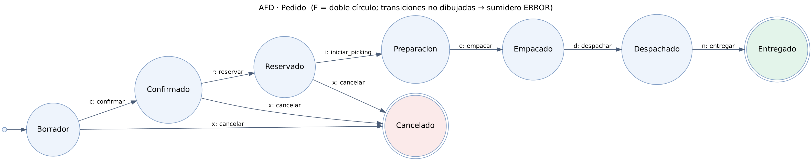

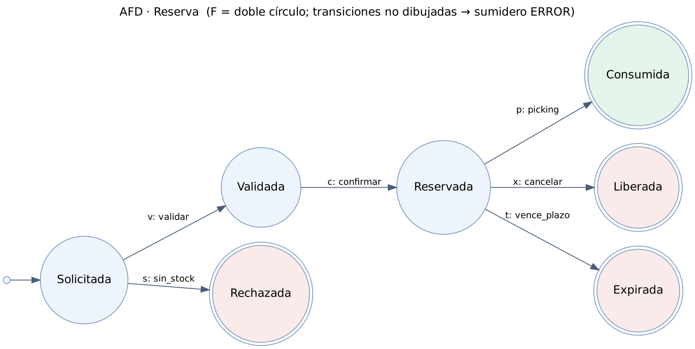

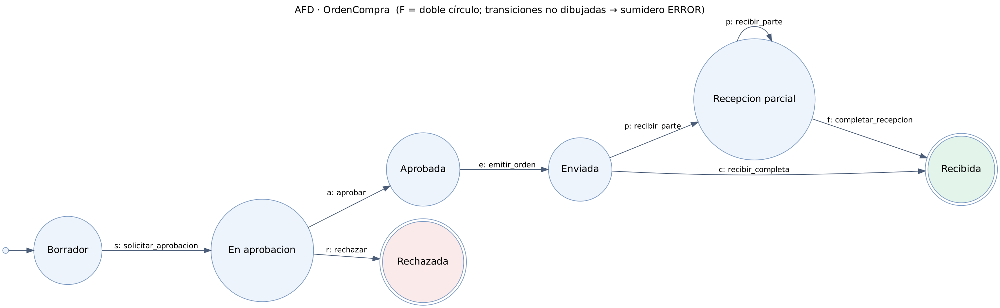


## Evidencia JFLAP (Multiple Run)

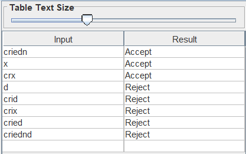

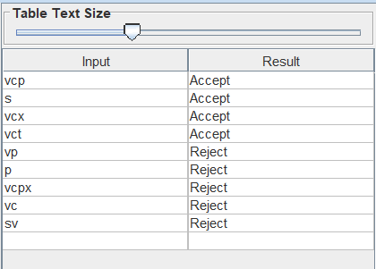

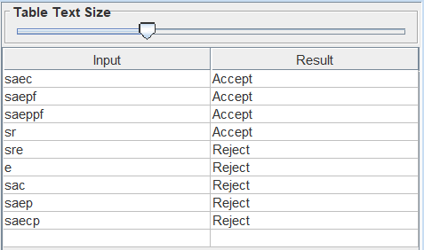

Determinismo y trazas válidas/inválidas de cada autómata: [jflap/capturas](https://github.com/JessPCL/logistpulse-deber2-tc/tree/main/jflap/capturas).


# 3. Fase B · Planta y rutas


**Responsable: Luis** · Rúbrica: 1,5 pts (grafo definido, ruta válida, algoritmo y precondiciones, Big-O)

### 1. Modelado del grafo de la planta

La planta de LOGISTPULSE se representa como un grafo ponderado no dirigido G = (V, E, w), según la Figura 5 del enunciado y los datos de `data/planta.json`. Los vértices V representan zonas transitables y las aristas E representan pasillos que el robot móvil autónomo (AMR) puede recorrer en ambos sentidos. A cada arista le corresponde un peso w igual a su longitud en metros, con w ≥ 0 e igual para ambos sentidos. El objetivo es encontrar una ruta de distancia mínima de **Recepción (R)** a **Despacho (D)**. La distancia de una ruta es la suma de los pesos de los pasillos recorridos.

| Vértice | Zona |
|---|---|
| R | Recepción (origen) |
| A | Pasillo A |
| B | Pasillo B |
| C | Pasillo C |
| P | Picking |
| E | Empaque |
| D | Despacho (destino) |

| Pasillo bidireccional | Distancia (m) |
|---|---:|
| R ↔ A | 4 |
| R ↔ B | 2 |
| A ↔ B | 1 |
| A ↔ P | 3 |
| A ↔ E | 5 |
| B ↔ P | 7 |
| B ↔ C | 3 |
| P ↔ E | 2 |
| P ↔ C | 2 |
| C ↔ E | 4 |
| E ↔ D | 3 |

El grafo base tiene **7 vértices y 11 aristas**. Cada pasillo se cuenta una vez en E y se almacena en ambas listas de adyacencia, una por cada extremo. Por tanto, el grafo base tiene 22 entradas de adyacencia.


### 2. Escenarios de operación

En el **escenario base**, el grafo es **no dirigido** y **todas las zonas están habilitadas**. El AMR parte de **Recepción (R)** y se dirige a **Despacho (D)**. Los bloqueos de Pasillo A, Picking y Empaque están definidos en `data/planta.json` y se evalúan **por separado** como escenarios de prueba para observar su efecto en la ruta.

Un bloqueo fija una zona como inaccesible durante el cálculo. Si B es el conjunto de zonas bloqueadas, el AMR opera sobre el subgrafo inducido por V menos B. Esto equivale a retirar los vértices bloqueados y todas las aristas incidentes. La implementación omite esas zonas durante la búsqueda. Un origen bloqueado genera un error de entrada. Un destino bloqueado se reporta como inalcanzable, con distancia ∞.

| Escenario | Zona bloqueada | Ruta devuelta por Dijkstra | Distancia |
|---|---|---|---:|
| Operación base | Ninguna | R → B → A → E → D | 11 m |
| Cierre del pasillo A | A | R → B → C → E → D | 12 m |
| Picking fuera de servicio | P | R → B → A → E → D | 11 m |
| Empaque fuera de servicio | E | Sin ruta. D queda aislado. | ∞ |

En el escenario base, la ruta devuelta cuesta 2 + 1 + 5 + 3 = **11 m**. La ruta destacada en la Figura 5 cuesta 2 + 1 + 3 + 2 + 3 = **11 m** y también es óptima. Si se bloquea A, la ruta por C cuesta 2 + 3 + 4 + 3 = **12 m**. Bloquear P conserva la ruta óptima que pasa directamente de A a E. Bloquear E elimina el único pasillo que conecta con D.

**Reproducción.** Desde la raíz del repositorio, ejecutar `python -m logistpulse rutas` para obtener los cuatro escenarios, o `python -m unittest tests.test_rutas -v` para verificar las rutas, los empates y las entradas inválidas.

### 3. Dijkstra para minimizar la distancia

La entrada es un grafo finito con pesos numéricos finitos y no negativos, el origen, el destino y las zonas bloqueadas. El origen y el destino deben pertenecer al grafo. El origen debe estar habilitado y cada zona bloqueada debe existir. La salida es una ruta óptima y su distancia en metros, o sin ruta y distancia infinita si el destino es inalcanzable.

El módulo `logistpulse/rutas/dijkstra.py` usa un montículo mínimo para extraer la menor distancia provisional. Cada mejora guarda un par nuevo en el montículo y actualiza `pred`. Las entradas antiguas se descartan cuando su vértice ya está finalizado. Este método se conoce como inserción perezosa. El montículo desempata por identificador y los vecinos se recorren en orden alfabético. Una ruta de costo igual conserva el predecesor registrado porque la actualización exige una mejora estricta.

```text
RUTA_MÍNIMA(grafo, origen, destino, bloqueados)
    validar los vértices, los pesos y los bloqueos
    para cada vértice v
        dist[v] ← ∞
        pred[v] ← NULO
    dist[origen] ← 0
    heap ← montículo con (0, origen)
    finalizados ← conjunto vacío

    mientras el heap no esté vacío
        (d, u) ← extraer el par mínimo
        si u está finalizado
            continuar con la siguiente extracción
        marcar u como finalizado
        para cada vecino (v, peso) de u en orden alfabético
            si v está habilitado y aún no se ha finalizado
                candidato ← d + peso
                si candidato < dist[v]
                    dist[v] ← candidato
                    pred[v] ← u
                    insertar (candidato, v) en el heap

    si dist[destino] = ∞
        devolver (SIN RUTA, ∞)
    reconstruir siguiendo pred desde destino hasta NULO
    devolver (secuencia invertida, dist[destino])
```

**Correctitud.** Dijkstra finaliza cada vértice con su distancia mínima. Si hubiera una ruta más corta hacia el vértice extraído, el primer vértice aún sin finalizar de esa ruta ya tendría en el montículo una distancia menor. Esto se debe a que su predecesor ya fue procesado y, como los pesos son no negativos, el costo de ese tramo inicial es como máximo el de la ruta completa. Esto contradice que se haya extraído la menor distancia provisional. Los predecesores permiten reconstruir la ruta obtenida.

**Terminación.** Cada vértice se finaliza como máximo una vez. En un grafo no dirigido con m aristas se revisan como máximo 2m entradas de adyacencia, una por cada sentido. Cada revisión genera como máximo una inserción, así que el montículo recibe a lo sumo 2m+1 entradas contando la inicial. Como cada iteración extrae una entrada, el bucle termina. Reconstruir la ruta recorre a lo sumo n vértices, donde n es el total de vértices del grafo.

**Complejidad.** Sean n = |V| y m = |E|. El tiempo es **O((n + m) log n)** para n ≥ 2. El montículo puede guardar O(m + 1) entradas y cada operación cuesta O(log n) en este grafo simple, donde m = O(n²). Ordenar los vértices y las listas de vecinos cuesta en total O((n + m) log n) y queda dentro de la misma cota. El espacio auxiliar es **O(n + m)** para distancias, predecesores, finalizados, orden y montículo. La reconstrucción agrega O(n). La demo enumera también las rutas empatadas mediante una función aparte. El número de rutas óptimas puede ser exponencial y su enumeración tiene su propio costo.

**Precondición de los pesos.** Dijkstra requiere que todas las aristas tengan pesos no negativos. En el caso p2, desde S se llega a A con costo 2 y a B con costo 3. Como 2 es menor que 3, Dijkstra finaliza A primero y calcula que llegar a C por S → A → C cuesta 2 + 1 = 3. Al procesar B, la arista B → A de peso −2 permite llegar a A con costo 3 − 2 = 1. Como A ya fue finalizado, Dijkstra no lo vuelve a procesar y conserva el costo 3 para C. Bellman–Ford sí encuentra la ruta óptima S → B → A → C, que cuesta 2. Este ejemplo explica por qué el código valida los pesos antes de ejecutar Dijkstra.

### 4. Traza observada de Dijkstra en la planta

La tabla reproduce el escenario base de `python -m logistpulse rutas`. Cada fila registra una finalización y las mejoras aceptadas al examinar los vecinos.

| Paso | Vértice finalizado | Distancia (m) | Mejoras aceptadas |
|---|---|---:|---|
| 1 | R | 0 | A de ∞ a 4, B de ∞ a 2. Ambos reciben a R como predecesor. |
| 2 | B | 2 | A de 4 a 3, C de ∞ a 5, P de ∞ a 9. Los tres reciben a B como predecesor. |
| 3 | A | 3 | E de ∞ a 8, P de 9 a 6. Ambos reciben a A como predecesor. |
| 4 | C | 5 | Ninguna. |
| 5 | P | 6 | Ninguna. Pasar por P hasta E da 6 + 2 = 8, igual a la distancia registrada. |
| 6 | E | 8 | D de ∞ a 11, con E como predecesor. |
| 7 | D | 11 | Ninguna. |

Para reconstruir la ruta se sigue la cadena **D ← E ← A ← B ← R** en sentido inverso al recorrido. Al invertir la lista obtenemos **R → B → A → E → D**, de **11 m**. En el paso 5 se observa por qué la Figura 5 también muestra una solución óptima. Pasar por Picking llega a Empaque con los mismos 8 m.

### 5. BFS para minimizar el número de tramos

`logistpulse/rutas/bfs.py` recibe una lista de adyacencia sin pesos. Usa una cola FIFO y registra a cada vértice cuando lo encola por primera vez. Por ello procesa las zonas por niveles de distancia en número de tramos. Al extraer el destino, los predecesores permiten reconstruir una ruta con el mínimo número de tramos.

```text
MENOS_TRAMOS(adyacencia, origen, destino, bloqueados)
    validar origen y destino, y comprobar que el origen esté habilitado
    si destino está bloqueado
        devolver SIN RUTA
    cola ← cola FIFO con origen
    pred[origen] ← NULO

    mientras la cola no esté vacía
        u ← extraer el primero
        si u = destino
            devolver la ruta reconstruida mediante pred
        para cada vecino v de u en el orden de la lista
            si v está habilitado y no tiene entrada en pred
                pred[v] ← u
                encolar v

    devolver SIN RUTA
```

**Terminación y complejidad.** Cada vértice se encola y se extrae a lo sumo una vez y las listas de vecinos son finitas. Con la lista de adyacencia ya construida y sin guardar copias de la cola para una traza, el tiempo es **O(n + m)** y el espacio auxiliar es **O(n)**. La representación de entrada ocupa O(n + m). En la demo, preparar la lista a partir del grafo ponderado incluye el ordenamiento de los vecinos para reproducir el resultado. Esa preparación es independiente de la búsqueda.

| Algoritmo | Criterio | Ruta devuelta | Tramos | Distancia |
|---|---|---|---:|---:|
| Dijkstra | Distancia total | R → B → A → E → D | 4 | 11 m |
| BFS | Número de tramos | R → A → E → D | 3 | 12 m |

Para el AMR se elige Dijkstra porque el objetivo de la planta se mide en metros y los pasillos tienen longitudes distintas.

### 6. Validación

| Tipo | Prueba o escenario | Resultado comprobado |
|---|---|---|
| Normal | `test_ruta_base_costo_11` y `test_ruta_de_la_figura_es_optima_y_empata` | La ruta devuelta suma 11 m y la de la Figura 5 empata. |
| Normal | `test_bloqueos` y `test_bfs_minimiza_tramos_no_costo` | Se reproducen los cierres de la tabla y BFS devuelve la ruta de 3 tramos y 12 m. |
| Límite | `test_origen_igual_destino` y `test_destino_bloqueado_no_tiene_ruta` | R a R devuelve la ruta [R] con costo 0. Un destino bloqueado es inalcanzable. |
| Inválida | `test_pesos_invalidos` y `test_origen_destino_y_bloqueos_invalidos` | Un peso negativo, un vértice inexistente o un origen bloqueado provocan un error. |

Las pruebas de la tabla están en `tests/test_rutas.py`. En `tests/test_complejidad.py`, `test_dijkstra_operaciones_de_heap_acotadas` verifica la cota de inserciones, extracciones y aristas examinadas. `test_bfs_es_O_V_mas_E` verifica que las extracciones y las aristas examinadas respeten las cotas lineales. `test_dijkstra_crece_casi_lineal` compara tiempos en grafos dispersos de 5 000 y 20 000 vértices. Estos resultados respaldan el análisis de crecimiento para los casos probados.

#### Preguntas de práctica para la defensa oral

1. **¿Por qué hay 11 aristas si en la lista de adyacencia hay 22 entradas?** Un pasillo bidireccional conecta dos zonas mediante una sola arista. Para poder recorrerlo desde cualquiera de sus extremos, cada zona registra a la otra como vecina.
2. **¿Por qué bloquear Empaque impide llegar a Despacho?** El tramo E ↔ D es la única conexión de Despacho con la planta. Quitar E elimina ese tramo y deja D aislado.
3. **¿Por qué el programa devuelve una ruta diferente de la Figura 5?** Desde A, el pasillo directo a E cuesta 5 m y el desvío por P cuesta 3 + 2 = 5 m. Las dos rutas completas tienen distancia mínima de 11 m.

# 4. Fase C · FEFO y reposición


**Responsable:** Luis

### 1. Selección de lotes mediante FEFO

FEFO (*First Expired, First Out*) asigna primero las unidades de los lotes elegibles que vencen antes. Un lote es elegible si corresponde al SKU solicitado, tiene unidades disponibles y su fecha de vencimiento es posterior a la fecha de referencia. Según la política del proyecto, un lote que vence el mismo día de la reserva queda excluido. Si dos lotes vencen el mismo día, se elige primero el de menor código en orden alfabético.

La función `seleccionar_fefo`, en `logistpulse/inventario/fefo.py`, recibe los lotes, el SKU, la cantidad solicitada, la fecha de referencia y la política ante falta de stock. Devuelve un plan por lote, la cantidad pendiente y el estado del pedido. El plan indica qué unidades reservar.

```text
SELECCIONAR_FEFO(lotes, sku, cantidad, fecha, política)
    validar cantidad positiva entera, fecha, política y códigos únicos
    candidatos ← lotes del sku con disponible > 0 y vencimiento > fecha
    ordenar candidatos por (vencimiento ascendente, código ascendente)
    pendiente ← cantidad
    plan ← lista vacía

    para cada lote en candidatos
        si pendiente = 0
            salir del recorrido
        tomar ← mínimo(pendiente, disponible del lote)
        agregar (código del lote, tomar) al plan
        pendiente ← pendiente − tomar

    si pendiente = 0
        devolver (plan, 0, COMPLETO)
    si política = parcial
        devolver (plan, pendiente, PARCIAL)
    si política = rechazar
        devolver (lista vacía, cantidad, RECHAZADO)
    devolver (lista vacía, cantidad, EN_ESPERA)
```

La cantidad tomada se limita tanto al stock del lote como al pendiente del pedido. El orden de selección se cumple porque solo se pasa al lote siguiente cuando todavía faltan unidades. El algoritmo termina tras filtrar y ordenar una lista finita. El recorrido se detiene al cubrir el pedido o al agotar los candidatos.

**Complejidad.** Con (L) lotes de entrada, filtrar y recorrer cuesta **O(L)**. El ordenamiento de los candidatos y el ordenamiento del registro de descartes dan un tiempo total de **O(L log L)** en el peor caso. El espacio es **O(L)** por las listas de lotes, candidatos, descartes y el plan que se genera.

#### Resultados de la ejecución

Con fecha de referencia del **20 de noviembre de 2026**, el pedido de **80 unidades de LECHE-1L** toma 30 de L-001, 25 de L-002 y 25 de L-003. L-001 y L-002 vencen el 1 de diciembre, así que el código decide el orden entre ambos. Se excluyen L-004 por vencido, L-005 por falta de stock y L-007 porque vence el día de la reserva.

En un pedido separado de **200 unidades** del mismo SKU, los cuatro lotes elegibles suman **155 unidades**. El resultado depende de la política:

| Política | Estado | Unidades asignadas | Unidades pendientes |
|---|---|---:|---:|
| Parcial | `PARCIAL` | 155 | 45 |
| Rechazar | `RECHAZADO` | 0 | 200 |
| Esperar reposición | `EN_ESPERA` | 0 | 200 |

### 2. Reposición por punto de pedido

Para cada SKU se calcula la **posición de inventario** sumando las unidades en bodega y las unidades pendientes de recibir de órdenes de compra abiertas, y restando las unidades ya reservadas. Cuando la posición es menor o igual al mínimo, se sugiere la cantidad necesaria para alcanzar el objetivo. Las cantidades de entrada son enteros no negativos y el objetivo debe ser mayor o igual al mínimo. La posición calculada puede ser negativa.

```text
SUGERIR_REPOSICIÓN(productos)
    para cada producto
        posición ← disponible + en_orden − reservado
        sugerencia ← 0
        si posición ≤ mínimo
            sugerencia ← máximo(0, objetivo − posición)
        emitir (sku, posición, sugerencia)
```

**Ejemplo del enunciado.** Con 18 unidades disponibles, 10 en órdenes abiertas, 5 reservadas, mínimo de 30 y objetivo de 50, la posición es **18 + 10 − 5 = 23**. Como 23 ≤ 30, se sugieren **50 − 23 = 27 unidades**. Una vez emitida y registrada esa orden, hay 10 + 27 = 37 unidades pendientes de recibir. Si los demás datos siguen iguales, la posición sube a **18 + 37 − 5 = 50** y la nueva sugerencia es **0**. Así se evita duplicar el pedido.

**Terminación y complejidad.** `sugerencias`, en `logistpulse/inventario/reposicion.py`, procesa una vez cada producto de un conjunto finito. Con **P productos**, el tiempo es **O(P)** porque se hacen las mismas operaciones por SKU. El generador entrega una sugerencia a la vez y usa **O(1)** de espacio auxiliar. Si se guardan todas las sugerencias, la salida ocupa **O(P)**.

### 3. Validación

Desde la raíz del repositorio, `python -m logistpulse inventario` reproduce los ejemplos. `python -m unittest tests.test_inventario -v` comprueba los siguientes casos, entre otros:

| Tipo | Caso | Resultado comprobado |
|---|---|---|
| Normal | Pedido de 80 unidades con lotes que vencen el mismo día | Plan de 30, 25 y 25 unidades, con desempate por código. |
| Normal | Pedido de 200 unidades con 155 elegibles | Se aplican las tres políticas de la tabla de resultados. |
| Normal | Orden abierta registrada después de la primera sugerencia | El recálculo sugiere 0 cuando la orden ya cubre el objetivo. |
| Límite | Pedido de exactamente 155 unidades elegibles | Estado `COMPLETO`, con pendiente 0. |
| Límite | Posición igual al mínimo | Con posición y mínimo de 30 y objetivo de 45, se sugieren 15 unidades. |
| Inválida | Cantidad solicitada 0, códigos de lote repetidos u objetivo inferior al mínimo | El programa devuelve un error de validación (`ValueError`). |

En `tests/test_complejidad.py`, `test_fefo_O_L_log_L_y_reposicion_O_P` verifica los conteos del filtro, el recorrido y el ordenamiento de candidatos en FEFO, y comprueba que la regla de reposición procesa cada SKU una sola vez.

#### Preguntas de práctica para la defensa oral

1. **¿Qué pasa si dos lotes vencen el mismo día?** Se elige primero el lote con el código que aparece antes en orden alfabético. Así el resultado es reproducible aunque cambie el orden de entrada.
2. **¿Qué pasa si se piden 200 unidades y solo hay 155 elegibles?** Con política parcial se asignan 155 y quedan 45 pendientes. Con rechazo o espera se asignan 0, con el estado correspondiente.
3. **¿Por qué se cuentan las órdenes abiertas?** Porque las unidades pendientes de recibir ya están comprometidas por el proveedor. Al incluirlas en la posición, la siguiente sugerencia cubre únicamente el faltante que todavía activa la regla.

# 5. Fase D · Clasificación de los diez correos

## Tabla resumen de los 10 correos


| Correo | Clase | Tipo de problema | Decidible | Algoritmo | Complejidad (tiempo · espacio) | Estrategia |
|--------------------|----------|-------------|----------|--------------------|------------------|-----------|
| **p1** ¿Puede llegar el envío a la zona Norte? | P | Decisión | Sí | BFS | O(V + E) · O(V) | Exacto |
| **p2** Ruta mínima entre centros de distribución | P | Optimización → se clasifica su versión de decisión | Sí | Dijkstra (heap binario) | O((V + E) log V) · O(V + E) | Exacto |
| **p3** Máximo de camiones hacia clientes | P | Optimización → se clasifica su versión de decisión | Sí | Edmonds–Karp (Ford–Fulkerson con BFS) | O(V·E²) · O(V + E) | Exacto |
| **n1** Comparar topologías equivalentes | NP | Decisión | Sí | Búsqueda exhaustiva de permutaciones (+ poda por grados) | O(n!·n²) · O(n²) entrada + O(n) extra | Exacto |
| **n2** ¿Tiene N un factor en este intervalo? | NP | Decisión | Sí | Prueba por división exhaustiva | O(B·L²) — exponencial en L si B ≈ √N · O(L) | Exacto |
| **n3** ¿Existe exponente x que produzca h? | NP | Decisión | Sí | Búsqueda exhaustiva con exponenciación modular (alternativa: baby-step giant-step) | O(B·M(log p)) lineal · O(√B·M(log p)) BSGS · O(1) lineal · O(√B) BSGS | Exacto |
| **n4** ¿La topología tiene una simetría? | NP | Decisión | Sí | Permutaciones + verificación de adyacencia | O(n!·n²) · O(n) extra | Exacto |
| **c1** ¿Hay una asignación que cumpla todas las reglas? | NP-completo | Decisión | Sí | DPLL (propagación unitaria + literal puro) | DPLL O(2ⁿ·n·m·k) peor caso (fuerza bruta O(2ⁿ·m·k)) · O(n·m·k) (una copia simplificada por nivel de recursión) | Exacto |
| **c2** ¿Existe una ruta hamiltoniana dentro del presupuesto? | NP-completo | Decisión | Sí | Enumeración de permutaciones (decisión) · Held–Karp (optimización) · vecino más cercano (heurística) | O((n−1)!·n) = O(n!) · Held–Karp O(n²·2ⁿ) · O(n) · Held–Karp O(n·2ⁿ) | Exacto (enumeración, Held–Karp) / heurístico (vecino más cercano) |
| **c3** ¿Bastan k almacenes para cubrir todas las zonas? | NP-completo | Decisión | Sí | Backtracking / ramificación acotada (exacto) · 2-aproximación por emparejamiento (heurística) | O(2^k·(V + E)) ramificación · O(V + E) aproximación · O(k·(V + E)) (lista de aristas por nivel) | Exacto (ramificación) / aproximado (factor 2) |

Evidencia de cada clase (detalle en cada ficha):

- **p1** (P): Algoritmo polinómico conocido: BFS.
- **p2** (P): Algoritmo polinómico conocido: Dijkstra (requiere pesos ≥ 0).
- **p3** (P): Algoritmo polinómico conocido: Edmonds–Karp; el corte mínimo certifica optimalidad.
- **n1** (NP): Certificado π + verificador O(n²) ⇒ ∈ NP.
- **n2** (NP): Certificado d + verificador O(L²) ⇒ ∈ NP.
- **n3** (NP): Certificado x + verificador con exponenciación rápida ⇒ ∈ NP.
- **n4** (NP): Certificado π + verificador O(n²) ⇒ ∈ NP.
- **c1** (NP-completo): Verificador O(m·k) + 3-SAT ≤p DESPACHO-SAT (identidad); Cook–Levin.
- **c2** (NP-completo): Verificador O(n) + HAM-CYCLE ≤p TSP-DEC (pesos 1/2, L = n).
- **c3** (NP-completo): Verificador O(V + E) + INDEPENDENT-SET ≤p VERTEX-COVER.

Grupo A = algoritmo polinómico conocido · B = pertenencia a NP con certificado (sin afirmar NPC) · C = NP-completo con reducción. Distribución: A = 3 (p1, p2, p3) · B = 4 (n1–n4) · C = 3 (c1–c3).

## Ficha p1 · ¿Puede llegar el envío a la zona Norte?

**Remitente:** Daniela Paredes · Planificación · **Grupo:** A · **Clasificación propuesta:** P
**Responsable:** Luis


> **Solicitud operativa:** ¿Puede un pedido llegar desde Planta Durán hasta la zona Norte usando únicamente rutas activas?

### 0. Respuesta al correo (para Daniela Paredes)
Daniela: **sí, hoy existe ruta** desde la Planta Durán hasta la zona Norte: **Durán → Quito → Norte (2 tramos)**, así que se puede coordinar el camión con el cliente. Si el cierre de vías hubiera dejado fuera de servicio el tramo Quito → Norte, la respuesta sería **no**: desde Durán solo se llegaría a Quito, Guayaquil y Sur. Adjuntamos el programa (BFS), que recibe cualquier lista de conexiones, con las dos pruebas.

### 3. Clasificación y evidencia: **P**
- **Evidencia del grupo A (algoritmo polinómico conocido):** la búsqueda en anchura (BFS) decide ALCANZABILIDAD en O(|V| + |E|), que es polinomial en el tamaño de la entrada. Por lo tanto **ALCANZABILIDAD ∈ P** (Sipser, Teorema 7.14, 3.ª ed.).
- **Relación con NP:** como P ⊆ NP, el problema también está en NP (el certificado sería el propio camino, verificable en O(|E| + |camino|) con `verificar_camino`). Para el grupo A, sin embargo, la evidencia exigida es el algoritmo polinómico, no el certificado. Que esté en P no dice nada sobre si P = NP.

### ¿Qué concluimos?
| Decidibilidad | Computabilidad | Complejidad |
|---|---|---|
| **Sí.** BFS termina al agotar la cola o al encontrar el destino. | **Sí.** Hay un procedimiento efectivo (MT determinista / RAM) que calcula la función característica de ALCANZABILIDAD para toda red finita. | **P.** O(V + E) de tiempo y O(V) de espacio con listas de adyacencia (comprobado con conteo de operaciones). |


**Ficha completa** (resumen del correo, entrada y salida, decidibilidad y computabilidad, algoritmo, Big-O, código, pruebas y salida observada): [docs/fichas/p1.md](https://github.com/JessPCL/logistpulse-deber2-tc/blob/main/docs/fichas/p1.md)

## Ficha p2 · Ruta mínima entre centros de distribución

**Remitente:** Marco Cedeño · Transporte · **Grupo:** A · **Clasificación de la versión de decisión:** P
**Responsable:** Luis

> **Solicitud operativa:** Encontrar el recorrido de menor tiempo de CD Quito a CD Guayaquil y explicar cómo reconstruirlo.

### 0. Respuesta al correo

Marco, para asignar el camión refrigerado te sugiero la ruta **Quito → Latacunga → Guayaquil**, con tiempo total **8** en las unidades de la tabla. Pasar por Ambato también da **8**. Guarda el predecesor de cada centro para reconstruir el recorrido desde el destino.

### 3. Clasificación y evidencia

**RUTA-CORTA pertenece a P.** Dijkstra calcula la distancia mínima desde s hasta t. Luego se responde Sí exactamente cuando t es alcanzable y su distancia mínima es ≤ K. El número de operaciones es polinómico en el tamaño del grafo. Las sumas y comparaciones de tiempos también son polinómicas en bits, pues un camino simple suma a lo sumo |V| − 1 pesos. Con pesos no negativos siempre basta considerar caminos simples para encontrar una distancia mínima. Por tanto, una distancia finita requiere a lo sumo O(B + log(|V| + 1)) bits.

### ¿Qué concluimos?

| Decidibilidad | Computabilidad | Complejidad |
|---|---|---|
| Sí. Dijkstra y la comparación con K siempre terminan para entradas válidas. | Se calculan la distancia mínima, una ruta óptima y la respuesta Sí o No mediante un procedimiento determinista. | La versión de decisión está en P. Dijkstra con montículo usa O((V + E) log V) operaciones y O(V + E) de espacio auxiliar, donde V y E son las cantidades de vértices y aristas. |


**Ficha completa** (resumen del correo, entrada y salida, decidibilidad y computabilidad, algoritmo, Big-O, código, pruebas y salida observada): [docs/fichas/p2.md](https://github.com/JessPCL/logistpulse-deber2-tc/blob/main/docs/fichas/p2.md)

## Ficha p3 · Máximo de camiones hacia clientes

**Remitente:** Luis Vaca · Distribución · **Grupo:** A · **Clasificación de la versión de decisión:** P
**Responsable:** Luis

### 0. Respuesta al correo

Luis, con las capacidades actuales pueden llegar **10 camiones por día** a la zona de clientes. Una asignación válida envía 4 por Planta → Quito → Clientes, 5 por Planta → Guayaquil → Clientes y 1 por Planta → Quito → Guayaquil → Clientes. Los dos tramos que llegan a Clientes quedan al máximo de su capacidad.

### 3. Clasificación y evidencia

**FLUJO-UMBRAL pertenece a P.** Edmonds–Karp calcula el flujo máximo en tiempo polinómico. Compararlo con K da la respuesta. Las operaciones sobre capacidades, flujo y umbral también tienen un costo polinómico en bits. Por ejemplo, el flujo total está acotado por la suma de las capacidades de los tramos que salen de la fuente, que requiere O(B + log(E + 1)) bits.

Para **verificar** una propuesta, se comprueban las capacidades, la conservación de flujo y si el valor alcanza K. Para demostrar que un flujo es máximo, se puede presentar un **corte** de igual capacidad. Cada flujo factible da un valor alcanzable y cada corte pone un límite a ese valor. Encontrar el flujo máximo es la tarea que resuelve el algoritmo.

### ¿Qué concluimos?

| Decidibilidad | Computabilidad | Complejidad |
|---|---|---|
| Sí. Se obtiene el máximo y se compara con K en un número finito de pasos. | El algoritmo calcula el máximo y una asignación factible de forma determinista. | La decisión está en P. Edmonds–Karp usa O(V·E²) operaciones y O(V + E) espacio de trabajo, más el espacio del registro. |


**Ficha completa** (resumen del correo, entrada y salida, decidibilidad y computabilidad, algoritmo, Big-O, código, pruebas y salida observada): [docs/fichas/p3.md](https://github.com/JessPCL/logistpulse-deber2-tc/blob/main/docs/fichas/p3.md)

## Ficha n1 · Comparar topologías equivalentes

**Remitente:** Elena Ruiz · Arquitectura · **Grupo:** B · **Clasificación propuesta:** NP
**Responsable de redacción:** Camila

> **Solicitud operativa:** ¿Existe una biyección entre nodos que preserve todas las conexiones ($A \cong B$)?

### 0. Respuesta al correo (para Elena Ruiz)
Sí, las dos topologías comparadas en el caso de prueba tienen exactamente la misma estructura de conexiones. La correspondencia válida entre nodos es el certificado $\pi = (1, 0, 2)$ (el nodo $i$ de la red $A$ corresponde al nodo $\pi(i)$ de la red $B$), verificado de forma automática preservando todas las adyacencias.

### 3. Clasificación y evidencia
- **Clase:** NP
- **Evidencia:** Certificado $\pi$ de tamaño polinómico + verificador determinista en tiempo $O(n^2)$ $\Rightarrow L_{\text{ISO}} \in \text{NP}$.
- **Certificado / verificador:** El certificado es una permutación $\pi$ de $\{0, \dots, n-1\}$, que ocupa $O(n \log n)$ bits (polinómico respecto al tamaño de entrada $\Theta(n^2)$). El verificador comprueba primero que $\pi$ sea una biyección válida en $O(n)$ y luego verifica que $A[i][j] = B[\pi(i)][\pi(j)]$ para los $n^2$ pares $(i, j)$, tomando tiempo total $O(n^2)$, que es polinómico en el tamaño de la entrada.
- **Reducción:** —

**Justificación formal:** Exhibir un certificado de tamaño polinómico y un verificador determinista polinómico demuestra rigurosamente que el problema de isomorfismo de grafos pertenece a **NP**. Sin embargo, esta evidencia **no demuestra** que el problema esté fuera de **P** (recordando que $\text{P} \subseteq \text{NP}$ y que "NP" no significa "no polinómico") ni demuestra que sea **NP-completo**, ya que para afirmar NP-completitud se requeriría una reducción polinómica desde un problema NP-completo conocido hacia este problema, la cual no se conoce.

### ¿Qué concluimos?
| Decidibilidad | Computabilidad | Complejidad |
|---|---|---|
| Decidible: siempre termina y responde Sí/No porque el espacio de $n!$ permutaciones es finito. | Computable en MT determinista / modelo RAM: decide $L_{\text{ISO}}$ y construye el testigo $\pi$ cuando existe. | NP · Búsqueda $O(n! \cdot n^2)$, verificador $O(n^2)$ |


**Ficha completa** (resumen del correo, entrada y salida, decidibilidad y computabilidad, algoritmo, Big-O, código, pruebas y salida observada): [docs/fichas/n1.md](https://github.com/JessPCL/logistpulse-deber2-tc/blob/main/docs/fichas/n1.md)

## Ficha n2 · ¿Tiene N un factor en este intervalo?

**Remitente:** Andrés Molina · Seguridad · **Grupo:** B · **Clasificación propuesta:** NP
**Responsable de redacción:** Camila

> **Solicitud operativa:** ¿Existe $d$ con $2 \le d \le B$ que divida a $N$?

### 0. Respuesta al correo (para Andrés Molina)
Sí, el número $N = 91$ tiene un divisor dentro del intervalo permitido $[2, 10]$: el factor es $d = 7$, ya que cumple $2 \le 7 \le 10$ y $91 \bmod 7 = 0$. Si el límite se reduce a $B = 6$, la respuesta pasa a ser No porque el primer divisor no trivial queda fuera del rango.

### 3. Clasificación y evidencia
- **Clase:** NP
- **Evidencia:** Certificado $d$ de tamaño polinómico + verificador determinista en tiempo $O(L^2)$ $\Rightarrow L_{\text{FACT}} \in \text{NP}$.
- **Certificado / verificador:** El certificado es un entero candidato $d$ en binario, que ocupa a lo sumo $\lfloor \log_2 B \rfloor + 1 \le L$ bits (tamaño polinómico respecto a la entrada). El verificador comprueba dos condiciones: que $2 \le d \le B$ (en $O(L)$) y que $N \bmod d = 0$ mediante división entera escolar en $O(L^2)$. El tiempo total de verificación es $O(L^2)$, polinómico en el tamaño de la entrada $L$.
- **Reducción:** —

**Justificación formal:** Contar con un certificado de tamaño polinómico y un verificador determinista de tiempo polinómico en $L$ prueba que $L_{\text{FACT}} \in \text{NP}$. Sin embargo, esto **no prueba** que el problema esté fuera de **P** (pues $\text{P} \subseteq \text{NP}$ y "NP" no significa "no polinómico") ni prueba que sea **NP-completo**: no existe ninguna reducción polinómica conocida desde un problema NP-completo hacia este problema.

### ¿Qué concluimos?
| Decidibilidad | Computabilidad | Complejidad |
|---|---|---|
| Decidible: siempre termina y responde Sí/No tras probar a lo sumo $B - 1$ divisores candidatos. | Computable en MT determinista / modelo RAM con enteros en binario: decide $L_{\text{FACT}}$ y entrega el divisor $d$ si existe. | NP · Búsqueda $O(B \cdot L^2)$ (exponencial en $L$ si $B \approx \sqrt{N}$), verificador $O(L^2)$ |


**Ficha completa** (resumen del correo, entrada y salida, decidibilidad y computabilidad, algoritmo, Big-O, código, pruebas y salida observada): [docs/fichas/n2.md](https://github.com/JessPCL/logistpulse-deber2-tc/blob/main/docs/fichas/n2.md)

## Ficha n3 · ¿Existe exponente x que produzca h?

**Remitente:** Paola León · Seguridad TI · **Grupo:** B · **Clasificación propuesta:** NP
**Responsable de redacción:** Camila

> **Solicitud operativa:** ¿Existe $x$ con $0 \le x \le B$ y $g^x \equiv h \pmod p$?

### 0. Respuesta al correo (para Paola León)
Sí, existe un exponente dentro del límite permitido para el caso de prueba: $x = 6$, ya que cumple $0 \le 6 \le 10$ y $5^6 \equiv 8 \pmod{23}$. Si el límite se reduce a $B = 5$, la respuesta es No, porque el único exponente válido menor o igual a $21$ es $6$ y queda fuera del rango.

### 3. Clasificación y evidencia
- **Clase:** NP
- **Evidencia:** Certificado $x$ de tamaño polinómico + verificador determinista mediante exponenciación rápida modular en tiempo $O(\log B \cdot M(\log p))$ $\Rightarrow L_{\text{DLOG}} \in \text{NP}$.
- **Certificado / verificador:** El certificado es el exponente candidato $x$ en binario, que ocupa a lo sumo $\lfloor \log_2 B \rfloor + 1$ bits (tamaño polinómico respecto a la entrada). El verificador comprueba $0 \le x \le B$ en $O(\log B)$ y evalúa $g^x \bmod p = h$ usando exponenciación por cuadrado y multiplicación (`pow(g, x, p) == h`), lo cual realiza $O(\log x) \le O(\log B)$ multiplicaciones modulares de enteros de $O(\log p)$ bits, tomando tiempo total $O(\log B \cdot M(\log p))$, que es polinómico en el tamaño de la entrada.
- **Reducción:** —

**Justificación formal:** Exhibir un certificado de tamaño polinómico y un verificador determinista de tiempo polinómico demuestra que $L_{\text{DLOG}} \in \text{NP}$. Sin embargo, esta evidencia **no prueba** que el problema esté fuera de **P** (dado que $\text{P} \subseteq \text{NP}$ y "NP" no significa "no polinómico") ni demuestra que sea **NP-completo**, ya que no existe ninguna reducción polinómica conocida desde un problema NP-completo hacia el logaritmo discreto.

### ¿Qué concluimos?
| Decidibilidad | Computabilidad | Complejidad |
|---|---|---|
| Decidible: siempre termina y responde Sí/No porque el intervalo $[0, B]$ tiene a lo sumo $B + 1$ candidatos finitos. | Computable en MT determinista / modelo RAM con enteros en binario: decide $L_{\text{DLOG}}$ y entrega el exponente $x$ si existe. | NP · $O(B \cdot M(\log p))$ lineal · $O(\sqrt{B} \cdot M(\log p))$ BSGS · verificador $O(\log B \cdot M(\log p))$ |


**Ficha completa** (resumen del correo, entrada y salida, decidibilidad y computabilidad, algoritmo, Big-O, código, pruebas y salida observada): [docs/fichas/n3.md](https://github.com/JessPCL/logistpulse-deber2-tc/blob/main/docs/fichas/n3.md)

## Ficha n4 · ¿La topología tiene una simetría?

**Remitente:** Santiago Jaramillo · Analítica · **Grupo:** B · **Clasificación propuesta:** NP
**Responsable de redacción:** Camila

> **Solicitud operativa:** ¿Existe una permutación $\pi \neq \text{identidad}$ que preserve las adyacencias?

### 0. Respuesta al correo (para Santiago Jaramillo)
Sí, la topología evaluada en el caso de prueba presenta una simetría estructural real: la reasignación $\pi = (0, 2, 1)$ es distinta de la identidad y conserva intactas todas las adyacencias del grafo. En contraste, sobre un grafo asimétrico de 6 vértices la respuesta es No tras agotar todas las permutaciones posibles.

### 3. Clasificación y evidencia
- **Clase:** NP
- **Evidencia:** Certificado $\pi$ de tamaño polinómico + verificador determinista en tiempo $O(n^2)$ $\Rightarrow L_{\text{AUT}} \in \text{NP}$.
- **Certificado / verificador:** El certificado es una permutación $\pi$ de $\{0, \dots, n-1\}$, que ocupa $O(n \log n)$ bits (tamaño polinómico respecto a la entrada de $\Theta(n^2)$ bits). El verificador comprueba en $O(n)$ que $\pi$ es una biyección y que $\pi \neq \text{id}$ (existe al menos un $i$ con $\pi(i) \neq i$), y luego comprueba que $G[i][j] = G[\pi(i)][\pi(j)]$ para los $n^2$ pares $(i, j)$ en tiempo $O(n^2)$, lo cual es polinómico en el tamaño de la entrada.
- **Reducción:** —

**Justificación formal:** Exhibir un certificado de tamaño polinómico y un verificador determinista polinómico demuestra rigurosamente que $L_{\text{AUT}} \in \text{NP}$. Sin embargo, esta evidencia **no demuestra** que el problema esté fuera de **P** (pues $\text{P} \subseteq \text{NP}$ y "NP" no significa "no polinómico") ni prueba que sea **NP-completo**, ya que no existe ninguna reducción polinómica conocida desde un problema NP-completo hacia el problema de automorfismo de grafos.

### ¿Qué concluimos?
| Decidibilidad | Computabilidad | Complejidad |
|---|---|---|
| Decidible: siempre termina y responde Sí/No tras inspeccionar a lo sumo las $n!$ permutaciones posibles. | Computable en MT determinista / modelo RAM: decide $L_{\text{AUT}}$ y construye el testigo $\pi \neq \text{id}$ cuando existe. | NP · Búsqueda $O(n! \cdot n^2)$, verificador $O(n^2)$ |


**Ficha completa** (resumen del correo, entrada y salida, decidibilidad y computabilidad, algoritmo, Big-O, código, pruebas y salida observada): [docs/fichas/n4.md](https://github.com/JessPCL/logistpulse-deber2-tc/blob/main/docs/fichas/n4.md)

## Ficha c1 · ¿Hay una asignación que cumpla todas las reglas?

**Remitente:** Mónica Ruiz · Planificación (para Planificación de Turnos) · **Grupo:** C · **Clasificación propuesta:** NP-completo
**Responsable de redacción:** Jessica

> **Solicitud operativa:** ¿Existe una asignación de vehículos a franjas de carga (valores verdadero/falso de las variables) que cumpla a la vez todas las reglas de compatibilidad y los compromisos?

### 0. Respuesta al correo (para Mónica Ruiz)
Mónica: **sí, existe un horario candidato que cumple todas las reglas**, así que **no hace falta renegociar la ventana de despacho**. El horario es x1 = verdadero, x2 = falso, x3 = verdadero. La regla (x1 ∨ ¬x2) se cumple porque x1 es verdadero (y también porque x2 es falso), y la regla (x2 ∨ x3) se cumple porque x3 es verdadero. La comprobación independiente adjunta revisa cláusula por cláusula, sin depender de cómo se encontró el horario. Hay otros horarios válidos, por ejemplo x1 = falso, x2 = falso, x3 = verdadero. Sobre el número de posibilidades: con n decisiones hay 2ⁿ horarios posibles, así que cada decisión extra duplica la búsqueda (con 3 son 8; con 60 la búsqueda exhaustiva tardaría miles de años, sección 3).

### 3. Clasificación y evidencia: **NP-completo**
Para el grupo C hay que probar dos cosas: que DESPACHO-SAT **pertenece a NP** y que es **NP-difícil**, mediante una reducción polinómica desde un problema que ya se sabe NP-completo.

**(a) DESPACHO-SAT ∈ NP: certificado + verificador polinómico.**
- *Certificado:* la asignación, es decir, n bits (uno por variable). Su tamaño es polinomial en la entrada.
- *Verificador* (`verificar` en `c1_sat.py`): recorre las m cláusulas; en cada una revisa sus literales hasta encontrar uno verdadero bajo la asignación. Si alguna cláusula no tiene ninguno, rechaza; si todas lo tienen, acepta. Hace a lo sumo m·k consultas, es decir, **O(m·k)**, polinomial en el tamaño de la entrada. Es independiente del buscador: no le importa cómo se encontró la asignación. `test_verificadores_polinomicos` lo respalda contando ≤ 3m literales revisados con m = 10, 100 y 1000. Para responder al correo, que pide validar **cada cláusula**, `verificar_detalle` hace la misma revisión pero devuelve, regla por regla, qué literal la cumple (o que no se cumple); en la salida observada se ve como "Regla 1 (x1 ∨ ¬x2): se cumple porque x1 es verdadero".

**(b) DESPACHO-SAT es NP-difícil: 3SAT ≤p DESPACHO-SAT.**
3SAT = { ⟨φ⟩ : φ es una fórmula 3-CNF satisfacible } es NP-completo: el teorema de Cook–Levin prueba que SAT es NP-completo y la misma construcción da fórmulas en 3-CNF (Sipser, sección 7.4; Cook, 1971; Karp, 1972). La reducción va del problema **conocido** (3SAT) al **nuestro**.

- *Construcción:* f(⟨φ⟩) = ⟨φ⟩, es decir, la **identidad**. Toda fórmula 3-CNF ya es una lista válida de reglas de despacho (cláusulas de hasta 3 literales), así que no hay que transformar nada.
- *Tiempo de la transformación:* copiar la fórmula, O(m·k), que es polinomial.
- *Correctitud (⇔):* φ ∈ 3SAT ⇔ φ es satisfacible ⇔ φ ∈ DESPACHO-SAT. Es la misma fórmula con la misma respuesta en los dos sentidos.
- *Por qué basta una reducción tan simple:* 3SAT es un **caso particular** de nuestro problema. Si existiera un algoritmo polinómico para DESPACHO-SAT, al darle una fórmula 3-CNF resolvería 3SAT en tiempo polinómico, y con eso todo NP. Por eso DESPACHO-SAT es al menos tan difícil como 3SAT.
- *Comprobación ejecutable:* con las dos fórmulas 3-CNF extra del expediente, DPLL encuentra una asignación verificada para la satisfacible (5 variables, 5 cláusulas) y responde **No** para la que tiene las 8 combinaciones de signos de x1, x2, x3, igual que la fuerza bruta. `test_solvers_coinciden_aleatorio` compara DPLL con la fuerza bruta en 400 fórmulas 3-CNF aleatorias, y 2-SAT con la fuerza bruta en 400 fórmulas 2-CNF: siempre dan la misma respuesta.

Con (a) y (b), **DESPACHO-SAT es NP-completo**. Esto **no** demuestra que no exista un algoritmo polinómico: dice que, si existiera uno, entonces P = NP, algo que nadie ha probado ni refutado. Recordar que P ⊆ NP, que NP-completo ⊆ NP y que "NP" no significa "no polinómico".

**Consecuencia práctica para el tamaño de la instancia.** Con fuerza bruta, cada variable de decisión extra **duplica** el trabajo. Tiempos **medidos** (`docs/generado/crecimiento.md`; dependen de la máquina): con 18 variables y respuesta No, la fuerza bruta revisa 262 144 asignaciones en unos 0,5 s; extrapolando ese costo, **40 variables → unos 25 días** y **60 variables → unos 70 000 años**. DPLL poda mucho más: en fórmulas 3-CNF aleatorias de la zona difícil (m ≈ 4,26·n), la mediana fue de 17 nodos con 20 variables, 600 con 60 y unos 5 000 con 80. Aun así, sus nodos crecen de forma exponencial: un plan de despacho con cientos de variables no tiene garantía de respuesta en tiempo útil.

### ¿Qué concluimos?
| Decidibilidad | Computabilidad | Complejidad |
|---|---|---|
| **Sí.** Hay 2ⁿ asignaciones finitas: la fuerza bruta y DPLL siempre terminan y responden Sí (con testigo) o No. | **Sí.** Hay un procedimiento efectivo (MT determinista / RAM) que calcula la función característica de DESPACHO-SAT y, si la respuesta es Sí, devuelve la asignación. | **NP-completo** (∈ NP con verificador O(m·k); NP-difícil por 3SAT ≤p DESPACHO-SAT). DPLL: O(2ⁿ·n·m·k) en el peor caso. La instancia 2-CNF del expediente: O(n + m) con 2-SAT. |


**Ficha completa** (resumen del correo, entrada y salida, decidibilidad y computabilidad, algoritmo, Big-O, código, pruebas y salida observada): [docs/fichas/c1.md](https://github.com/JessPCL/logistpulse-deber2-tc/blob/main/docs/fichas/c1.md)

## Ficha c2 · ¿Existe una ruta hamiltoniana dentro del presupuesto?

**Remitente:** Jorge Tapia · Ruteo · **Grupo:** C · **Clasificación propuesta:** NP-completo
**Responsable de redacción:** Jessica

> **Solicitud operativa:** ¿Existe un recorrido que visite cada centro exactamente una vez, regrese al punto de salida y cueste como máximo L kilómetros?

### 0. Respuesta al correo (para Jorge Tapia)
Jorge: **sí, existe un recorrido dentro del presupuesto de L = 20 km**: Planta → Quito → Guayaquil → Planta, con **15 km**. El programa adjunto lo verifica: cada centro se visita una vez, el recorrido vuelve a la Planta y el costo es ≤ 20. Con tres centros es también el recorrido más corto, porque solo existe uno (recorrido en uno u otro sentido); si la gerencia bajara el presupuesto a 14 km, la respuesta sería **no**. Para manifiestos con muchos más centros, la búsqueda exacta crece muy rápido (sección 6), así que habría que usar un método exacto más eficiente (Held–Karp) o una heurística. La heurística entrega recorridos válidos, pero no garantiza el más corto.

### 3. Clasificación y evidencia: **NP-completo**
Para el grupo C hay que probar dos cosas: que TSP-DEC **pertenece a NP** y que es **NP-difícil**, mediante una reducción polinómica desde un problema que ya se sabe NP-completo.

**(a) TSP-DEC ∈ NP: certificado + verificador polinómico.**
- *Certificado:* el orden de visita (v₁, …, vₙ, v₁), es decir, n + 1 índices de O(log n) bits cada uno, de tamaño polinomial.
- *Verificador* (`verificar` en `c2_tsp_decision.py`): (1) comprueba que el recorrido tenga n + 1 posiciones y empiece y termine en el mismo centro; (2) recorre los n primeros marcando "visto" en un arreglo, para confirmar que cada centro aparece **exactamente una vez**; (3) suma las n distancias; (4) compara la suma con L. Hace O(n) operaciones aritméticas sobre números de O(b + log n) bits, que es polinomial en el tamaño de la entrada. `test_verificadores_polinomicos` lo respalda contando ≤ 2n pasos con n = 10, 100 y 1000.

**(b) TSP-DEC es NP-difícil: HAM-CYCLE ≤p TSP-DEC** (Karp, 1972; CLRS, sección 34.5).
HAM-CYCLE = { ⟨G⟩ : G es un grafo no dirigido con un ciclo que pasa por cada vértice exactamente una vez } es NP-completo. La reducción va del problema **conocido** al **nuestro**: si existiera un algoritmo polinómico para TSP-DEC, también lo habría para HAM-CYCLE.

- *Construcción* `f(⟨G⟩) = ⟨D, L⟩` (`reducir_ham_a_tsp`): con n = |V|, se toma un centro por vértice, se define D[u][v] = **1** si {u, v} ∈ E y D[u][v] = **2** si no (con D[u][u] = 0), y se fija **L = n**.
- *Tiempo de la transformación:* llenar una matriz n×n cuesta O(n²), que es polinomial en el tamaño de ⟨G⟩.
- *Correctitud (⇔):*
  - (⇒) Si G tiene un ciclo hamiltoniano, sus n aristas están en E y cada una cuesta 1. Ese mismo orden es un recorrido de costo n ≤ L, así que ⟨D, L⟩ ∈ TSP-DEC.
  - (⇐) Si existe un recorrido de costo ≤ n, como tiene exactamente n tramos y cada uno cuesta al menos 1, todos cuestan exactamente 1. Es decir, todos sus tramos son aristas de G, y el recorrido es un ciclo hamiltoniano de G.
  - (Para n < 3 no existe ciclo hamiltoniano simple, y la reducción envía esos casos a una instancia fija con respuesta No; lo prueba `test_reduccion_casos_pequenos_dan_no`.)
- *Comprobación ejecutable:* `test_reduccion_ham_a_tsp` construye 80 grafos aleatorios de 3 a 6 vértices y confirma que "G tiene ciclo hamiltoniano" coincide **siempre** con "la instancia reducida tiene respuesta Sí". En la salida observada: C₄ (que tiene ciclo) da **Sí** y la estrella K₁,₃ (que no lo tiene) da **No**.

Con (a) y (b), **TSP-DEC es NP-completo**. Esto **no** demuestra que no exista un algoritmo polinómico: dice que, si existiera uno, entonces P = NP, algo que nadie ha probado ni refutado. Recordar que P ⊆ NP, que NP-completo ⊆ NP y que "NP" no significa "no polinómico".

**Consecuencia práctica para el tamaño de la instancia.** Con la enumeración exacta, cada centro extra multiplica el trabajo por unos (n − 1). Tiempos **medidos** (`docs/generado/crecimiento.md`; dependen de la máquina): 10 centros → 362 880 recorridos en 0,46 s; extrapolando ese costo por recorrido, 15 centros → unas 30 horas, **20 centros → unos 4 800 años** y 25 centros → unos 2,5·10¹⁰ años. Held–Karp resolvió 14 centros en 0,13 s, pero su memoria O(n·2ⁿ) también explota: con 30 centros serían unos 3·10¹⁰ valores en la tabla. Para un manifiesto real con decenas de centros, la respuesta exacta no es viable en tiempo útil y se usan heurísticas, aceptando que no garantizan el óptimo.

### ¿Qué concluimos?
| Decidibilidad | Computabilidad | Complejidad |
|---|---|---|
| **Sí.** Hay (n − 1)! recorridos finitos con inicio fijo: la enumeración siempre termina y responde Sí (con testigo) o No. | **Sí.** Hay un procedimiento efectivo (MT determinista / RAM) que calcula la función característica de TSP-DEC y, si la respuesta es Sí, devuelve el recorrido. | **NP-completo** (∈ NP con verificador O(n); NP-difícil por HAM-CYCLE ≤p TSP-DEC). Exacto: O(n!) por enumeración, O(n²·2ⁿ) con Held–Karp. Heurística: O(n²), sin garantía de óptimo. |


**Ficha completa** (resumen del correo, entrada y salida, decidibilidad y computabilidad, algoritmo, Big-O, código, pruebas y salida observada): [docs/fichas/c2.md](https://github.com/JessPCL/logistpulse-deber2-tc/blob/main/docs/fichas/c2.md)

## Ficha c3 · ¿Bastan k almacenes para cubrir todas las zonas?

**Remitente:** Carla Núñez · Red logística (para Continuidad Operativa) · **Grupo:** C · **Clasificación propuesta:** NP-completo
**Responsable de redacción:** Jessica

> **Solicitud operativa:** ¿Existe una selección de no más de k zonas donde desplegar equipos de inspección, de modo que cada corredor tenga un equipo en al menos uno de sus extremos?

### 0. Respuesta al correo (para Carla Núñez)
Carla: **sí, basta con k = 1 equipo de inspección, desplegado en la zona B**. B es extremo de los dos corredores del mapa (A–B y B–C), así que los dos movimientos quedan cubiertos y se puede confirmar el despliegue nocturno. La selección {B} es el certificado; el verificador adjunto, separado de la búsqueda, comprueba que tiene a lo sumo k zonas y que todo corredor tiene un equipo en un extremo. Un equipo en A no alcanza, porque B–C queda sin cubrir, y sin equipos (k = 0) tampoco. Si el mapa crece, la búsqueda exacta crece de forma exponencial con k (sección 3).

### 3. Clasificación y evidencia: **NP-completo**
Para el grupo C hay que probar dos cosas: que VERTEX-COVER **pertenece a NP** y que es **NP-difícil**, mediante una reducción polinómica desde un problema que ya se sabe NP-completo.

**(a) VERTEX-COVER ∈ NP: certificado + verificador polinómico.**
- *Certificado:* el conjunto S, a lo sumo k nombres de zonas. Su tamaño es polinomial en la entrada.
- *Verificador* (`verificar` en `c3_vertex_cover.py`), independiente del buscador, como pide el correo: (1) valida el grafo y arma la lista de aristas en una pasada; (2) comprueba que S ⊆ V y que |S| ≤ k; (3) recorre las aristas y rechaza si encuentra una con ningún extremo en S. Tiempo **O(V + E)**, polinomial. `test_verificadores_polinomicos` lo respalda contando ≤ 3n + 1 pasos en estrellas de n = 10, 50 y 200 hojas.

**(b) VERTEX-COVER es NP-difícil: INDEPENDENT-SET ≤p VERTEX-COVER** (Karp, 1972).
INDEPENDENT-SET = { ⟨G, j⟩ : G tiene un conjunto independiente de tamaño ≥ j } es NP-completo (un conjunto es *independiente* si no tiene dos vértices adyacentes; es el problema CLIQUE sobre el grafo complemento). La reducción va del problema **conocido** al **nuestro**. Sipser (sección 7.5) prueba lo mismo con otra reducción, desde 3SAT; usamos la de INDEPENDENT-SET porque es más corta.

- *Idea clave:* **S es una cobertura de vértices ⇔ V ∖ S es un conjunto independiente.** S cubre todas las aristas ⇔ ninguna arista tiene sus dos extremos fuera de S ⇔ no hay dos vértices adyacentes en V ∖ S.
- *Construcción* `f(⟨G, j⟩) = ⟨G, |V| − j⟩` (`reducir_is_a_vc`): el mismo grafo, con presupuesto k = |V| − j. Si j > |V| no puede haber un conjunto independiente tan grande, y la reducción devuelve una instancia fija con respuesta No.
- *Tiempo de la transformación:* copiar el grafo y contar sus vértices, O(V + E), polinomial.
- *Correctitud (⇔):*
  - (⇒) Si G tiene un conjunto independiente I con |I| ≥ j, entonces S = V ∖ I es una cobertura con |S| = |V| − |I| ≤ |V| − j. Respuesta Sí en VERTEX-COVER.
  - (⇐) Si G tiene una cobertura S con |S| ≤ |V| − j, entonces I = V ∖ S es independiente con |I| ≥ j. Respuesta Sí en INDEPENDENT-SET.
- *Comprobación ejecutable:* `test_reduccion_is_a_vc` construye 80 grafos aleatorios de 1 a 7 vértices y, para cada j de 0 a |V|, confirma que "hay conjunto independiente de tamaño j" coincide **siempre** con "la instancia reducida tiene respuesta Sí". `test_reduccion_k_mayor_que_V_da_no` cubre el caso j > |V|. En la salida observada: ¿hay un independiente de tamaño 2 en A–B–C? Sí ({A, C}), y por lo tanto hay cobertura de tamaño 3 − 2 = 1 ({B}).

Con (a) y (b), **VERTEX-COVER es NP-completo**. Esto **no** demuestra que no exista un algoritmo polinómico: dice que, si existiera uno, entonces P = NP, algo que nadie ha probado ni refutado. Recordar que P ⊆ NP, que NP-completo ⊆ NP y que "NP" no significa "no polinómico".

**Consecuencia práctica para el tamaño de la instancia.** La búsqueda exacta por ramificación es exponencial en **k**: cada equipo extra duplica el árbol. Tiempos **medidos** (`docs/generado/crecimiento.md`; dependen de la máquina), en el peor caso (respuesta No, árbol completo de 2ᵏ⁺¹ − 1 nodos): k = 16 → 131 071 nodos en unos 0,1 s; extrapolando ese costo, **k = 40 → unos 19 días** y **k = 60 → unos 55 000 años**. Si en vez de ramificar se prueban todos los subconjuntos de zonas, el costo es 2^V: con 60 zonas ya son unos 10¹⁸ subconjuntos. En cambio, la 2-aproximación cubrió una red de 100 000 zonas en unos 0,2 s, pero puede usar hasta el doble de equipos que el óptimo.

### ¿Qué concluimos?
| Decidibilidad | Computabilidad | Complejidad |
|---|---|---|
| **Sí.** La ramificación tiene profundidad ≤ k y ≤ 2ᵏ⁺¹ − 1 nodos (o hay 2^V subconjuntos finitos): siempre termina y responde Sí (con testigo) o No. | **Sí.** Hay un procedimiento efectivo (MT determinista / RAM) que calcula la función característica de VERTEX-COVER y, si la respuesta es Sí, devuelve la selección de zonas con equipo. | **NP-completo** (∈ NP con verificador O(V + E); NP-difícil por INDEPENDENT-SET ≤p VERTEX-COVER). Exacto: O(2ᵏ·(V + E)) por ramificación. Aproximado: O(V + E) con \|S\| ≤ 2·ÓPTIMO. |


**Ficha completa** (resumen del correo, entrada y salida, decidibilidad y computabilidad, algoritmo, Big-O, código, pruebas y salida observada): [docs/fichas/c3.md](https://github.com/JessPCL/logistpulse-deber2-tc/blob/main/docs/fichas/c3.md)

# 6. Fase E · Implementación y validación


Rúbrica: "Implementación y pruebas (1,5): algoritmo ejecutable o verificador; casos normales, límite e inválidos; resultados reproducibles". El enunciado agrega: "No se evaluará solo que funcione: **debe coincidir con el problema formalizado y con la complejidad argumentada**". Esta sección muestra cómo cumplimos ambas cosas.

### 1. Qué se implementó (más de lo mínimo exigido)
| Exigido | Implementado |
|---|---|
| ≥ 1 búsqueda de rutas **o** regla FEFO/reposición | Dijkstra (con bloqueos, predecesores y detección de empates), BFS, FEFO (3 políticas) y reposición |
| ≥ 1 verificador de certificado (caso NP o NPC) | 7 verificadores: n1, n2, n3, n4, c1, c2 y c3 (además de los de p1 y p3) |
| Opcional: exacto vs heurística en un NPC | c2: enumeración y Held–Karp vs vecino más cercano · c3: ramificación vs 2-aproximación |
| — | Reducciones **ejecutables y probadas**: HAM-CYCLE ≤p TSP-DEC e IS ≤p VC |
| — | Los 3 autómatas como AFD en Python, idénticos a los `.jff` de JFLAP (probado) |

### 2. Separación lectura / procesamiento / presentación
```
data/*.json ──► io_datos.py (LECTURA: valida y convierte) ──► automatas/ rutas/ inventario/ casos/ (PROCESAMIENTO: algoritmos puros)
                                                                         │
                                         presentacion.py / presentacion_casos.py (PRESENTACIÓN: texto y tablas) ◄┘
```
- Los módulos de procesamiento **no leen archivos ni imprimen**. `tests/test_registro.py::TestCapas` lo comprueba automáticamente analizando el código.
- Los datos de los 10 expedientes están en `data/casos_simulador.json`, no incrustados en el código (también se prueba).

### 3. Validación de entradas (ejemplos)
| Dato inválido | Reacción |
|---|---|
| Peso negativo, NaN, infinito o no numérico en la planta | `ValueError`: Dijkstra exige pesos ≥ 0 |
| Origen bloqueado, nodo inexistente, zona bloqueada desconocida | `ValueError` |
| Símbolo ∉ Σ en un autómata | `ValueError` (entrada inválida, distinta de un rechazo) |
| Cantidad ≤ 0, política desconocida, lotes con código repetido, fecha mal escrita | `ValueError` |
| SKU repetido, objetivo < mínimo, campos negativos | `ValueError` (los SKU repetidos se detectan al leer) |
| Matriz no cuadrada, no simétrica o con lazos; p no primo; cadena no binaria | `ValueError` |
| Aristas antiparalelas en la red de flujo | `ValueError` con la indicación de agregar un nodo intermedio (CLRS 26.1) |

### 4. Pruebas
- **Funcionales** (normales, límite e inválidas): `tests/test_automatas.py`, `test_jflap.py`, `test_rutas.py`, `test_inventario.py`, `test_casos_p.py`, `test_casos_np.py`, `test_casos_npc.py`, `test_registro.py`. El inventario completo, generado al ejecutar, está en `docs/generado/inventario_pruebas.md`.
- **Comparación contra fuerza bruta** en cientos de instancias aleatorias con semilla fija: Dijkstra vs todos los caminos simples, Held–Karp vs todas las permutaciones, DPLL y 2-SAT vs 2ⁿ asignaciones, ramificación vs subconjuntos, BSGS vs búsqueda lineal, y las dos reducciones vs una prueba directa.
- **Complejidad** (`tests/test_complejidad.py`), en dos niveles:
  1. *Conteo de operaciones* (determinista): cada algoritmo cuenta su operación dominante y se compara con la cota. Por ejemplo: Dijkstra hace ≤ E⃗+1 inserciones en el heap; Edmonds–Karp hace ≤ V·E aumentos y su número **no cambia** al multiplicar todas las capacidades por 10⁶; la enumeración TSP hace exactamente (n−1)! tours; la búsqueda de factores **se duplica con cada bit** extra; los verificadores son lineales o cuadráticos.
  2. *Tiempo real* (`time.perf_counter`, mínimo de mediciones intercaladas, hasta 3 intentos): al cuadruplicar la entrada, BFS y Dijkstra crecen unas 4–5 veces (no 16, que sería cuadrático); la enumeración TSP crece unas 9 veces al pasar de 8 a 9 centros; los factores, unas 4 veces con 2 bits más.

### 5. Coherencia código ⇄ Big-O (decisiones de implementación)
- No se ordena dentro de los bucles de BFS ni de Edmonds–Karp, porque agregaría un factor log a O(V+E) y a O(V·E²). El orden de recorrido es el de la lista (determinista).
- Held–Karp recorre las máscaras en orden creciente con una tabla 2ⁿ × n, lo que da O(n²·2ⁿ) real (no O(n³·2ⁿ)).
- Los verificadores de c2 y c3 no ordenan: marcan "visto" en O(n) y O(V+E).
- La reposición procesa con un generador (O(1) extra); la detección de SKU repetidos está en la capa de lectura.
- Dijkstra recorre los vecinos en orden alfabético para que los empates sean reproducibles: Σ d·log d = O(E log V), dentro de la cota O((V+E) log V).

### 6. Reproducibilidad
- Solo biblioteca estándar de Python ≥ 3.8. Semillas fijas en todas las pruebas aleatorias. Desempates deterministas.
- `python -m unittest discover -s tests -v` (o el notebook de Colab, celda 2) · `python -m logistpulse` · `python scripts/verificar_entrega.py`.
- Las salidas observadas de las fichas y de `docs/generado/salidas_observadas.md` se **generan ejecutando** el código (`scripts/generar_docs.py`). `verificar_entrega.py` avisa si quedaron desactualizadas.

## Crecimiento medido (tiempos reales)

_Máquina: CPython 3.13.18 · x86_64. Los valores cambian según el equipo; lo que importa es la forma del crecimiento._

### TSP-decisión (c2): enumeración (peor caso, respuesta No) vs Held–Karp vs vecino más cercano

| n centros | tours (n−1)! | enumeración (s) | Held–Karp (s) | vecino más cercano (s) |
|---|---|---|---|---|
| 4 | 6 | 0.0000 | 0.0000 | 0.000074 |
| 5 | 24 | 0.0000 | 0.0000 | 0.000012 |
| 6 | 120 | 0.0002 | 0.0001 | 0.000016 |
| 7 | 720 | 0.0008 | 0.0003 | 0.000029 |
| 8 | 5,040 | 0.0061 | 0.0009 | 0.000026 |
| 9 | 40,320 | 0.0518 | 0.0015 | 0.000035 |
| 10 | 362,880 | 0.4555 | 0.0039 | 0.000053 |
| 12 | 39,916,800 | (no se ejecuta) | 0.027 | — |
| 14 | 6,227,020,800 | (no se ejecuta) | 0.130 | — |

#### Extrapolación de la enumeración (con el costo por tour medido en n = 10)

| n centros | tours | tiempo estimado |
|---|---|---|
| 12 | 3.99e+07 | 5.01e+01 s ≈ 1.59e-06 años |
| 15 | 8.72e+10 | 1.09e+05 s ≈ 3.47e-03 años |
| 20 | 1.22e+17 | 1.53e+11 s ≈ 4.84e+03 años |
| 25 | 6.20e+23 | 7.79e+17 s ≈ 2.47e+10 años |

Conclusión: TSP-DEC es **decidible** para todo n (la enumeración termina), pero con 20–25 centros la búsqueda exhaustiva tarda de miles a miles de millones de años (ver tabla). Held–Karp (O(n²·2ⁿ)) aleja el límite, pero sigue siendo exponencial; la heurística es instantánea y no garantiza el óptimo.

### SAT (c1): fuerza bruta en el peor caso (respuesta No) y DPLL

| n variables | asignaciones 2ⁿ | fuerza bruta (s) |
|---|---|---|
| 12 | 4,096 | 0.009 |
| 14 | 16,384 | 0.035 |
| 16 | 65,536 | 0.145 |
| 18 | 262,144 | 0.519 |

#### Extrapolación de la fuerza bruta (con el costo por asignación medido en n = 18)

| n variables | asignaciones | tiempo estimado |
|---|---|---|
| 30 | 1.07e+09 | 2.13e+03 s ≈ 6.74e-05 años |
| 40 | 1.10e+12 | 2.18e+06 s ≈ 6.90e-02 años |
| 60 | 1.15e+18 | 2.28e+12 s ≈ 7.24e+04 años |
| 100 | 1.27e+30 | 2.51e+24 s ≈ 7.96e+16 años |

#### DPLL en 3-CNF aleatorias con m ≈ 4,26·n (la zona más difícil); mediana de 5 fórmulas

| n variables | m cláusulas | nodos del árbol | tiempo (s) |
|---|---|---|---|
| 20 | 85 | 17 | 0.001 |
| 40 | 170 | 215 | 0.024 |
| 60 | 256 | 600 | 0.135 |
| 80 | 341 | 5,011 | 1.738 |

Conclusión: SAT es **decidible** (hay 2ⁿ asignaciones finitas), pero la fuerza bruta se duplica con cada variable extra: con 60 decisiones de despacho ya serían siglos. DPLL poda mucho y llega más lejos, pero sus nodos también crecen de forma exponencial con n.

### Vertex Cover (c3): ramificación en el peor caso (respuesta No) y 2-aproximación

| k equipos | nodos 2^(k+1)−1 | ramificación (s) |
|---|---|---|
| 10 | 2,047 | 0.001 |
| 12 | 8,191 | 0.006 |
| 14 | 32,767 | 0.024 |
| 16 | 131,071 | 0.098 |

#### Extrapolación de la ramificación (con el costo por nodo medido en k = 16)

| k equipos | nodos | tiempo estimado |
|---|---|---|
| 30 | 2.15e+09 | 1.60e+03 s ≈ 5.08e-05 años |
| 40 | 2.20e+12 | 1.64e+06 s ≈ 5.20e-02 años |
| 60 | 2.31e+18 | 1.72e+12 s ≈ 5.46e+04 años |
| 100 | 2.54e+30 | 1.89e+24 s ≈ 6.00e+16 años |

2-aproximación en un camino de 100,000 zonas: 0.223 s (O(V + E), garantiza |S| ≤ 2·ÓPTIMO).

Conclusión: con pocos equipos (k pequeño) la ramificación exacta es rápida aunque haya muchas zonas; el costo explota con k (cada equipo extra duplica el árbol). Para k grandes se usa la 2-aproximación, que es instantánea pero puede usar hasta el doble de equipos.

### Dijkstra (polinómico) en grafos aleatorios con E ≈ 4V

| V | E | tiempo (s) |
|---|---|---|
| 1,000 | 3,996 | 0.003 |
| 10,000 | 39,997 | 0.042 |
| 50,000 | 199,993 | 0.307 |

Conclusión: con 50 000 ubicaciones Dijkstra sigue respondiendo en segundos: O((V+E) log V) es resoluble en tiempo útil.

# 7. Fase F · Decidibilidad y el problema de la parada

**Responsable: Jessica** · 1 página

- **Decidibilidad:** ¿hay un algoritmo que siempre termine y responda bien para toda entrada válida? Ej.: el AFD de pedidos da un paso por símbolo y siempre se detiene (A_DFA es decidible, Sipser Teo. 4.1).
- **Computabilidad:** ¿qué función o relación se calcula, y en qué modelo? Ej.: en p2, f(planta, R, D) = distancia mínima de R a D y un camino que la logra, en una máquina de Turing determinista (o RAM).
- **Complejidad:** ¿cuánto tiempo y memoria usa según el tamaño de la entrada? Ej.: Dijkstra, O((V + E) log V); TSP-DEC exacto, O(n!) u O(n²·2ⁿ).
- **Práctica:** ¿responde en tiempo útil con tamaños reales? Ej.: Dijkstra resuelve la planta del enunciado (7 zonas) al instante y 50 000 ubicaciones en 0,3 s; TSP-DEC con 20 centros tardaría unos 4 800 años.

"Decidible" no implica "eficiente", y "NP-completo" no significa "indecidible".

### Caso límite: decidible, pero impracticable
En c2 (TSP-DEC: ¿hay un recorrido por los n centros con costo ≤ L?), una instancia finita tiene (n − 1)! órdenes. Revisarlos todos siempre termina con la respuesta correcta: el problema es **decidible**. Pero lo medimos (`docs/generado/crecimiento.md`): 10 centros, 0,46 s; 20 centros, unos 4 800 años; 25 centros, unos 2,5·10¹⁰ años. Lo mismo pasa en c1 (SAT, 60 variables: unos 70 000 años) y en c3 (k = 60: unos 55 000 años). Es un límite de **complejidad**, no de decidibilidad: la respuesta llegaría, pero después de la vida útil del almacén. Por eso, en tamaños reales se usan heurísticas o aproximaciones.

### Contraste: "¿este programa arbitrario terminará para toda entrada?"
Aquí no hay cota: si una simulación no ha terminado, no se sabe si terminará después o nunca. HALT_TM = { ⟨M, w⟩ : M se detiene con la entrada w } es **indecidible** (Sipser, Teo. 5.1, por reducción desde A_TM, Teo. 4.11). **Idea de la diagonalización:** si existiera un decisor H, construiríamos D que, con la entrada ⟨M⟩, le pregunta a H si M se detiene con ⟨M⟩ y hace lo contrario (entra en un ciclo infinito si H dice "sí" y se detiene si dice "no"). Con la entrada ⟨D⟩, D se detiene si y solo si no se detiene: contradicción. "Para toda entrada" es aún más difícil: la máquina M′ que ignora su entrada y simula M con w termina con toda entrada ⇔ M se detiene con w, así que decidirlo permitiría decidir HALT_TM.

### Cómo probamos que nuestros algoritmos sí terminan
No hay un decisor **general**, pero sí se puede probar que un programa **concreto** termina, con una cota finita o una cantidad que decrece: AFD, un paso por símbolo; BFS y Dijkstra, cada zona se cierra una vez; Edmonds–Karp, ≤ V·E aumentos; FEFO y reposición, listas finitas; DPLL (c1) y ramificación (c3), profundidad ≤ n y ≤ k. `tests/test_complejidad.py` comprueba estas cotas contando operaciones.

# 8. Gestión del proyecto

## Backlog del producto

El enunciado pide que **cada correo sea una unidad de trabajo vinculada a su ficha, su código y sus pruebas** (sección 5). Por eso hay una fila por correo, además de las historias por fase. Sugerencia: crear un *Issue* de GitHub por fila y cerrarlo desde el PR.

> Los tres sprints se comprimieron al plazo real de entrega (martes 24/11): Sprint 1 = 17–21/11, Sprint 2 = 22/11, Sprint 3 = 23–24/11. La columna Sprint indica en cuál se terminó cada tarea.

### Historias por fase
| ID | Historia | Fase | Responsable | Sprint | Estimación | Estado | Evidencia (PR / archivo) |
|---|---|---|---|---|---|---|---|
| F-G0 | Configuración del repositorio: público, Codespaces, GitHub Actions, protección de `main`, Issues, limpieza sin emojis | — | Jessica | 1 | 2 | Hecho | `.devcontainer/`, `.github/workflows/pruebas.yml`, `equipo/GUIA_CODESPACES.md` |
| F-A1 | AFD de pedido + JFLAP | A | Camila | 2 | 3 | Hecho (22/11, #30) | `jflap/pedido.jff`, `docs/fase_A_automatas.md` |
| F-A2 | AFD de reserva + JFLAP | A | Camila | 2 | 2 | Hecho (22/11, #30) | `jflap/reserva.jff` |
| F-A3 | AFD de orden de compra + JFLAP | A | Camila | 2 | 2 | Hecho (22/11, #30) | `jflap/orden_compra.jff` |
| F-B1 | Grafo de la planta y escenarios de ruta | B | Luis | 1 | 2 | Hecho (21/11, #24) | `data/planta.json`, `docs/diagramas/planta_ruta.png` |
| F-B2 | Pseudocódigo + Big-O de Dijkstra/BFS + traza | B | Luis | 1 | 3 | Hecho (21/11, #24) | `docs/fase_B_rutas.md` |
| F-C1 | Pseudocódigo + Big-O de FEFO y reposición | C | Luis | 2 | 3 | Hecho (22/11, #26) | `docs/fase_C_fefo_reposicion.md` |
| F-E1 | Revisión cruzada de código y pruebas (PR) | E | Rol de validación | 2 | 2 | Hecho (22/11, revisiones cruzadas #20–#32) | `tests/`, `scripts/verificar_entrega.py` |
| F-F1 | Nota sobre el problema de la parada | F | Jessica | 2 | 2 | Hecho (22/11, #27) | `docs/fase_F_nota_parada.md` |
| F-G1 | Informe PDF + release v1.0 + presentación | — | Jessica (integra) | 3 | 3 | En curso | `docs/generado/INFORME.md`, tag `v1.0` |

### Una unidad de trabajo por correo
| ID | Correo | Clase | Responsable | Sprint | Ficha | Código | Pruebas | Estado |
|---|---|---|---|---|---|---|---|---|
| C-p1 | ¿Puede llegar el envío a la zona Norte? | P | Luis | 1 | `docs/fichas/p1.md` (modelo) | `casos/p1_alcanzabilidad.py` | `test_casos_p.py::TestP1` | Hecho (20/11, ficha modelo; programa con lista de conexiones en #27) |
| C-p2 | Ruta mínima entre centros | P | Luis | 2 | `docs/fichas/p2.md` | `casos/p2_ruta_minima.py` | `test_casos_p.py::TestP2` | Hecho (22/11, #29) |
| C-p3 | Máximo de camiones | P | Luis | 2 | `docs/fichas/p3.md` | `casos/p3_flujo_maximo.py` | `test_casos_p.py::TestP3` | Hecho (22/11, #29) |
| C-n1 | Isomorfismo de redes | NP | Camila | 2 | `docs/fichas/n1.md` | `casos/n1_isomorfismo.py` | `test_casos_np.py::TestN1` | Hecho (22/11, #32) |
| C-n2 | Factor en un intervalo | NP | Camila | 2 | `docs/fichas/n2.md` | `casos/n2_factor_rango.py` | `test_casos_np.py::TestN2` | Hecho (22/11, #32) |
| C-n3 | Logaritmo discreto acotado | NP | Camila | 2 | `docs/fichas/n3.md` | `casos/n3_log_discreto.py` | `test_casos_np.py::TestN3` | Hecho (22/11, #32) |
| C-n4 | Simetría de la topología | NP | Camila | 2 | `docs/fichas/n4.md` | `casos/n4_automorfismo.py` | `test_casos_np.py::TestN4` | Hecho (22/11, #32) |
| C-c1 | Asignación que cumpla las reglas (SAT) | NPC | Jessica | 2 | `docs/fichas/c1.md` | `casos/c1_sat.py` | `test_casos_npc.py::TestC1` | Hecho (22/11, #25) |
| C-c2 | Recorrido dentro del presupuesto (TSP) | NPC | Jessica | 1 | `docs/fichas/c2.md` | `casos/c2_tsp_decision.py` | `test_casos_npc.py::TestC2` | Hecho (20/11, #21) |
| C-c3 | Cobertura con k equipos (Vertex Cover) | NPC | Jessica | 2 | `docs/fichas/c3.md` | `casos/c3_vertex_cover.py` | `test_casos_npc.py::TestC3` | Hecho (22/11, #25) |

## Sprint 1
**Fechas:** martes 17 al sábado 21 de noviembre de 2026 · **Objetivo:** Modelar pedidos, reservas y compras con autómatas; definir el grafo de la planta y los casos de ruta.
**Evidencia de revisión que pide el enunciado:** Diagramas de estados y grafo con entradas, eventos y supuestos.
**Ajuste de plazo:** la entrega real es el martes 24/11, así que los tres sprints se comprimieron: Sprint 1 (17–21/11), Sprint 2 (22/11) y Sprint 3 (23–24/11).

### Roles de este sprint (rotativos)
| Coordinación y backlog | Formalización | Algoritmos y análisis | Implementación y validación |
|---|---|---|---|
| Jessica | Camila | Luis | Luis |

### Planificación
| Tarea (ID del backlog) | Responsable | Rama / PR | Revisor | Estado |
|---|---|---|---|---|
| F-G0 · Repositorio público, Codespaces (`.devcontainer`), GitHub Actions, protección de `main`, Issues del backlog | Jessica | `main` (configuración inicial) | — | Hecho (20/11) |
| F-G0 · Limpieza de documentos y scripts (sin emojis) + corrección del paso 6 de la guía | Jessica | `jessica/fase-df-gestion` · PR #20 | Luis | Hecho (20/11) |
| C-c2 · Ficha c2 (TSP de decisión), adelantada para la exposición | Jessica | `jessica/fase-df-gestion` · PR #21 | Luis | Hecho (20/11) |
| F-B1, F-B2 · Grafo de la planta, escenarios de ruta y redacción de la Fase B | Luis | `luis/fase-bc-fichas-p` · PR #24 | Camila | Hecho (21/11) |
| F-A1, F-A2, F-A3 · Autómatas de pedido, reserva y orden de compra: redacción + capturas JFLAP | Camila | `camila/fase-a-fichas-np` | Jessica | No se terminó en este sprint: pasa al Sprint 2 (#30, 22/11) |
| C-c1, C-c3 · Fichas c1 (SAT) y c3 (Vertex Cover), adelantadas | Jessica | `jessica/fase-df-gestion` · PR #25 | Luis | En revisión al cierre: se fusionó en el Sprint 2 |

### Revisión (demo del sprint) · sábado 21/11
- Qué se mostró: el repositorio con `main` protegido (PR + 1 aprobación + pruebas en Python 3.10 y 3.12) y las pruebas en verde en GitHub Actions; la ruta R → B → A → E → D de 11 m con el empate de la Figura 5 (Fase B, #24); la ficha c2 con el recorrido de 15 km ≤ 20.
- Comentarios del revisor: Luis aprobó #20 y #21 con las pruebas en verde; Camila revisó y fusionó la Fase B (#24).
- Estado de `python scripts/verificar_entrega.py` al cierre: "Grafo y búsqueda de rutas" e "Implementación y pruebas" en OK; pendientes la Fase A con capturas JFLAP, siete fichas y la gestión.

### Retrospectiva
| Qué salió bien | Qué salió mal | Qué mejoramos el próximo sprint |
|---|---|---|
| El código y las pruebas estuvieron listos desde el inicio, y cada cambio entró por PR con revisión y pruebas automáticas. | Hubo que rehacer documentos e Issues por emojis y corregir los nombres de los checks del ruleset. La Fase A no se terminó dentro del sprint. En c1 y c3 se usó la tarjeta del simulador en lugar del cuerpo del correo. | Leer el cuerpo completo de cada correo antes de redactar (`docs/QUE_PIDE_CADA_CORREO.md`), confirmar la fecha real de entrega y abrir los PR más temprano. |

## Sprint 2
**Fechas:** domingo 22 de noviembre de 2026 · **Objetivo:** Desarrollar Dijkstra, el pseudocódigo FEFO y la regla de reposición; analizar terminación y Big-O. Por el ajuste de plazo, este sprint también cerró la Fase A pendiente y las diez fichas.
**Evidencia de revisión que pide el enunciado:** Pruebas, pseudocódigo y complejidades revisados por pares.

### Roles de este sprint (rotativos)
| Coordinación y backlog | Formalización | Algoritmos y análisis | Implementación y validación |
|---|---|---|---|
| Camila | Luis | Jessica | Jessica |

### Planificación
| Tarea (ID del backlog) | Responsable | Rama / PR | Revisor | Estado |
|---|---|---|---|---|
| C-c1, C-c3 · Fichas c1 (SAT) y c3 (Vertex Cover) | Jessica | `jessica/fase-df-gestion` · PR #25 | Luis | Hecho (22/11) |
| F-C1 · Fase C: pseudocódigo de FEFO y reposición, terminación y Big-O | Luis | `luis/fase-bc-fichas-p` · PR #26 | Camila | Hecho (22/11) |
| F-F1 · Nota de la parada + correcciones según el cuerpo de los correos (p1, c1, c3) | Jessica | `jessica/fase-df-gestion` · PR #27 | Luis | Hecho (22/11) |
| Conclusiones y declaración de uso de IA | Jessica | `jessica/fase-df-gestion` · PR #28 | Luis | Hecho (22/11) |
| C-p2, C-p3 · Fichas p2 (Dijkstra) y p3 (Edmonds–Karp) | Luis | `luis/fase-bc-fichas-p` · PR #29 | Camila | Hecho (22/11) |
| F-A1, F-A2, F-A3 · Fase A + 12 capturas JFLAP (viene del Sprint 1) | Camila | `camila/fase-a-fichas-np` · PR #30 | Jessica | Hecho (22/11) |
| Guion de Luis para la exposición | Luis | `luis/fase-bc-fichas-p` · PR #31 | Camila | Hecho (22/11) |
| C-n1, C-n2, C-n3, C-n4 · Fichas del grupo NP | Camila | `camila/fase-a-fichas-np` · PR #32 | Jessica | Hecho (22/11) |
| F-E1 · Revisión cruzada de código y pruebas | Todos | PR #24 a #32 | — | Hecho: Luis revisa a Jessica, Camila a Luis y Jessica a Camila |

### Revisión (demo del sprint) · domingo 22/11
- Qué se mostró: el *Multiple Run* de los tres autómatas en JFLAP (las 26 cadenas dan el mismo resultado que el código); FEFO con el pedido de 80 unidades y la reposición de 27 unidades; las diez fichas completas.
- Comentarios del revisor: en #30, Jessica comprobó que las tablas de transiciones coinciden con `definiciones.py` y pidió volver a tomar `pedido_determinismo.png` con la franja de *Nondeterminism*. En #32 comprobó, con una fusión de prueba (146 pruebas OK), que n1–n4 cubren lo que pide cada correo y no afirman NP-completitud.
- Estado de `python scripts/verificar_entrega.py` al cierre: 5 de 7 criterios en OK; pendientes la gestión (sprints, release, capturas) y la comunicación (informe PDF, guion).

### Retrospectiva
| Qué salió bien | Qué salió mal | Qué mejoramos el próximo sprint |
|---|---|---|
| Las revisiones fueron cruzadas y con evidencia objetiva: comparación con el código y fusión de prueba antes de aprobar. | Dos fichas entraron con un emoji que el verificador detectó después del merge, y algunas ramas estaban desactualizadas respecto de `main`. | Correr `python scripts/verificar_entrega.py` antes de abrir cada PR y traer `main` a la rama antes de empezar a trabajar. |

## Sprint 3
**Fechas:** lunes 23 al martes 24 de noviembre de 2026 · **Objetivo:** Analizar los diez correos; conectar decidibilidad/computabilidad/P-NP; presentar resultados.
**Evidencia de revisión que pide el enunciado:** Release del informe, código, modelos JFLAP y retrospectiva.

### Roles de este sprint (rotativos)
| Coordinación y backlog | Formalización | Algoritmos y análisis | Implementación y validación |
|---|---|---|---|
| Luis | Jessica | Camila | Camila |

### Planificación
| Tarea (ID del backlog) | Responsable | Rama / PR | Revisor | Estado |
|---|---|---|---|---|
| Simulador: los diez correos + reporte .txt | Luis | `jessica/fase-df-gestion` · #34 | Jessica | Hecho (22/11, #34) |
| Guion completo y diapositivas de la exposición (8–10 min) | Los tres (integra Jessica) | #31, #33, #35 | Luis | Guion hecho (22/11, #31, #33, #35) · diapositivas en curso |
| Captura `pedido_determinismo.png` con la franja de *Nondeterminism* | Camila | `camila/fase-a-fichas-np` | Jessica | Por hacer |
| F-G1 · Informe PDF (`scripts/armar_informe.py` → Word → PDF; enlaza al repositorio fichas, código y pruebas) | Jessica | `jessica/fase-df-gestion` | Luis | En curso (armador listo; PDF el 24/11) |
| F-G1 · Tag `v1.0` + release con el PDF | Jessica | `main` | — | Por hacer |

### Revisión (demo del sprint) · martes 24/11
- Qué se mostró: (completar el 24/11: ensayo de la exposición y release `v1.0`)
- Comentarios del revisor: (completar el 24/11)
- Estado de `python scripts/verificar_entrega.py` al cierre: (completar el 24/11)

### Retrospectiva
| Qué salió bien | Qué salió mal | Qué mejoramos el próximo sprint |
|---|---|---|
| (completar el 24/11) | (completar el 24/11) | (completar el 24/11) |

## Evidencias de gestión

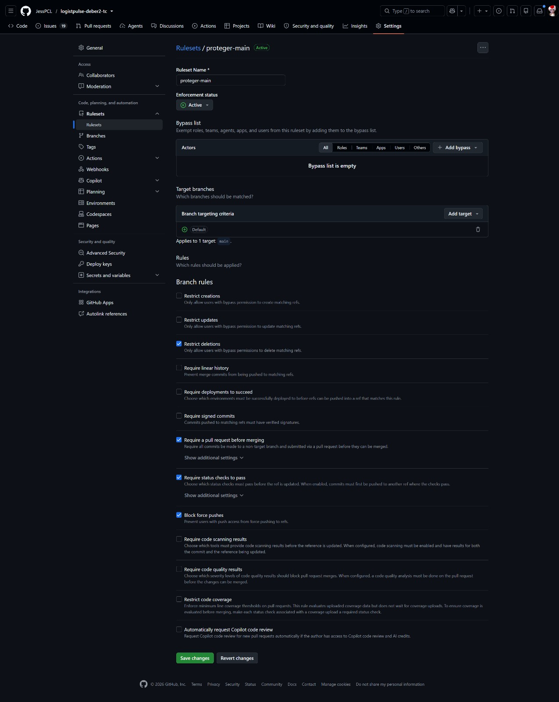


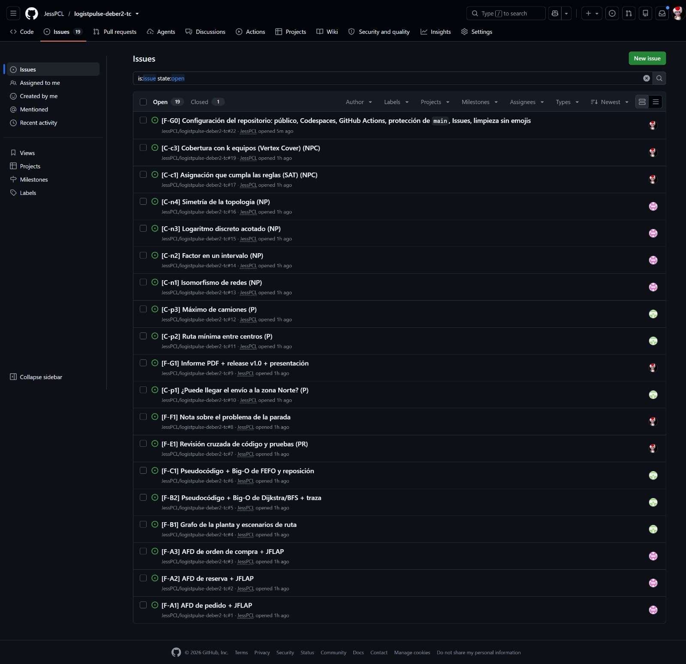


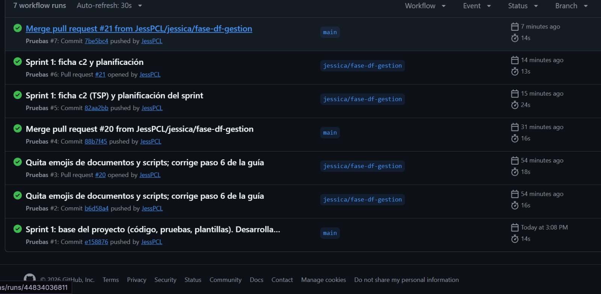

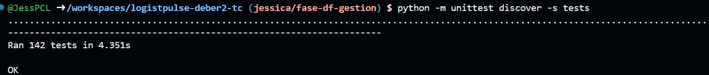

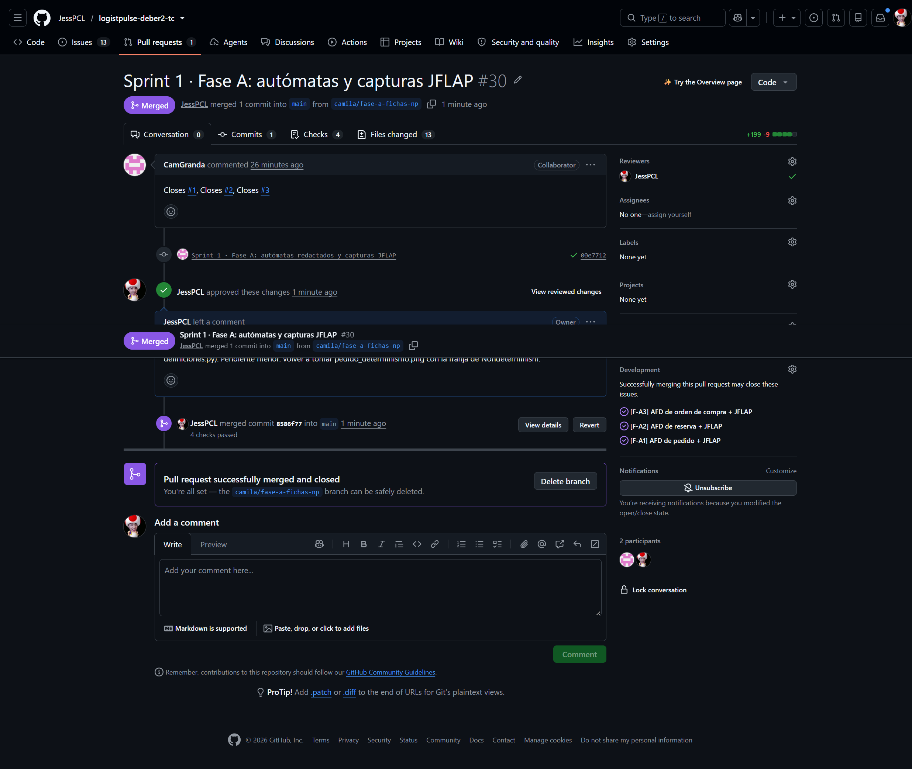


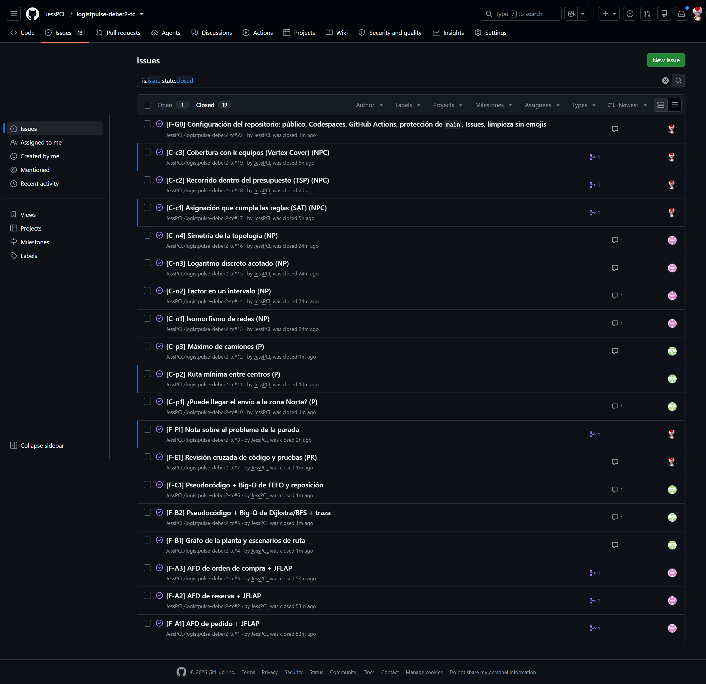

# 9. Supuestos, límites y conclusiones

**Responsable: Jessica**

### Supuestos
Todos están justificados en `docs/DECISIONES_Y_HALLAZGOS.md`; aquí va el resumen.
- **Modelo de cómputo:** máquina de Turing determinista, o de forma equivalente el modelo RAM con enteros codificados **en binario**. Por eso el tamaño de un número B es log₂B bits, y un algoritmo O(B) no es polinomial (H9).
- **Autómatas (A1–A8):** F son los estados donde el proceso cerró de forma legítima; *Cancelado* y *Rechazada* cuentan como cierre válido. La variante "solo pedidos entregados" queda en `PEDIDO_ESTRICTO`. La función δ es parcial con un sumidero ERROR, y un símbolo fuera de Σ es un dato inválido, no un rechazo.
- **Planta (B1–B3):** el grafo es no dirigido, los pesos son metros ≥ 0, el origen es R y el destino D. Una zona bloqueada se modela como vértice eliminado. Los empates se resuelven por nombre para que la salida sea reproducible.
- **Inventario (C1–C4):** un lote que vence **hoy** ya no es elegible. FEFO ordena por (vencimiento, código de lote). `en_orden` cuenta solo las órdenes abiertas.
- **Correos:** manda el **cuerpo del correo**, no la tarjeta del simulador (H7 en c3). Los tramos de p1, p2 y p3 tienen sentido, como muestran las flechas del mapa del portal. Los valores de n1 y c2 que la tabla no trae se toman del código de ejemplo del propio caso.

### Límites de la inferencia
- **El código prueba lo que dicen sus datos, no la operación real.** Las 146 pruebas confirman que los algoritmos dan la respuesta correcta sobre estas instancias y sobre instancias aleatorias generadas. No prueban que la planta, los tiempos o las capacidades reales sean los del expediente: si cambian, hay que volver a ejecutar.
- **Una instancia fácil no cambia la clase del problema.** La fórmula de c1 es 2-CNF y se resuelve en tiempo lineal (H6), pero el problema que describe el correo sigue siendo NP-completo.
- **P vs NP sigue abierto.** Clasificar un problema como NP-completo no demuestra que no exista un algoritmo polinómico: dice que, si existiera, entonces P = NP. Para n1–n4 solo afirmamos que están en NP (certificado y verificador polinómico), sin afirmar NP-completitud.
- **Los tiempos medidos dependen de la máquina.** Los números de `docs/generado/crecimiento.md` cambian entre ejecuciones; lo que se mantiene es la **forma** del crecimiento. Por eso el Big-O se respalda además con conteos de operaciones (`tests/test_complejidad.py`), que no dependen de la máquina.
- **Las extrapolaciones son órdenes de magnitud.** Decir "20 centros: unos 4 800 años" multiplica el costo medido por el número de candidatos. Sirve para mostrar que la búsqueda exhaustiva es impracticable, no para predecir un tiempo exacto.

### Conclusiones por fase
- **A · Autómatas:** los tres procesos (pedido, reserva, orden de compra) son lenguajes regulares. Cada AFD responde en un paso por símbolo, y los archivos .jff de JFLAP son idénticos a los autómatas probados en Python, así que las dos herramientas aceptan y rechazan las mismas secuencias.
- **B · Rutas:** Dijkstra da R → B → A → E → D = **11 m**. La ruta de la Figura 5 también cuesta 11 m: hay **empate**, y Dijkstra garantiza el costo mínimo, no una ruta única (H1). BFS minimiza tramos, no metros: da 12 m (H2).
- **C · FEFO y reposición:** las tres políticas (parcial, rechazar, esperar) dan resultados distintos ante falta de stock. La regla del enunciado sugiere **27** unidades y no duplica pedidos cuando ya hay una orden abierta (H5).
- **D · Los 10 correos:**
  - **P:** p1, p2 y p3.
  - **NP, sin afirmar NP-completitud:** n1–n4.
  - **NP-completo:** c1, c2 y c3, cada uno con verificador y reducción ejecutable.
  - En p3 lo que sale de la planta suma 12, pero el flujo máximo es **10** (H4).
  - En n2 y n3, buscar cuesta O(B), que es exponencial en los bits de B, mientras que verificar es polinomial (H9).
- **E · Implementación:** el código está separado en capas (lectura, procesamiento y presentación). Las salidas del informe se generan ejecutándolo, y cada cota Big-O está atada a un conteo de operaciones que una prueba revisa.
- **F · Parada:** "decidible" no es lo mismo que "resoluble en tiempo útil". TSP-DEC con 20 centros es decidible pero tomaría miles de años por búsqueda exhaustiva. En cambio, decidir si un programa arbitrario termina es indecidible: para eso no existe ningún algoritmo, por mucho tiempo que se le dé.

# 10. Declaración de uso de IA

- **Herramientas:** cada integrante usó un asistente de IA conversacional con los prompts de `equipo/ROLES_Y_PROMPTS.md`; Jessica usó Claude (Anthropic).
- **Para qué:** generar y revisar el código Python y sus pruebas, redactar borradores de las fichas, las fases y el informe, y organizar el repositorio y los sprints.
- **Cómo se verificó:** 146 pruebas automáticas (casos normales, límites e inválidos), pruebas de complejidad que cuentan operaciones, comparación de los .jff en JFLAP (Multiple Run), salidas generadas ejecutando el código y revisión cruzada de cada cambio en un PR aprobado por otro integrante.
- **Responsabilidad:** cada integrante revisó, entiende y defiende su parte: Camila (Fase A, JFLAP, n1–n4), Luis (Fases B y C, p2, p3) y Jessica (gestión, c1–c3, Fase F, conclusiones e informe).
