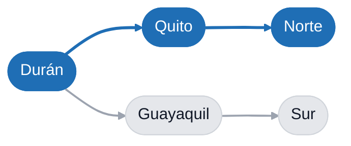

# TEORÍA DE LA COMPUTACIÓN — ¿Existe una ruta?
**Ejercicio 1 · Búsqueda en una red logística** | *USFQ*

---

> ### SOLICITUD OPERATIVA
> **¿Puede un pedido llegar desde Planta Durán hasta la zona Norte usando únicamente rutas activas?**

---

## 1 · Representa la red como un grafo
*Vértices = sitios | Aristas = conexiones activas*



* **Línea gruesa azul (`==>`)**: ruta elegida (`Durán → Quito → Norte`).
* **Línea delgada gris (`-->`)**: otras conexiones (`Durán → Guayaquil → Sur`).

---

## 2 · Ejecuta BFS por niveles
*Cola FIFO: primero se exploran los sitios descubiertos antes.*

| Paso | Acción / Estado de la cola | Detalle / Registro |
| :--- | :--- | :--- |
| **INICIO** | **Cola:** Durán | Visitados: Durán |
| **1** | **Sale Durán** | Entran Quito y Guayaquil |
| **2** | **Sale Quito** | Entra Norte · `padre[Norte] = Quito` |
| **3** | **Sale Guayaquil** | Entra Sur |
| **4** | **Sale Norte** | **¡Destino encontrado!** |

**Camino reconstruido con los padres:** `Durán → Quito → Norte` · **2 tramos**

---

## 3 · Código Python: encontrar el camino

```python
from collections import deque

def buscar_ruta(grafo, origen, destino):
    cola, padre = deque([origen]), {origen: None}
    while cola:
        actual = cola.popleft()
        if actual == destino:
            ruta = []
            while actual is not None: ruta.append(actual); actual = padre[actual]
            return ruta[::-1]
        for vecino in grafo.get(actual, []):
            if vecino not in padre: padre[vecino] = actual; cola.append(vecino)
    return None

red = {'Durán':['Quito','Guayaquil'], 'Quito':['Norte'], 'Guayaquil':['Sur'], 'Norte':[], 'Sur':[]}
print(buscar_ruta(red, 'Durán', 'Norte'))
```

---

## 4 · ¿Qué concluimos?

| Decidibilidad | Computabilidad | Complejidad |
| :--- | :--- | :--- |
| **Sí.** BFS termina al agotar la cola o encontrar el destino. | **Sí.** Existe un procedimiento efectivo que responde Sí/No para toda red finita. | **P.** BFS usa $O(V + E)$ tiempo y $O(V)$ espacio con listas de adyacencia. |

---
*USFQ · LOGISTPULSE · P = problemas de decisión resolubles en tiempo polinomial determinista*